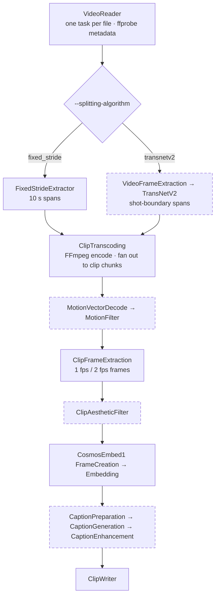

# Curator Video Pipeline Handoff

The video pipeline turns a directory of raw videos into short clips, plus per-clip metadata, optional quality filters, Cosmos-Embed1 embeddings, and VLM captions. It is a chain of `ProcessingStage`s in `nemo_curator/stages/video/`, wired together by one tutorial script that is also what the nightly benchmarks run.

## Contents

- [Summary](#summary)
- [How a run flows](#how-a-run-flows)
- [Stage reference](#stage-reference)
- [Data model and memory lifecycle](#data-model-and-memory-lifecycle)
- [Output layout](#output-layout)
- [Models and weights](#models-and-weights)
- [Runbook](#runbook)

## Summary

- **Entry point:** `tutorials/video/getting-started/video_split_clip_example.py`. `create_video_splitting_pipeline(args)` builds the pipeline from CLI flags and `create_video_splitting_argparser()` defines every knob. `benchmarking/scripts/video_pipeline_benchmark.py` imports both, so a change to the tutorial changes nightly behavior.
- **Unit of work:** one `VideoTask` per input video. After transcoding, each video fans out into several tasks ("clip chunks").
- The tutorial runs on `XennaExecutor` (cosmos-xenna 0.2.0). The benchmark script can also run on `RayDataExecutor` via `--executor ray_data`. Both are covered by nightly benchmarks.
- **Defaults:** fixed-stride 10 s splitting, `h264_nvenc` encoding, Cosmos-Embed1-224p embeddings **on**. Captions, motion filter, and aesthetic filter are **off** unless enabled with flags.
- The base Curator image ships without FFmpeg. For video, run `docker/common/install_h264_support.sh` as root inside the container.
- **Docs:** `fern/versions/main/pages/curate-video/` (user docs) and `fern/versions/main/pages/about/concepts/video/` (architecture, data flow).

## How a run flows



Solid border: always runs, or on by default. Dashed border: opt-in through flags. Every opt-in stage is skipped entirely when its flag is off; data passes straight through.

In plain terms:

1. **Read.** List video files (`.mp4 .mov .avi .mkv .webm`, local or remote URL), read each into memory as bytes, and run `ffprobe` for resolution, fps, duration, codecs, and bit rate.
2. **Split.** Decide clip spans. Either cut every 10 s, or decode the whole video at 27×48 px, run TransNetV2 shot detection, then split long shots, trim the ends, and drop short spans.
3. **Transcode.** Write the source to a temp file and run batched FFmpeg (16 clips per command by default) to cut and re-encode every span into its own mp4 in memory. Drop the source bytes, then split the clip list into chunks of about 256 s of clip time each. Each chunk becomes its own task.
4. **Filter** (optional). Motion filter: decode motion vectors with PyAV, build a flow field, drop near-static clips. Aesthetic filter: CLIP ViT-L/14 plus an aesthetic MLP on 1 fps frames, drop clips under the threshold. Dropped clips move to `video.filtered_clips`, which still gets written to `filtered_clips/`.
5. **Embed** (default on). Sample 2 fps frames, select 8 frames, and run Cosmos-Embed1 to get one vector per clip.
6. **Caption** (optional). Split each clip into 256-frame windows, sample frames at 2 fps, build vLLM prompt and video inputs, generate one caption per window with an in-process vLLM model, and optionally rewrite it with a text LLM.
7. **Write.** Write the clip mp4s, a JSON per clip, embeddings (pickle per clip plus parquet per chunk), and per-video and per-chunk JSON summaries. Then free the heavy buffers.

## Stage reference

Listed in pipeline order. All paths are relative to `nemo_curator/stages/video/`. Resource values are the defaults the tutorial passes in.

| # | Stage | Runs when | Resources | What it does |
|---|---|---|---|---|
| 01 | `VideoReader`<br>`io/video_reader.py` | always | 1 CPU | Composite stage. Uses `FilePartitioningStage` (or `ClientPartitioningStage` for remote URLs) with 1 file per task, then `VideoReaderStage` reads bytes and fills `Video.metadata` via ffprobe. A video whose metadata extraction fails is logged and passes on with empty metadata, and later stages skip it. |
| 02a | `FixedStrideExtractorStage`<br>`clipping/clip_extraction_stages.py` | default split | 1 CPU | Makes spans of `--fixed-stride-split-duration` (10 s) and drops any span shorter than `--fixed-stride-min-clip-length-s` (2 s). Duration is computed as `num_frames / fps`, and `num_frames` is itself estimated from ffprobe duration × fps. |
| 02b | `VideoFrameExtractionStage`<br>`clipping/video_frame_extraction.py` | transnetv2 | pynvc: 10 GB GPU; ffmpeg_*: 4 CPU | Decodes every frame at 27×48 RGB into `video.frame_array`. In `pynvc` mode it uses PyNvVideoCodec and falls back to FFmpeg CPU on error. PyNvVideoCodec ships only in the `video_media` extra and only on x86. If decoding fails, the stage returns `None` and the video disappears from the run without any output record. |
| 02c | `TransNetV2ClipExtractionStage`<br>`clipping/transnetv2_extraction.py` | transnetv2 | 10 GB GPU | Runs shot detection over 100-frame sliding windows with threshold 0.4. Shots longer than 10 s are split into 10 s pieces (`stride` mode), each piece is cropped by 0.5 s at both ends, and pieces shorter than 2 s after cropping are dropped, so clips are about 9 s at most. If no cut is found, the whole video is treated as one shot and goes through the same steps. |
| 03 | `ClipTranscodingStage`<br>`clipping/clip_extraction_stages.py` | always | nvenc: 1/3 GPU; CPU enc: 6 CPU | Runs batched FFmpeg `-ss/-to` cuts with re-encoding into `clip.buffer`. With the NVENC and VP9 encoders, 10-bit sources are converted to yuv420p. Audio is stream-copied. Afterwards it splits clips by duration into chunks of `--clip-re-chunk-size × 8` seconds (256 s by default) and emits one `VideoTask` per chunk. CPU encoders set `ray_data_num_cpus=1.0` so that Ray Data can fuse this stage with the reader (#2110). |
| 04 | `MotionVectorDecodeStage`<br>`filtering/motion_filter.py` | `--motion-filter` | 4 CPU | Uses PyAV with `export_mvs`. Samples frames at 2 fps from the start and stops after max(10, 2 fps × 50% × duration) samples, which is roughly the first half of the clip, or all of it for short clips. Clips under 256 px on either side, and clips that fail to decode, get `None`. |
| 05 | `MotionFilterStage`<br>`filtering/motion_filter.py` | `--motion-filter` | 0.5 GPU | Converts motion vectors to a flow field and computes `global_mean` and `per_patch_min_256`. A clip is flagged as low motion if either value is under its threshold (0.00098 and 1e-6). `enable` moves flagged clips to `filtered_clips`. `score-only` keeps them and only records the scores. |
| 06 | `ClipFrameExtractionStage`<br>`clipping/clip_frame_extraction.py` | embeddings or aesthetics | 3 CPU | Decodes clip frames for downstream models. FPS comes from `FramePurpose`: AESTHETICS = 1 fps, EMBEDDINGS = 2 fps. With both enabled, it decodes once at the LCM rate and subsamples. Frames are stored under keys like `FrameExtractionPolicy.sequence-2000`. On a decode error it sets `clip.buffer = None`. |
| 07 | `ClipAestheticFilterStage`<br>`filtering/clip_aesthetic_filter.py` | `--aesthetic-threshold` | 0.25 GPU | Scores 1 fps frames with CLIP and the aesthetic MLP, then reduces to one score per clip with `min` (default) or `mean`. Clips below the threshold go to `filtered_clips`. Clips with no buffer score −1 and are dropped. |
| 08 | `CosmosEmbed1FrameCreationStage`<br>`embedding/cosmos_embed1.py` | default on | 1 CPU | Takes the 2 fps frames and formats them into the 8-frame input the model expects. If a clip is too short, it re-decodes at 4, 8, then 16 fps, up to a 20 fps cap. Afterwards it clears `extracted_frames`. |
| 09 | `CosmosEmbed1EmbeddingStage`<br>`embedding/cosmos_embed1.py` | default on | 20 GB GPU | Runs the HF `AutoModel` in bf16 and stores `clip.cosmos_embed1_embedding`. Vectors are 256-d for 224p and 768-d for 336p and 448p. |
| 10 | `CaptionPreparationStage`<br>`caption/caption_preparation.py` | `--generate-captions` | 1 CPU | Splits each clip into 256-frame windows. A remainder of 128 frames or more becomes its own window; a smaller one is merged into the last window. It samples frames at 2 fps and builds vLLM inputs with `PromptFormatter`. Prompt variants are `default`, `av`, and `av-surveillance`, or a custom `--captioning-prompt-text`. |
| 11 | `CaptionGenerationStage`<br>`caption/caption_generation.py` | `--generate-captions` | 1 GPU | Runs an in-process vLLM model: Qwen2.5-VL, Qwen3-VL, Nemotron Nano 12B v2 VL (bf16/fp8/nvfp4), or Nemotron 3 Nano Omni. It batches all windows of a chunk and writes `window.caption[variant]`. To avoid torch.compile cache races (#1590), vLLM is loaded once per node in `setup_on_node` before the node's other workers load their own copies. |
| 12 | `CaptionEnhancementStage`<br>`caption/caption_enhancement.py` | `--generate-captions` + `--enhance-captions` | 1 GPU | Rewrites captions with a text-only Qwen LM (Qwen2.5-14B) and a system prompt. Results are stored under the hard-coded key `enhanced_caption["qwen_lm"]`. |
| 13 | `ClipWriterStage`<br>`io/clip_writer.py` | always | 0.25 CPU | Writes all outputs with a 6-thread pool. It runs ffprobe on every clip for metadata, which is why it needs a software decoder for the output codec. Afterwards it nulls buffers, embeddings, and caption data. |

## Data model and memory lifecycle

Defined in `nemo_curator/tasks/video.py`. Everything is held in memory inside the task, so the stage order is also the memory plan: each stage frees what it consumed.

**Video**

- `source_bytes`: whole input file. Freed by ClipTranscoding.
- `metadata`: ffprobe fields (`num_frames` is estimated).
- `frame_array`: TransNetV2 input. Freed by TransNetV2.
- `clips` and `filtered_clips`
- `num_total_clips`, `num_clip_chunks`, `clip_chunk_index`: chunk bookkeeping set by ClipTranscoding.
- `clip_stats`: counts accumulated by the filters and the writer.
- `weight`: duration / 300 s × chunk fraction, shown in log lines.

**Clip and _Window**

- `uuid` = `uuid5(NAMESPACE_URL, f"{video_path}_{start_frame}_{end_frame}")`. It is deterministic: rerunning into the same `--output-path` skips files that already exist instead of overwriting them.
- `span` (seconds), `buffer` (encoded mp4 bytes)
- `extracted_frames`, `decoded_motion_data`, `cosmos_embed1_frames`: intermediates freed by their consumer stage.
- `motion_score_*`, `aesthetic_score`, `cosmos_embed1_embedding`
- `windows`: one `_Window` per caption window, holding its frame range, model inputs, and captions.
- `errors`: per-stage errors for the clip. The clip JSON lists the error keys, such as `transcode` or `motion_decode`.

> **Chunking:** `--clip-re-chunk-size` (default 32) is not a clip count. Chunks are cut once the summed *integer seconds* of clip duration reach `32 × 8 = 256`. With 10 s clips, that is about 26 clips per chunk. The writer emits video-level JSON only from chunk 0, and per-chunk stats from every chunk.

## Output layout

```text
<--output-path>/
├── clips/<clip_uuid>.mp4                  # passing clips (not written with --no-upload-clips or --dry-run)
├── filtered_clips/<clip_uuid>.mp4         # clips dropped by the motion or aesthetic filter
├── metas/v0/<clip_uuid>.json              # per-clip: span, source dims, codec, scores, windows + captions, errors, valid
├── ce1_embd/<clip_uuid>.pickle            # per-clip Cosmos-Embed1 vector (pickled numpy)
├── ce1_embd_parquet/<uuid5(video,chunk)>.parquet   # rows of (id, embedding), one file per chunk; dedup input
├── processed_videos/<rel video path>.json        # video-level metadata (chunk 0 only)
└── processed_clip_chunks/<rel video path>_<idx>.json   # per-chunk counts, clip lists, caption maps
```

- Caption fields in the clip JSON are named `<variant>_caption` (for example `qwen2.5_caption` or `nemotron-bf16_caption`) and `qwen_lm_enhanced_caption`.
- `valid` is true only when the clip has a buffer **and** at least one caption window. On runs without captions, every clip shows `valid: false`. Don't use this field as a quality flag.
- Names under `processed_videos/` and `processed_clip_chunks/` mirror each input's path relative to `--video-dir`. Pass `--video-dir` as an absolute path.

## Models and weights

Each model stage downloads its weights into `<--model-dir>/<hf_org>/<hf_name>/` in `setup_on_node` and skips the download if the weights are already there.

| Role | HF model | Flag |
|---|---|---|
| Shot detection | `Sn4kehead/TransNetV2` | `--splitting-algorithm transnetv2` |
| Aesthetics (backbone) | `openai/clip-vit-large-patch14` | `--aesthetic-threshold 3.5` |
| Aesthetics (head) | `ttj/sac-logos-ava1-l14-linearMSE` | `--aesthetic-threshold 3.5` |
| Embedding | `nvidia/Cosmos-Embed1-{224p,336p,448p}` | `--embedding-algorithm cosmos-embed1-224p` |
| Caption | `Qwen/Qwen2.5-VL-7B-Instruct` | `--captioning-algorithm qwen2.5` (default) |
| Caption | `Qwen/Qwen3-VL-8B-Instruct` | `qwen3` |
| Caption | `nvidia/NVIDIA-Nemotron-Nano-12B-v2-VL-{BF16,FP8,NVFP4-QAD}` | `nemotron[-bf16\|-fp8\|-nvfp4]` |
| Caption | `nvidia/Nemotron-3-Nano-Omni-30B-A3B-Reasoning` | `nemotron-3-nano-omni` |
| Enhancement | `Qwen/Qwen2.5-14B-Instruct` | `--enhance-captions` |

- **vLLM settings:** Qwen-VL uses `max_model_len=32768`, `gpu_memory_utilization=0.85`, temperature 0.1, and fp8 through `--captioning-use-fp8-weights`. Nemotron VL uses TP=1, `gpu_memory_utilization=0.9`, temperature 0.6, and `video_pruning_rate=0`. Omni uses `max_model_len=131072` with thinking turned off in the chat template.

## Runbook

### One-time container setup

```bash
bash /opt/Curator/docker/common/install_h264_support.sh   # run as root
ffmpeg -decoders | grep -E '^[[:space:]]+V[^[:space:]]+[[:space:]]+h264[[:space:]]'   # confirm the software h264 decoder is present
```

### Smoke test: split, transcode, embed (default pipeline)

```bash
CUDA_VISIBLE_DEVICES=<your GPUs> python tutorials/video/getting-started/video_split_clip_example.py \
  --video-dir /path/to/videos \
  --model-dir /path/to/models \
  --output-path /path/to/output/smoke \
  --video-limit 20 --transcode-encoder h264_nvenc --verbose
```

### Captioning

```bash
python tutorials/video/getting-started/video_split_clip_example.py \
  --video-dir ... --model-dir ... --output-path ... \
  --no-generate-embeddings --generate-captions \
  --captioning-algorithm nemotron-bf16 [--enhance-captions]
```

### Tests

On a machine without a GPU, add `-m "not gpu"` to skip the GPU-marked tests.

```bash
pytest tests/stages/video tests/tasks/test_video.py \
  tests/models/test_qwen_vl.py tests/models/test_cosmos_embed1.py tests/models/test_transnetv2.py \
  tests/eval/video
```
