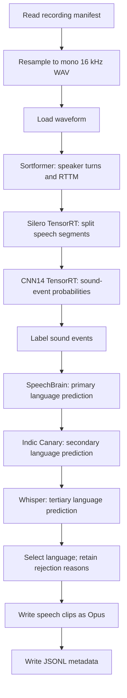

# Granary Metadata Extraction

Extract speech clips and metadata from recordings: who spoke when, where speech
occurs, which sounds are present, and which language was spoken. The pipeline
writes one Opus file per speech segment and a JSONL manifest. It does not
transcribe the audio.



## 1. Build and check the environment

From the root of this checkout on Linux x86_64, with Docker and the NVIDIA
Container Toolkit installed:

```bash
docker build -f docker/audio/Dockerfile.trt_llm -t curator-granary-base .
docker build -t curator-granary-metadata - <<'DOCKERFILE'
FROM curator-granary-base
RUN git init /tmp/nemo-reference \
    && git -C /tmp/nemo-reference remote add origin https://github.com/ipmedenn/NeMo.git \
    && git -C /tmp/nemo-reference fetch --depth 1 origin 5d56c27c0e80f4cd8c93b28bacca5f98440a45f9 \
    && git -C /tmp/nemo-reference checkout --detach FETCH_HEAD \
    && uv pip uninstall --python /opt/venv/bin/python nemo-toolkit \
    && uv pip install --no-config --no-sources --python /opt/venv/bin/python \
        --no-deps --no-build-isolation /tmp/nemo-reference \
    && rm -rf /tmp/nemo-reference
DOCKERFILE
docker run --rm --gpus all curator-granary-metadata python docker/audio/check_trt_llm.py
docker run --rm --gpus all curator-granary-metadata \
  python -c "import speechbrain, whisper; print('Language-ID imports passed')"
```

The reference `8spk-r087-3-50k.nemo` checkpoint uses RoPE attention, which the
base image's NeMo 3.0.0 cannot restore. The extension installs the required
[reference NeMo implementation](https://github.com/ipmedenn/NeMo/tree/5d56c27c0e80f4cd8c93b28bacca5f98440a45f9)
without changing the installed Torch or TensorRT dependencies. Remove the
installed NeMo package first so the fork records its own version,
`3.1.0+5d56c27`.

The tested runtime used Python 3.12, Torch `2.9.1+cu128`, TensorRT
`10.14.1.48.post1`, and TensorRT-LLM `1.2.1`. The exact checkpoint passed a
strict CPU restore with both speaker-count settings equal to eight. On EOS
H100 GPUs, all six configured adapters also loaded, inferred on two real
LibriSpeech clips, and unloaded successfully: Sortformer, Silero TensorRT,
CNN14 TensorRT, SpeechBrain, Indic Canary, and Whisper medium. These checks
establish runtime compatibility; they do not establish numerical parity
with the production pipeline.

The image includes the audio dependencies, SpeechBrain, OpenAI Whisper, and
FFmpeg. Indic Canary uses its dedicated Python 3.12 / TensorRT-LLM environment;
do not run root `uv sync` inside this image.

**GPU:** use a CUDA-capable GPU compatible with your TensorRT engines and
enough memory for all models. The production reference uses an 80 GB GPU;
this draft has not measured the complete graph's GPU-memory requirement.
The runtime also needs a CUDA 13-compatible NVIDIA driver or supported
data-center forward-compatibility setup.

Supply the following local model files before running the pipeline. Replace
`/absolute/path/to/models` in the container command below with their parent
directory:

```text
/models/
├── sortformer.nemo
├── silero.plan
├── sed.pth
├── sed.plan
├── sed.plan.json
├── speechbrain/
│   ├── hyperparams.yaml
│   ├── embedding_model.ckpt
│   ├── classifier.ckpt
│   └── label_encoder.txt
├── whisper.pt
└── indic_canary/
    ├── encoder/encoder.plan
    ├── encoder/config.json
    ├── decoder/config.json
    ├── decoder/rank0.engine
    ├── decoder/vocab.json
    ├── preprocessor/config.json
    └── preprocessor/mel_basis.pt
```

| Artifact | Required model or configuration |
| --- | --- |
| `sortformer.nemo` | The reference eight-speaker `8spk-r087-3-50k.nemo` checkpoint. A public four-speaker checkpoint changes the workload. |
| `silero.plan` | Silero VAD TensorRT engine for the target GPU/runtime, with batch profiles covering 1–64 recurrent windows. |
| `sed.pth`, `sed.plan`, `sed.plan.json` | Matching CNN14 DecisionLevelMax checkpoint, TensorRT engine, and build-provenance sidecar. The reference frontend uses 16 kHz, a 1,024-sample window, a 320-sample hop, 64 mel bins, and 527 classes. The engine must cover 40-second clips. |
| `speechbrain/` | Complete local `speechbrain/lang-id-voxlingua107-ecapa` model snapshot. |
| `whisper.pt` | OpenAI Whisper **medium** checkpoint. |
| `indic_canary/` | Compatible Indic Canary TensorRT encoder and TensorRT-LLM decoder bundle supporting language-token prediction. |

The tutorial downloads audio only. Public download locations for the reference
eight-speaker Sortformer and Indic Canary bundles are not provided. Bring those
artifacts yourself; a `.nemo` file alone does not replace a Canary engine bundle.
SED's sidecar is checked against the checkpoint, frontend, GPU, engine hash, and
TensorRT version; do not copy an unrelated sidecar onto an old engine.

If you have the matching CNN14 checkpoint, build its engine and sidecar on the
GPU that will run inference. From the host, replace the model-directory path
and run:

```bash
docker run --rm --gpus all \
  -v /absolute/path/to/models:/models \
  curator-granary-metadata \
  python -m nemo_curator.models.audio.sed.build_sed_tensorrt_engine \
    --checkpoint /models/sed.pth --output /models/sed.plan \
    --sample-rate 16000 --fp16
```

The explicit 16 kHz setting preserves the Granary frontend; the builder's
default is 32 kHz. The run container below mounts completed models read-only.

Create persistent work directories and open the container:

```bash
mkdir -p granary-metadata-work/data granary-metadata-work/outputs granary-metadata-work/ray-logs
docker run --rm -it --gpus all --ipc=host \
  -e PYTORCH_CUDA_ALLOC_CONF=expandable_segments:True \
  -v "$PWD/granary-metadata-work:/work" \
  -v "$PWD/granary-metadata-work/ray-logs:/tmp/ray" \
  -v /absolute/path/to/models:/models:ro \
  curator-granary-metadata bash
```

Run the remaining commands inside this container, from `/opt/Curator`.

## 2. Download two sample recordings

Reuse the public Hindi sample downloader from the Indic ASR tutorial:

```bash
python tutorials/audio/indic_asr/download_samples.py --output-dir /work/data/fleurs
```

This downloads two Google FLEURS recordings, 12.24 and 10.26 seconds long,
under the dataset's CC BY 4.0 license. It pins the dataset revision, verifies
file hashes, and refuses to overwrite different files.

Create a recording manifest with absolute audio paths. Keep the dataset
provenance; the parent recording's transcript is not a transcript of each
future speech segment:

```bash
python - <<'PY'
import json
from pathlib import Path

root = Path('/work/data/fleurs')
rows = [json.loads(line) for line in (root / 'manifest.jsonl').read_text().splitlines()]
with (root / 'metadata_input.jsonl').open('x') as output:
    for row in rows:
        item = {key: row[key] for key in ('audio_item_id', 'duration', 'dataset', 'dataset_revision', 'license')}
        item['audio_filepath'] = str((root / row['audio_filepath']).resolve(strict=True))
        output.write(json.dumps(item, ensure_ascii=False) + '\n')
PY
```

This creates `metadata_input.jsonl` once; reuse it for both executors.

## 3. Run the pipeline

All stages and model settings are listed in [pipeline.yaml](pipeline.yaml).
Run one pipeline at a time and use a new output directory and log filename
for every run:

```bash
set -o pipefail
test ! -e /work/outputs/xenna && test ! -e /work/outputs/xenna.log && {
  python nemo_curator/config/run.py \
    --config-path ../../tutorials/audio/granary_metadata --config-name pipeline \
    manifest_path=/work/data/fleurs/metadata_input.jsonl \
    model_dir=/models output_dir=/work/outputs/xenna \
    backend=xenna execution_mode=streaming \
    2>&1 | tee /work/outputs/xenna.log
}
```

To run the same graph with Ray Data:

```bash
set -o pipefail
test ! -e /work/outputs/ray_data && test ! -e /work/outputs/ray_data.log && {
  python nemo_curator/config/run.py \
    --config-path ../../tutorials/audio/granary_metadata --config-name pipeline \
    manifest_path=/work/data/fleurs/metadata_input.jsonl \
    model_dir=/models output_dir=/work/outputs/ray_data backend=ray_data \
    2>&1 | tee /work/outputs/ray_data.log
}
```

`execution_mode` selects Xenna streaming or batch scheduling; Ray Data ignores
that setting. Console logs and Ray worker logs persist under
`granary-metadata-work` on the host.

## 4. Inspect the output

For the Xenna command, the host output directory is
`granary-metadata-work/outputs/xenna`:

```text
xenna/
├── metadata.jsonl       # One row per speech segment, plus no-speech audit rows
├── audio/              # Emitted Opus speech clips
├── rttm/               # Recording-level speaker turns
├── resampled/          # Intermediate mono 16 kHz WAV recordings
└── speechbrain_cache/  # Worker-local model loading files
```

Print every output row and check that emitted clips exist:

```bash
python - <<'PY'
import json
from pathlib import Path

path = Path('/work/outputs/xenna/metadata.jsonl')
rows = [json.loads(line) for line in path.read_text().splitlines()]
assert rows, 'No speech segments or no-speech audit rows were written'
for row in rows:
    if not row.get('vad_empty'):
        clip = Path(row['audio_filepath'])
        assert clip.is_file() and clip.stat().st_size > 0, clip
        assert row['start_ms'] < row['end_ms']
        assert row['duration'] > 0
    assert 'waveform' not in row and '_sed_framewise' not in row
    print(json.dumps(row, ensure_ascii=False, indent=2))
print(f'{len(rows)} output rows')
PY
```

| Field | Meaning |
| --- | --- |
| `audio_filepath` | Absolute path to the emitted Opus clip. A `vad_empty` audit row keeps the original recording path and has no new clip. |
| `original_file` | Original recording used to create the speech segment. |
| `audio_item_id` | Stable identifier for this speech segment; distinct from sibling segments from the same recording. |
| `start_ms`, `end_ms` | Segment offsets in the original recording, in integer milliseconds. |
| `duration`, `sample_rate` | Duration of the segment waveform in seconds and its working sample rate, 16,000 Hz. Opus decoders may expose a different playback sample rate. |
| `num_speakers`, `rttm_filepath` | Number of diarization speaker labels overlapping this segment, and the recording-level RTTM path relative to `rttm/`. |
| `sed_events` | Sound labels with `start_time` and `end_time` in seconds relative to this segment; each includes its broader `superclass`. |
| `source_lang` | Selected language code, empty when predictions are missing, or `skipped` when models disagree. |
| `additional_notes`, `_skipme` | Model labels/confidences, selection notes, and rejection reasons. Inspect these even when the process succeeds. |
| `vad_empty` | A recording produced no usable speech; retained so it is distinguishable from a missing input. |

A nonempty `_skipme` does not silently drop the segment. Speech clips with
rejected language predictions remain available for inspection. Do not use
those rows as accepted language-labeled training data without reviewing them.

## What each stage does

1. **Read and resample:** read JSONL, create a mono 16 kHz floating-point WAV, then load its
   waveform. The original audio path remains available for provenance.
2. **Sortformer:** diarize the whole recording and save speaker turns as RTTM.
3. **VAD:** split speech at threshold 0.5 with 1,000 ms minimum silence,
   100 ms padding, and segment lengths from 0.5 to 40 seconds. Each segment
   receives the number of overlapping diarization speakers.
4. **SED:** run CNN14 through TensorRT, then label individual sound classes
   at probability threshold 0.5. This labels clips; it does not filter them.
5. **Language identification:** run SpeechBrain, Indic Canary, and Whisper on
   each eligible segment. They inspect up to the first 10, 40, and 30 seconds,
   respectively; clips below one second have no model language prediction.
6. **Language selection:** accept Whisper's English prediction; otherwise
   require all three models to agree for Indic languages, or SpeechBrain and
   Whisper to agree for non-Indic languages. Preserve rejection reasons.
7. **Write:** encode the speech waveform as Opus and write JSON-safe metadata.
   Remove waveform arrays and recording-level diarization arrays from each
   row; retain the RTTM path and per-segment speaker count.

## Use your own recordings

Supply a JSONL manifest with one recording per row and absolute local paths
visible at the same location to every worker:

```json
{"audio_filepath":"/data/recording.wav","audio_item_id":"recording_001"}
```

Use unique `audio_item_id` values containing only letters, numbers, underscores,
or hyphens. WAV and FLAC inputs are supported by the supplied container.
Change `manifest_path` and choose fresh output/log paths in the command above.

This draft loads each resampled recording into memory before diarization and
segmentation. Start with short recordings: it does not implement the production
reader's bounded file-streaming behavior for recordings up to 11 hours.
VAD processes one parent recording per task to preserve Curator's fan-out
identity contract, instead of the production runner's batch of 64 parents.
The Silero engine still batches recurrent windows internally.

The graph preserves the optimized reference model choices and processing
settings. Numerical parity with the production pipeline and long-recording
memory scaling have not been established.
