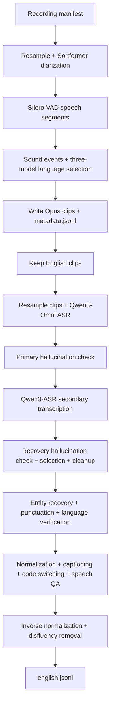

# Full English audio pipeline

Turn recordings into English speech clips with metadata, Qwen3-Omni transcripts,
Qwen3-ASR recovery, and enriched text in one pipeline.
[pipeline.yaml](pipeline.yaml) combines the
[metadata](../metadata/README.md), [Qwen Omni ASR](../qwen_omni_asr/README.md), and
[text](../text_pipeline/README.md) tutorials. [main.py](main.py) manages serving
and runs the YAML through Curator's existing configuration APIs.



The metadata audit retains non-English, rejected and no-speech rows. Only clips
whose selected `source_lang` is `en` continue to ASR. Unrecovered ASR and text rejection flags
remain in the final manifest; this is an enriched audit manifest, not a guarantee
that every row is suitable for training.

Xenna is unsupported for this combined pipeline: its GPU allocation is independent
of Ray's serving reservations, and Curator rejects GPU stages with Xenna while a
managed inference server is active. Use Ray Data so both share Ray's GPU scheduler.

## 1. Prepare the image and models

Run commands from this checkout's root. The default configuration requires
**16 H100 80 GB GPUs**, 256 logical CPUs, 500 GiB shared memory for Ray's object
store, and additional host RAM (2 TiB recommended). Four Dynamo replicas reserve
two GPUs each; the remaining eight GPUs are available to the audio stages.
These reservations persist through the run; idle serving GPUs are not reassigned
to audio. Docker and the NVIDIA Container Toolkit are required.

Follow the metadata tutorial's [environment and model preparation](../metadata/README.md#1-build-and-prepare-the-shared-environment)
to build `curator-granary-metadata` and prepare the complete model directory,
including engine provenance sidecars. Stop before downloading its Hindi samples
or running its pipeline. The eight-speaker Sortformer checkpoint and Indic Canary
engine bundle require separately supplied assets, even for this English pipeline:
language selection still uses all three language models.

Build the combined image:

```bash
docker buildx build --builder default --load \
  -f tutorials/audio/granary_v2/full_english_pipeline/Dockerfile \
  -t curator-full-english .
```

The [Dockerfile](Dockerfile) preserves the metadata environment while adding the
pinned Qwen runtime and Dynamo driver dependencies. It installs the existing
etcd/NATS service binaries and copies this checkout into the image. The audio
stages use the image's TensorRT/NeMo, Torch 2.9.1, Transformers 4.57.6 and vLLM
0.15.1 stack. Curator's Dynamo backend creates isolated text-model workers with
its own vLLM dependencies and the YAML's Transformers 5.8.0 requirement. Worker
packages resolve at startup, so the image alone does not freeze that environment.
No separate serving image, package constraint files or server command is needed.

## 2. Supply a recording manifest

Use a UTF-8 JSONL manifest containing one recording per line, with a unique
`audio_item_id` and an absolute `audio_filepath` visible to every audio worker:

```json
{"audio_item_id":"recording-001","audio_filepath":"/data/recording-001.wav"}
```

Extra provenance fields are preserved. No reference transcript is required.
Do not treat a recording-level `text` field as a reference for its VAD segments.
The selected ASR clip prediction supplies entity spellings during text cleanup;
this does not provide independently verified entity recovery. No recording-level
transcript is used as a human reference.

Following the [integration-test example](https://github.com/nithinraok/Curator/blob/c26a0078b28b32ea8d66cfb77f25a9d81b8fc0bf/examples/audio/qwen_omni_inprocess/run_pipeline.py),
Qwen3-ASR-0.6B transcribes every selected English clip after the primary
hallucination check. A clean secondary transcript can clear a primary
hallucination flag and becomes `best_prediction`; otherwise the existing
selection stage retains the primary or applies its cross-model agreement rule.
Unresolved flags remain and suppress later LLM work. Both raw predictions, the
selected text and `best_prediction_source` are retained. The secondary stage
uses one GPU per worker from the same eight-GPU audio pool; it does not require
another server or image. Its model revision is pinned in the YAML.

For public sample audio, use the Qwen tutorial's
[pinned LibriSpeech preparation](../qwen_omni_asr/README.md#2-prepare-a-small-public-sample)
in its dedicated environment. Mount the generated directory at the **same
absolute path** in the audio container so its manifest paths still resolve.
These short English recordings exercise the graph; their references are not
used as segment labels.

## 3. Run the combined pipeline

Set absolute host paths. The model and recording directories are mounted unchanged
so absolute manifest paths remain valid. Choose a fresh output directory; the
entrypoint refuses to overwrite an existing run.

```bash
export ENGLISH_MODELS=/absolute/path/to/prepared/models
export ENGLISH_DATA=/absolute/path/to/recordings
export ENGLISH_MANIFEST="$ENGLISH_DATA/manifest.jsonl"
export ENGLISH_CACHE="$PWD/.cache/full-english"
export ENGLISH_OUTPUT="$PWD/full-english-output"
mkdir -p "$ENGLISH_CACHE" "$ENGLISH_OUTPUT"
docker run --rm --gpus all --ipc=host \
  -v "$ENGLISH_MODELS:$ENGLISH_MODELS:ro" \
  -v "$ENGLISH_DATA:$ENGLISH_DATA:ro" \
  -v "$ENGLISH_CACHE:/cache" \
  -v "$ENGLISH_OUTPUT:/output" \
  curator-full-english bash -lc '
    source /opt/venv/env.sh
    set -euo pipefail
    python -u tutorials/audio/granary_v2/full_english_pipeline/main.py "$@" \
      2>&1 | tee /output/pipeline.log
  ' -- manifest_path="$ENGLISH_MANIFEST" model_dir="$ENGLISH_MODELS" \
  output_dir=/output/run cache_root=/cache/compilation
```

The entrypoint starts one Ray cluster, downloads the pinned text model snapshot,
and enters the YAML's `InferenceServer` context. Dynamo handles worker placement,
readiness and routing. The pipeline starts after the endpoint is ready and reuses
it for all nine text operations. On completion or failure, the entrypoint closes
the server before closing Ray. Logs and outputs remain in the mounted directory.
Model downloads and worker environment setup can take several minutes on first use.

The graph writes Opus clips before ASR and then resamples those clips, preserving
their IDs and recording offsets. Qwen therefore transcribes the speech segment,
not the original recording. Its pinned model revision, prompts, duration limits,
hallucination checks and cleanup rules come from the Qwen tutorial. All nine
text operations and prompts come from the text tutorial.

## 4. Inspect the saved outputs

The host's `full-english-output/run/` contains:

| Path | Contents |
| --- | --- |
| `metadata.jsonl` | All metadata-stage results, including rejected/non-English and no-speech audit rows |
| `english.jsonl` | Selected English rows, primary/fallback ASR predictions, selection source, enriched text and rejection notes |
| `audio/` | Opus clips for all speech segments, including non-English clips |
| `rttm/` | Recording-level speaker turns |
| `resampled/` | Intermediate recording WAVs |
| `asr_workspace/audio_resampled/` | English clip WAVs read by Qwen |
| `speechbrain_cache/` | Language-model loading cache |

After the run, check that final rows map to metadata clips and inspect flags
separately from successful enrichment. This opens the saved outputs read-only:

```bash
docker run --rm -i -v "$ENGLISH_OUTPUT:/output:ro" \
  --entrypoint python curator-full-english - <<'PY'
import json
from pathlib import Path

root = Path('/output/run')
metadata = [json.loads(line) for line in (root / 'metadata.jsonl').read_text().splitlines()]
english = [json.loads(line) for line in (root / 'english.jsonl').read_text().splitlines()]
expected = {row['audio_item_id']: row for row in metadata if row.get('source_lang') == 'en'}
actual = {row['audio_item_id']: row for row in english}
assert len(actual) == len(english) == len(expected)
assert actual.keys() == expected.keys()
fields = (
    'primary_model_prediction', 'fallback_model_prediction', 'best_prediction',
    'abbreviated_text', 'entity_recovered_text',
    'pnc_text', 'llm_language_prediction', 'tn_raw', 'captioning_text',
    'code_switched_text', 'speech_qa_text', 'itn_raw', 'itn_clean',
)
flagged = 0
for clip_id, row in actual.items():
    assert row['source_lang'] == 'en'
    for key in ('audio_filepath', 'original_file', 'start_ms', 'end_ms'):
        assert row[key] == expected[clip_id][key], (clip_id, key)
    assert Path(row['audio_filepath']).is_file()
    if row.get('_skipme'):
        flagged += 1
        print('FLAGGED', clip_id, row['_skipme'], row.get('additional_notes'))
    else:
        assert all(isinstance(row.get(key), str) and row[key].strip() for key in fields), row
print(f'{len(metadata)} metadata rows; {len(english)} English rows; {flagged} flagged')
assert english, 'No English clips selected; inspect metadata language/VAD notes'
PY
```

Empty English output can reflect no speech, language rejection or non-English
input; inspect `metadata.jsonl` before changing settings. Nonempty fields and
successful requests do not establish transcript accuracy or semantic quality.
Review generated text and `additional_notes` before using the results. If using
an external text server, stop it when it is no longer needed.

## 5. Validation

The combined image builds successfully. CPU checks cover configuration loading,
Dynamo frontend imports, endpoint wiring, cleanup after failures, and rejection
of unsupported executors or an existing output directory. No test files are
included in this tutorial. These checks do not exercise GPU inference.

GPU inference and end-to-end execution of this single-cluster setup remain
unverified. Historical runs used a different setup and do not validate it.

The inherited metadata/vLLM environment has conflicting package declarations:
`uv pip check` is not clean. Other package features and replacement versions
require separate validation.
