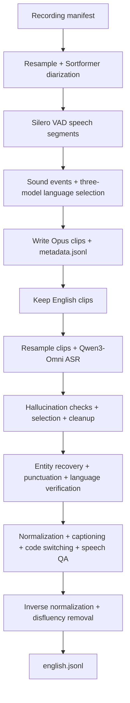

# Full English audio pipeline

Turn recordings into English speech clips with metadata, Qwen3-Omni transcripts,
and enriched text in one pipeline. [pipeline.yaml](pipeline.yaml) combines the
[metadata](../metadata/README.md), [Qwen Omni ASR](../qwen_omni_asr/README.md), and
[text](../text_pipeline/README.md) tutorials using the shared YAML runner.



The metadata audit retains non-English, rejected and no-speech rows. Only clips
whose selected `source_lang` is `en` continue to ASR. ASR or text rejection flags
remain in the final manifest; this is an enriched audit manifest, not a guarantee
that every row is suitable for training.

## 1. Prepare the environments and models

Run commands from this checkout's root. The audio pipeline combines TensorRT
metadata models and in-process vLLM; the text model runs on a **separate GPU
allocation and Ray cluster**, reached through an OpenAI-compatible endpoint.
Do not connect the audio runner to the text server's Ray cluster.

For the audio node, provision Linux x86_64, Docker Buildx, NVIDIA Container Toolkit,
eight H100 80 GB GPUs, 128 logical CPUs, at least 500 GiB shared memory and enough
additional RAM for workers and models (1 TiB recommended). Each Qwen worker uses
two GPUs. The text client uses two workers per stage instead of the standalone
text tutorial's twelve; the model server retains its four TP=2 replicas on eight
separate H100 GPUs. A smaller configuration needs its own validation.

Follow the metadata tutorial's [environment and model preparation](../metadata/README.md#1-build-and-prepare-the-shared-environment)
to build `curator-granary-metadata` and prepare the complete `/models` directory,
including engine provenance sidecars. Stop before downloading its Hindi samples
or running its pipeline. The eight-speaker Sortformer checkpoint and Indic Canary
engine bundle require separately supplied assets, even for this English pipeline:
language selection still uses all three language models.

Extend that image with the pinned Qwen runtime:

```bash
docker buildx build --builder default --load \
  -f tutorials/audio/granary_v2/full_english_pipeline/Dockerfile \
  -t curator-full-english .
```

Use the default Docker driver here so it can see the locally loaded base image;
the extension installs binary wheels only. The base image's native compilation
still uses the metadata tutorial's bounded builder.

The [Dockerfile](Dockerfile) preserves the base image's installed package versions
while adding vLLM 0.15.1 and qwen-omni-utils 0.0.9. It keeps the metadata image's
NeMo fork, Torch 2.9.1, Transformers 4.57.6, TensorRT engines and CUDA compatibility
loader. It overrides the metadata image's expandable-segment allocator with
`PYTORCH_CUDA_ALLOC_CONF=expandable_segments:False` for vLLM's tensor-parallel
CUDA memory sharing and graph warm-up. Keep this override when initializing
the combined runtime. Do not replace it with the text server's Python/Torch environment.
This combined image and end-to-end GPU execution have not been validated here;
the individual tutorials' benchmark results do not measure this combined graph.

On the separate text-serving node, follow the text tutorial's
[environment setup](../text_pipeline/README.md#1-prepare-the-environment) and
[server startup](../text_pipeline/README.md#2-start-the-model-server). Use a
network-reachable endpoint that every audio worker can access. The server's
loopback endpoint is only usable on its own host; configure networking and the
server's advertised address for your deployment. Record the reachable URL as
`ENGLISH_TEXT_ENDPOINT`, for example `http://text-host:8000/v1`. The combined
YAML includes the same serving configuration for reference; the shared runner
does not start it. An existing compatible endpoint can be used with its model
name supplied as `model_name`.

## 2. Supply a recording manifest

Use a UTF-8 JSONL manifest containing one recording per line, with a unique
`audio_item_id` and an absolute `audio_filepath` visible to every audio worker:

```json
{"audio_item_id":"recording-001","audio_filepath":"/data/recording-001.wav"}
```

Extra provenance fields are preserved. No reference transcript is required.
Do not treat a recording-level `text` field as a reference for its VAD segments.
Qwen's original clip prediction supplies entity spellings during text cleanup;
this does not provide independently verified entity recovery. Unlike the
standalone Qwen tutorial, hallucination checks cannot fall back to a human
transcript: flagged predictions keep their flag and later LLM work is skipped.

For public sample audio, use the Qwen tutorial's
[pinned LibriSpeech preparation](../qwen_omni_asr/README.md#2-prepare-a-small-public-sample)
in its dedicated environment. Mount the generated directory at the **same
absolute path** in the audio container so its manifest paths still resolve.
These short English recordings exercise the graph; their references are not
used as segment labels. Follow the metadata tutorial's runtime initialization
inside the audio container before running TensorRT models.

## 3. Run the combined pipeline

Set host paths for the prepared model directory, recording directory and manifest.
Choose a fresh output directory for every run. The example mounts input and model
paths unchanged so absolute paths in the manifest remain valid:

```bash
export ENGLISH_MODELS=/absolute/path/to/prepared/models
export ENGLISH_DATA=/absolute/path/to/recordings
export ENGLISH_MANIFEST="$ENGLISH_DATA/manifest.jsonl"
export ENGLISH_OUTPUT="$PWD/full-english-output"
export ENGLISH_TEXT_ENDPOINT=http://text-host:8000/v1
test ! -e "$ENGLISH_OUTPUT"
mkdir "$ENGLISH_OUTPUT"
docker run --rm -it --gpus all --ipc=host \
  --mount type=bind,src="$ENGLISH_MODELS",dst="$ENGLISH_MODELS",readonly \
  --mount type=bind,src="$ENGLISH_DATA",dst="$ENGLISH_DATA",readonly \
  --mount type=bind,src="$ENGLISH_OUTPUT",dst=/output \
  --env ENGLISH_MODELS --env ENGLISH_MANIFEST --env ENGLISH_TEXT_ENDPOINT \
  curator-full-english bash
```

Inside the container, initialize the runtime using the metadata tutorial's
[initialization commands](../metadata/README.md#initialize-the-runtime), then:

```bash
set -euo pipefail
cd /opt/Curator
export VLLM_WORKER_MULTIPROC_METHOD=spawn
test ! -e /output/run
test ! -e /output/pipeline.log
python nemo_curator/config/run.py \
  --config-path ../../tutorials/audio/granary_v2/full_english_pipeline \
  --config-name pipeline \
  manifest_path="$ENGLISH_MANIFEST" model_dir="$ENGLISH_MODELS" \
  output_dir=/output/run endpoint="$ENGLISH_TEXT_ENDPOINT" \
  2>&1 | tee /output/pipeline.log
```

Xenna streaming is the default. For Ray Data, add `backend=ray_data` to the same
command, with fresh output and log paths. Audio files, model bundles, workspace
and output paths must be shared across workers for a multi-node allocation.
Keep the text endpoint running until the audio pipeline finishes. Its inference
server configuration and `cache_root` are unused by the audio runner.

The graph writes Opus clips before ASR and then resamples those clips, preserving
their IDs and recording offsets. Qwen therefore transcribes the speech segment,
not the original recording. Its pinned model revision, prompts, duration limits,
hallucination checks and cleanup rules come from the Qwen tutorial. All nine
text operations and prompts come from the text tutorial.

## 4. Inspect the saved outputs

The host's `full-english-output/run/` contains:

| Path | Contents |
| --- | --- |
| `metadata.jsonl` | All metadata-stage results, including rejected/non-English and no-speech audit rows |
| `english.jsonl` | Selected English rows, ASR predictions, enriched text and rejection notes |
| `audio/` | Opus clips for all speech segments, including non-English clips |
| `rttm/` | Recording-level speaker turns |
| `resampled/` | Intermediate recording WAVs |
| `asr_workspace/audio_resampled/` | English clip WAVs read by Qwen |
| `speechbrain_cache/` | Language-model loading cache |

Inside the container, check that final rows map to metadata clips and inspect
flags separately from successful enrichment:

```bash
python - <<'PY'
import json
from pathlib import Path

root = Path('/output/run')
metadata = [json.loads(line) for line in (root / 'metadata.jsonl').read_text().splitlines()]
english = [json.loads(line) for line in (root / 'english.jsonl').read_text().splitlines()]
expected = {row['audio_item_id']: row for row in metadata if row.get('source_lang') == 'en'}
actual = {row['audio_item_id']: row for row in english}
assert len(actual) == len(english) == len(expected)
assert actual.keys() == expected.keys()
fields = (
    'primary_model_prediction', 'abbreviated_text', 'entity_recovered_text',
    'pnc_text', 'llm_language_prediction', 'tn_raw', 'captioning_text',
    'code_switched_text', 'speech_qa_text', 'itn_raw', 'itn_clean',
)
flagged = 0
for clip_id, row in actual.items():
    assert row['source_lang'] == 'en'
    for key in ('audio_filepath', 'original_file', 'start_ms', 'end_ms'):
        assert row[key] == expected[clip_id][key], (clip_id, key)
    assert Path(row['audio_filepath']).is_file()
    if row.get('_skipme'):
        flagged += 1
        print('FLAGGED', clip_id, row['_skipme'], row.get('additional_notes'))
    else:
        assert all(isinstance(row.get(key), str) and row[key].strip() for key in fields), row
print(f'{len(metadata)} metadata rows; {len(english)} English rows; {flagged} flagged')
assert english, 'No English clips selected; inspect metadata language/VAD notes'
PY
```

Empty English output can reflect no speech, language rejection or non-English
input; inspect `metadata.jsonl` before changing settings. Nonempty fields and
successful requests do not establish transcript accuracy or semantic quality.
Review generated text and `additional_notes` before using the results. Stop the
separately managed text server after inspection when it is no longer needed.
