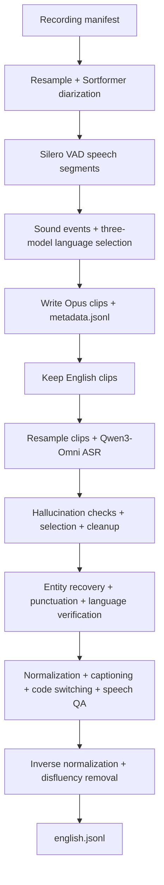

# Full English audio pipeline

Turn recordings into English speech clips with metadata, Qwen3-Omni transcripts,
and enriched text in one pipeline. [pipeline.yaml](pipeline.yaml) combines the
[metadata](../metadata/README.md), [Qwen Omni ASR](../qwen_omni_asr/README.md), and
[text](../text_pipeline/README.md) tutorials using the shared YAML runner.



The metadata audit retains non-English, rejected and no-speech rows. Only clips
whose selected `source_lang` is `en` continue to ASR. ASR or text rejection flags
remain in the final manifest; this is an enriched audit manifest, not a guarantee
that every row is suitable for training.

## 1. Prepare the images and models

Run commands from this checkout's root. The default launcher uses Docker Compose
on one Linux x86_64 host with **16 H100 80 GB GPUs**: devices 0–7 for the audio
pipeline and 8–15 for text serving. Provide 256 logical CPUs, at least 500 GiB
shared memory for the audio Ray object store, and additional RAM for both roles
(2 TiB recommended). Docker Compose v2 and the NVIDIA Container Toolkit are required.
The earlier validation used two separate eight-GPU nodes; it did not validate this
new single-host launcher or establish optimal GPU utilization.

The two containers keep incompatible Python/model stacks separate. Xenna assigns
GPUs independently of Ray, so it cannot safely share its audio GPUs with Dynamo.
[compose.yaml](compose.yaml) gives each container an explicit, disjoint device
list and its own Ray cluster. The pipeline remains streaming; no intermediate
text-only manifest or second processing pass is introduced. Text stages reuse
one Dynamo server for all nine operations.

Follow the metadata tutorial's [environment and model preparation](../metadata/README.md#1-build-and-prepare-the-shared-environment)
to build `curator-granary-metadata` and prepare the complete model directory,
including engine provenance sidecars. Stop before downloading its Hindi samples
or running its pipeline. The eight-speaker Sortformer checkpoint and Indic Canary
engine bundle require separately supplied assets, even for this English pipeline:
language selection still uses all three language models.

Extend that image with the pinned Qwen runtime:

```bash
docker buildx build --builder default --load \
  -f tutorials/audio/granary_v2/full_english_pipeline/Dockerfile \
  -t curator-full-english .
```

The default Docker driver can see the locally loaded metadata base. The
[Dockerfile](Dockerfile) retains its installed versions while adding vLLM 0.15.1
and qwen-omni-utils 0.0.9. It preserves the metadata NeMo fork, Torch 2.9.1,
Transformers 4.57.6, TensorRT engines and CUDA compatibility loader. It disables
expandable-segment allocations for Qwen's tensor-parallel CUDA memory sharing.
It also copies this checkout so the runner and tutorial files match the build.

Build `curator-audio-text` from **this same checkout**, following the standalone
text tutorial's [bounded image-build instructions](../text_pipeline/README.md#1-prepare-the-environment).
Only build the image; do not start its example container or model server.
The launcher uses that image for text serving and the audio image for metadata
and Qwen. There are no tutorial-specific package constraint files or package
inventory checks. Curator's Dynamo backend creates its normal isolated model
workers and applies the YAML's model-specific Transformers requirement.
Worker dependencies are resolved at startup, so these images alone do not freeze
the entire effective serving environment.

## 2. Supply a recording manifest

Use a UTF-8 JSONL manifest containing one recording per line, with a unique
`audio_item_id` and an absolute `audio_filepath` visible to every audio worker:

```json
{"audio_item_id":"recording-001","audio_filepath":"/data/recording-001.wav"}
```

Extra provenance fields are preserved. No reference transcript is required.
Do not treat a recording-level `text` field as a reference for its VAD segments.
Qwen's original clip prediction supplies entity spellings during text cleanup;
this does not provide independently verified entity recovery. Unlike the
standalone Qwen tutorial, hallucination checks cannot fall back to a human
transcript: flagged predictions keep their flag and later LLM work is skipped.

For public sample audio, use the Qwen tutorial's
[pinned LibriSpeech preparation](../qwen_omni_asr/README.md#2-prepare-a-small-public-sample)
in its dedicated environment. Mount the generated directory at the **same
absolute path** in the audio container so its manifest paths still resolve.
These short English recordings exercise the graph; their references are not
used as segment labels. Initialize the audio runtime as shown below before
running TensorRT models.

## 3. Run the combined pipeline

Set absolute host paths. The model and recording paths are mounted unchanged so
absolute manifest paths remain valid. Choose an output directory that does not
exist; the launcher refuses to reuse it.

```bash
export ENGLISH_MODELS=/absolute/path/to/prepared/models
export ENGLISH_DATA=/absolute/path/to/recordings
export ENGLISH_MANIFEST="$ENGLISH_DATA/manifest.jsonl"
export ENGLISH_CACHE="$PWD/.cache/full-english"
export ENGLISH_OUTPUT="$PWD/full-english-output"
bash tutorials/audio/granary_v2/full_english_pipeline/run.sh
```

That one command starts the text container, waits for a healthy model endpoint,
then runs [pipeline.yaml](pipeline.yaml) in the audio container. It stops and
removes both containers and their network on completion or failure. Input data,
model assets, the cache and output bind mounts remain on the host. Container
logs are saved together in `full-english-output/compose.log`.

The launcher automatically sources [runtime.sh](runtime.sh) inside both
containers. This selects the image environment, clears inherited distributed
ranks, limits native CPU threads, and enables private Ray token authentication.
No manual server terminal, endpoint file or environment initialization is needed.
Dynamo's existing `InferenceServer` owns model loading, worker placement, readiness
and shutdown; [serve.py](serve.py) only holds that context for the container's
lifetime and handles termination signals.

Xenna streaming is the default. To use Ray Data, append `backend=ray_data` to the
pipeline command in `compose.yaml` and use a fresh output directory. Keep the two
GPU device lists disjoint. Smaller GPU/model configurations need their own validation.

If your resources are two separate eight-GPU hosts instead of one 16-GPU host,
use the same images and YAML with an externally managed text endpoint. On the
text host, inside `curator-audio-text`, run:

```bash
source tutorials/audio/granary_v2/full_english_pipeline/runtime.sh
python -u tutorials/audio/granary_v2/full_english_pipeline/serve.py
```

Wait for `Ready:` and use the printed network-reachable URL. On the audio host,
inside `curator-full-english`, run:

```bash
source tutorials/audio/granary_v2/full_english_pipeline/runtime.sh
python nemo_curator/config/run.py \
  --config-path ../../tutorials/audio/granary_v2/full_english_pipeline \
  --config-name pipeline \
  manifest_path=/data/manifest.jsonl model_dir=/models output_dir=/output/run \
  endpoint=http://text-host:8000/v1
```

Mount the actual manifest, recordings, models and fresh output directory into
those containers, as required by their absolute paths. Stop the externally
managed server after the run. Do not connect the audio runner to its Ray cluster.

The graph writes Opus clips before ASR and then resamples those clips, preserving
their IDs and recording offsets. Qwen therefore transcribes the speech segment,
not the original recording. Its pinned model revision, prompts, duration limits,
hallucination checks and cleanup rules come from the Qwen tutorial. All nine
text operations and prompts come from the text tutorial.

## 4. Inspect the saved outputs

The host's `full-english-output/run/` contains:

| Path | Contents |
| --- | --- |
| `metadata.jsonl` | All metadata-stage results, including rejected/non-English and no-speech audit rows |
| `english.jsonl` | Selected English rows, ASR predictions, enriched text and rejection notes |
| `audio/` | Opus clips for all speech segments, including non-English clips |
| `rttm/` | Recording-level speaker turns |
| `resampled/` | Intermediate recording WAVs |
| `asr_workspace/audio_resampled/` | English clip WAVs read by Qwen |
| `speechbrain_cache/` | Language-model loading cache |

Inside the container, check that final rows map to metadata clips and inspect
flags separately from successful enrichment:

```bash
python - <<'PY'
import json
from pathlib import Path

root = Path('/output/run')
metadata = [json.loads(line) for line in (root / 'metadata.jsonl').read_text().splitlines()]
english = [json.loads(line) for line in (root / 'english.jsonl').read_text().splitlines()]
expected = {row['audio_item_id']: row for row in metadata if row.get('source_lang') == 'en'}
actual = {row['audio_item_id']: row for row in english}
assert len(actual) == len(english) == len(expected)
assert actual.keys() == expected.keys()
fields = (
    'primary_model_prediction', 'abbreviated_text', 'entity_recovered_text',
    'pnc_text', 'llm_language_prediction', 'tn_raw', 'captioning_text',
    'code_switched_text', 'speech_qa_text', 'itn_raw', 'itn_clean',
)
flagged = 0
for clip_id, row in actual.items():
    assert row['source_lang'] == 'en'
    for key in ('audio_filepath', 'original_file', 'start_ms', 'end_ms'):
        assert row[key] == expected[clip_id][key], (clip_id, key)
    assert Path(row['audio_filepath']).is_file()
    if row.get('_skipme'):
        flagged += 1
        print('FLAGGED', clip_id, row['_skipme'], row.get('additional_notes'))
    else:
        assert all(isinstance(row.get(key), str) and row[key].strip() for key in fields), row
print(f'{len(metadata)} metadata rows; {len(english)} English rows; {flagged} flagged')
assert english, 'No English clips selected; inspect metadata language/VAD notes'
PY
```

Empty English output can reflect no speech, language rejection or non-English
input; inspect `metadata.jsonl` before changing settings. Nonempty fields and
successful requests do not establish transcript accuracy or semantic quality.
Review generated text and `additional_notes` before using the results. If using
an external text server, stop it when it is no longer needed.

## 5. Validation

The following GPU results are historical validation of `d361d40e`, before the
current launcher and automatic server lifecycle were introduced. They used the
now-removed package constraints and inventory gate. They do not validate the
current Docker/Compose setup or its unconstrained transitive worker dependencies.
The new lifecycle has CPU-only checks for managed/external endpoints, pinned
snapshot resolution, cleanup after failures, Compose GPU isolation and launcher
exit status. A fresh GPU run from the exact pushed commit is still required.

On 2026-11-08, the complete graph ran on the same frozen 30,631-recording
LibriSpeech cohort (107.763567 hours). Each arm used eight H100 80 GB GPUs for
audio and a separate eight-H100 text server, with 128 requested CPUs, all node
RAM and a 90-minute limit per node. The previously built audio image was reused
with the clean `d361d40e` checkout; this was not a fresh image build at that commit.

| Executor | Metadata rows | English rows | Flagged English rows | Native process seconds |
| --- | ---: | ---: | ---: | ---: |
| Xenna streaming | 38,417 | 38,196 | 48 | 1,540.64 |
| Ray Data | 38,417 | 38,196 | 44 | 2,670.63 |

Validation checked coverage of every source recording, unique clip IDs, exact
English selection and preserved paths/offsets, plus all required output fields
and all nine operation notes on unflagged rows. Native process time excludes the
separate text server's startup. All selected clip IDs and offsets matched across
executors, but 4,277 raw Qwen predictions differed; exact transcript or generated
text parity is not claimed.

These checks do not measure transcript accuracy or full GPU scaling. Four
configured replicas do not establish that all four served requests. The pinned
metadata/vLLM stack also has conflicting dependency declarations: `uv pip check`
is not clean. The earlier tested graph worked with that installed stack; other
package features and replacement versions require separate validation.
