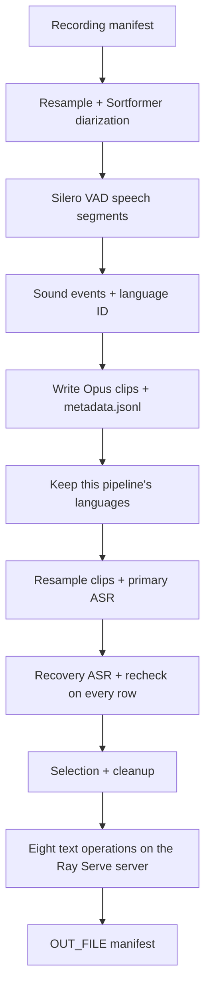

# Granary v2 full pipelines

These pipelines turn recordings into speech clips with metadata, ASR transcripts and enriched text in
one Ray Data cluster. They implement the metadata, ASR and text stages of the curation system in the
[Granary-v2 technical report](https://research.nvidia.com/labs/nemotron/files/granary-v2.pdf)
(dataset: [`nvidia/Granary-v2`](https://huggingface.co/datasets/nvidia/Granary-v2)).

## What the report describes

Granary-v2 is a multilingual speech dataset (48 languages, about 843,600 audio hours) built by three
reusable pipelines, each of which can run on its own:

1. **Metadata.** Splits raw or long recordings into short speech segments and adds speakers, language
   and sound events.
2. **ASR.** Creates or improves transcripts with a language-dependent *primary* and *recovery* model, then
   flags transcripts the two models disagree on or that look hallucinated.
3. **Text.** Derives the written forms and task labels from each transcript: punctuation and capitalization,
   text normalization, inverse text normalization, disfluency removal, code-switched text, captions and
   question-answer pairs, with a quality flag.

Not yet covered (follow-ups): the `high_quality` flag, contextual ASR and translation on high-quality rows, packing the
labels into `preference_instructions`, and the report's modes for corpora that already carry human transcripts (these
pipelines start from whole recordings).

The report routes languages to ASR model pairs (its Table 3):

| Group | Primary → recovery | Languages |
| --- | --- | --- |
| A | Qwen3-Omni → Qwen3-ASR | ar zh nl en fr de id it ja ko pt ru es tr vi |
| B | Qwen3-ASR → Whisper | fil fa th |
| C | Parakeet-v3 → Whisper | cs da fi el hu pl ro sv |
| D | Whisper → Parakeet-v3 | bg hr et lv lt mt sk sl uk |
| E | Hebrew Whisper → Whisper | he |
| F | Indic Transcribe → IndicConformer | as bn gu kn ml mr or pa ta te ur |
| G | Indic Transcribe → Hindi Parakeet | hi |

## The pipelines in this folder

One entrypoint, [main.py](main.py), runs one pipeline end to end (metadata, ASR and text), chosen with
`--config-name`. Each routing group is its own run with one primary and one recovery model:

| Pipeline | Languages | Language ID | ASR (primary → recovery) | Image |
| --- | --- | --- | --- | --- |
| [en_granary_pipeline.yaml](pipelines/en_granary_pipeline.yaml) | English | SpeechBrain + Whisper | Qwen3-Omni → Qwen3-ASR | [Dockerfile](Dockerfile) |
| [european_qwen_omni_granary_pipeline.yaml](pipelines/european_qwen_omni_granary_pipeline.yaml) | `de es fr it pt ru nl zh ja ko ar id vi tr` | SpeechBrain + Whisper | Qwen3-Omni → Qwen3-ASR | [Dockerfile](Dockerfile) |
| [european_parakeet_v3_granary_pipeline.yaml](pipelines/european_parakeet_v3_granary_pipeline.yaml) | `pl cs ro hu el fi da sv` | SpeechBrain + Whisper | Parakeet-v3 → Whisper | [Dockerfile](Dockerfile) |
| [european_whisper_granary_pipeline.yaml](pipelines/european_whisper_granary_pipeline.yaml) | `lt lv hr et bg sk sl mt uk` | SpeechBrain + Whisper | Whisper → Parakeet-v3 | [Dockerfile](Dockerfile) |
| [qwen_asr_whisper_granary_pipeline.yaml](pipelines/qwen_asr_whisper_granary_pipeline.yaml) | `th fa tl` | SpeechBrain + Whisper | Qwen3-ASR → Whisper | [Dockerfile](Dockerfile) |
| [hebrew_whisper_granary_pipeline.yaml](pipelines/hebrew_whisper_granary_pipeline.yaml) | `he` (language ID selects none; see [Details](#5-details)) | SpeechBrain + Whisper | Whisper large-v3 (no recovery) | [Dockerfile](Dockerfile) |
| [indic_granary_pipeline.yaml](pipelines/indic_granary_pipeline.yaml) | 22 Indic languages | SpeechBrain + Indic Transcribe + Whisper | Indic Transcribe (TensorRT-LLM) → Parakeet-Riva (`hi`) or IndicConformer (other languages) | [Dockerfile.trt_llm_granary](Dockerfile.trt_llm_granary) |
| [indic_english_granary_pipeline.yaml](pipelines/indic_english_granary_pipeline.yaml) | English (`en`) in Indic recordings | SpeechBrain + Indic Transcribe + Whisper | Qwen3-Omni → Indic Transcribe | [Dockerfile.trt_llm_granary](Dockerfile.trt_llm_granary) |

The pipeline YAMLs are in [pipelines/](pipelines); [common.yaml](pipelines/common.yaml) holds the stages and settings the pipelines share, so each pipeline YAML adds
only its language ID, ASR stages and output file. [prompts/](prompts) holds the text prompts (one YAML per prompt), the
[regex.yaml](prompts/regex.yaml) text-cleanup rules (rule set `indic` for the two Indic pipelines, `default` for the rest and the
`indic_asr` tutorial) and the per-language Indic rules. The table is what the YAMLs run and follows the report's routing groups: group A is split into
`en_granary_pipeline` and `european_qwen_omni_granary_pipeline`, and every other group is one YAML. Like the
report, no pipeline routes Malay (`ms`). Filipino keeps the language ID's code, Tagalog (`tl`), and goes to
`qwen_asr_whisper`; the text language check counts `tl` and `fil` as one language. `indic_english_granary_pipeline` is outside the report's
groups: it transcribes Indian-accented English with Qwen3-Omni and recovers it with Indic Transcribe.

The stages around the ASR step are the same in every pipeline (`hebrew_whisper` has no recovery model):



The metadata audit keeps non-matching, rejected and no-speech rows in `metadata.jsonl`; only clips
whose selected `source_lang` is in the pipeline's language set continue to ASR. Unrecovered ASR and
text rejection flags stay in the final manifest, so the output is an audit manifest, not a guarantee
that every row suits training.

## 1. Set up the environment

Run commands from this checkout's root. The default configuration needs **8 H100 80 GB GPUs**,
128 logical CPUs, 500 GiB shared memory for Ray's object store and more host RAM (2 TiB
recommended): the text model runs on Ray Serve replicas of two GPUs each (tensor parallelism 2;
Qwen3.6-27B-FP8 for English and European, Gemma-4-31B-it-FP8 for Indic), autoscaling on request load (0 to 4
replicas, so up to all 8 GPUs; Indic keeps one up from the start), so extra replicas start only when two GPUs are
free and the audio stages can use the whole node first. Most audio stages declare only the GPU memory each model needs (Qwen3-Omni takes two GPUs per actor, one in `indic_english_granary_pipeline`); Ray Data scales
their worker pools into whatever the text replicas leave free. Docker and the NVIDIA Container Toolkit are required.

The throughput settings are tuned for this node of eight H100 80 GB GPUs: each stage's `batch_size`,
`max_audio_sec_per_actor` and `gpu_memory_gb` (or `gpus`), the Indic TensorRT-LLM stages'
`kv_cache_free_gpu_memory_fraction`, and in [common.yaml](pipelines/common.yaml) the text stages' `num_workers` and
`max_concurrent_requests` and the text server's replicas, `gpu_memory_utilization`, `max_num_seqs` and
`max_num_batched_tokens`. On other GPUs, start by lowering `gpu_memory_gb`, `batch_size` and `max_audio_sec_per_actor`.

Build the images from the repository root, from public base images. English and European:

```bash
docker build -f docker/Dockerfile --target nemo_curator \
  --build-arg CURATOR_EXTRA="audio_tensorrt --extra inference_server" --build-arg CURATOR_GROUPS="" \
  -t curator-base .
docker build -f tutorials/audio/granary_v2/full_pipeline/Dockerfile -t curator-granary-full .
```

Indic:

```bash
docker build -f docker/audio/Dockerfile.trt_llm --target granary -t curator-granary-base .
docker build -f tutorials/audio/granary_v2/full_pipeline/Dockerfile.trt_llm_granary -t curator-granary-indic .
```

- [Dockerfile](Dockerfile) extends the repository's [docker/Dockerfile](../../../../docker/Dockerfile)
  (CUDA 12.9, Python 3.13, Torch 2.11, vLLM 0.22), built with the `audio_tensorrt`
  and `inference_server` extras. It adds the NeMo encoder the eight-speaker Sortformer checkpoint needs
  and Ubuntu's `ffmpeg` (libopus included), which torchcodec and the Opus clips need.
- [Dockerfile.trt_llm_granary](Dockerfile.trt_llm_granary) extends the Granary image from
  [docker/audio/Dockerfile.trt_llm](../../../../docker/audio/Dockerfile.trt_llm) (`--target granary`: Torch 2.9.1,
  TensorRT-LLM 1.2.1) with Ray 2.57, vLLM's CPU build for the Ray Serve driver (its CUDA extension cannot load
  against Torch 2.9.1) and the CUDA 12.9 compiler. The Indic ASR stages run on TensorRT-LLM and NeMo; the text
  model's vLLM 0.22 engine runs in the replicas' isolated environments.

The English and European image needs a host driver that supports CUDA 12.9 (R575 or newer).
The text-model replicas run in isolated Ray environments (Transformers 5.8.0 from the YAML) and
resolve their packages at startup, so neither image freezes them.

The Indic image sets `PYTORCH_CUDA_ALLOC_CONF=expandable_segments:False` (its Granary base enables expandable
segments), because vLLM tensor-parallel CUDA graphs need CUDA-IPC-compatible allocations; the other image leaves
PyTorch's default, which is the same.

`model_dir` holds the prepared models described in the metadata tutorial's
[model preparation](../metadata/README.md#1-build-and-prepare-the-shared-environment): `sortformer.nemo`, `sed.pth`,
`speechbrain/` and `whisper.pt`. The English and European pipelines run Silero VAD and SED on torch. The two Indic
pipelines run them on TensorRT engines, `silero.plan` and `sed.plan`; build those inside `curator-granary-indic`,
because TensorRT engines only load under the TensorRT version that built them. Both Indic pipelines also need
`indic_transcribe/` (the prebuilt TensorRT-LLM engine), and `indic_granary_pipeline` needs `indic_parakeet/`
(`model.nemo` and its TensorRT engine, built as in the Indic ASR tutorial's
[model bundles](../indic_asr/README.md#building-model-bundles-optional)). Qwen3-Omni, Qwen3-ASR, the text model, Parakeet-v3, Whisper large-v3 and
IndicConformer download from Hugging Face on first use unless
already cached; set `model_id` and `model_identifier` to local snapshot directories to avoid that. The Indic recovery loads one
IndicConformer checkpoint per language (`ai4bharat/indicconformer_stt_<lang>_hybrid_ctc_rnnt_large`, 22 repositories of about
0.5 GB; setup downloads all 22 even though Hindi recovers with Parakeet-Riva, and the Hindi checkpoint does not work for other languages). Those repositories need a Hugging Face login that accepted their
terms. Cache them once into the directory the run command mounts as `/cache` (it sets `HF_HOME=/cache/huggingface`), then
`export HF_HUB_OFFLINE=1` before running (the last line below); the run command passes it into the container:

```bash
export HF_HOME="$PWD/.cache/granary/huggingface"
for lang in as bn brx doi gu hi kn kok ks mai ml mni mr ne or pa sa sat sd ta te ur; do
  huggingface-cli download ai4bharat/indicconformer_stt_${lang}_hybrid_ctc_rnnt_large
done
export HF_HUB_OFFLINE=1
```

## 2. Try a pipeline on the sample clips

[data/](data) holds one to three short clips per pipeline (16 kHz mono WAV), cut from the test split of
[FLEURS](https://huggingface.co/datasets/google/fleurs) (`google/fleurs`, CC-BY-4.0):

| `CONFIG` (`--config-name`) | `IMAGE` | `SAMPLE` folder | Clips | `OUT_FILE` | `LANGS` |
| --- | --- | --- | --- | --- | --- |
| `en_granary_pipeline` | `curator-granary-full` | `en` | 2 English | `english.jsonl` | `en` |
| `european_qwen_omni_granary_pipeline` | `curator-granary-full` | `european_qwen_omni` | Italian, German | `european_qwen_omni.jsonl` | `de,es,fr,it,pt,ru,nl,zh,ja,ko,ar,id,vi,tr` |
| `european_parakeet_v3_granary_pipeline` | `curator-granary-full` | `european_parakeet_v3` | Polish, Czech | `european_parakeet_v3.jsonl` | `pl,cs,ro,hu,el,fi,da,sv` |
| `european_whisper_granary_pipeline` | `curator-granary-full` | `european_whisper` | Lithuanian, Ukrainian | `european_whisper.jsonl` | `lt,lv,hr,et,bg,sk,sl,mt,uk` |
| `qwen_asr_whisper_granary_pipeline` | `curator-granary-full` | `qwen_asr_whisper` | Thai, Persian, Filipino | `qwen_asr_whisper.jsonl` | `th,fa,tl` |
| `hebrew_whisper_granary_pipeline` | `curator-granary-full` | `hebrew_whisper` | Hebrew | `hebrew_whisper.jsonl` | `he` |
| `indic_granary_pipeline` | `curator-granary-indic` | `indic` | Hindi, Tamil, Bengali | `indic.jsonl` | `as,bn,brx,doi,gu,hi,kn,kok,ks,mai,ml,mni,mr,ne,or,pa,sa,sat,sd,ta,te,ur` |
| `indic_english_granary_pipeline` | `curator-granary-indic` | `en` | 2 English | `indic_english.jsonl` | `en` |

`LANGS` is the pipeline's whole language group: a clip the language ID tags as another language of the group is kept and checked too.

Prepare the models once (section 1), then pick a row, set its values and run the three commands below from
the repository root. Each command is the same for every row.

```bash
export MODELS=/absolute/path/to/prepared/models
export CONFIG=en_granary_pipeline IMAGE=curator-granary-full SAMPLE=en OUT_FILE=english.jsonl LANGS=en
export DATA="$PWD/tutorials/audio/granary_v2/full_pipeline/data/$SAMPLE"
export OUTPUT="$PWD/granary-output"
mkdir -p "$PWD/.cache/granary" "$OUTPUT"
```

Write the manifest (one line per clip, absolute paths):

```bash
for f in "$DATA"/*.wav; do
  printf '{"audio_item_id":"%s","audio_filepath":"%s"}\n' "$(basename "$f" .wav)" "$f"
done > "$PWD/.cache/granary/manifest.jsonl"
```

Run the pipeline. The manifest writers (`mode: error`) refuse an earlier run's output, so use a fresh `$OUTPUT/run`
each time:

```bash
docker run --rm --gpus all --ipc=host \
  -v "$MODELS:$MODELS:ro" -v "$DATA:$DATA:ro" \
  -v "$PWD/.cache/granary:/cache" -v "$OUTPUT:/output" \
  -e HF_HOME=/cache/huggingface -e HF_HUB_OFFLINE \
  -e RAY_AUTH_MODE=token -e RAY_AUTH_TOKEN="$(openssl rand -hex 32)" \
  "$IMAGE" bash -lc '
    source /opt/venv/env.sh
    set -euo pipefail
    python -u tutorials/audio/granary_v2/full_pipeline/main.py "$@" 2>&1 | tee /output/pipeline.log
  ' -- --config-name "$CONFIG" \
  manifest_path=/cache/manifest.jsonl model_dir="$MODELS" \
  output_dir=/output/run cache_root=/cache/compilation
```

A run that stops starts again in a new directory; resuming from finished shards and reading NeMo tarred data configs
are follow-ups.

Check the result:

```bash
docker run --rm -i -v "$OUTPUT:/output:ro" --entrypoint python "$IMAGE" - "$OUT_FILE" "$LANGS" <<'PY'
import json
import sys
from pathlib import Path

root = Path('/output/run')
name, langs = sys.argv[1], set(sys.argv[2].split(','))
metadata = [json.loads(line) for line in (root / 'metadata.jsonl').read_text().splitlines()]
final = [json.loads(line) for line in (root / name).read_text().splitlines()]
expected = {row['audio_item_id']: row for row in metadata if row.get('source_lang') in langs}
actual = {row['audio_item_id']: row for row in final}
assert len(actual) == len(final) == len(expected)
assert actual.keys() == expected.keys()
fields = (
    'primary_model_prediction', 'best_prediction',
    'abbreviated_text',
    'pnc_text', 'llm_language_prediction', 'tn_raw', 'captioning_text',
    'code_switched_text', 'speech_qa_text', 'itn_raw', 'itn_clean',
)
flagged = 0
for clip_id, row in actual.items():
    assert row['source_lang'] in langs
    if row.get('best_prediction_source') == 'fallback':
        assert row.get('fallback_model_prediction')
    for key in ('audio_filepath', 'original_file', 'start_ms', 'end_ms'):
        assert row[key] == expected[clip_id][key], (clip_id, key)
    assert Path(row['audio_filepath']).is_file()
    if row.get('_skipme'):
        flagged += 1
        print('FLAGGED', clip_id, row['_skipme'], row.get('additional_notes'))
    else:
        assert all(isinstance(row.get(key), str) and row[key].strip() for key in fields), row
print(f'{len(metadata)} metadata rows; {len(final)} final rows; {flagged} flagged')
assert final, 'No clips selected; inspect metadata language/VAD notes'
PY
```

A run on two or three clips is dominated by model start-up (several minutes for Qwen3-Omni or the text
model on first use). The check prints `FLAGGED` for rows the pipeline rejected and fails if the final rows do
not map back to the metadata clips; it does not judge transcript quality, so read the transcripts in
`$OUTPUT/run/$OUT_FILE`.

## 3. Run on your own recordings

Use a UTF-8 JSONL manifest, one recording per line, with a unique `audio_item_id` and an absolute
`audio_filepath` visible to every audio worker:

```json
{"audio_item_id":"recording-001","audio_filepath":"/data/recording-001.wav"}
```

Extra provenance fields are preserved. No reference transcript is required, and none is used as a
segment label. Mount the model and recording directories at the **same absolute path** inside the
container so manifest paths still resolve.

Each recording is decoded whole, whatever its length; skipping very long recordings (for example over 12 h) as audit
rows is a follow-up.

Run the same `docker run` command as in section 2 with `DATA` set to your recordings directory and
`manifest_path` pointing at your manifest (mount it, or put it in `$PWD/.cache/granary`). Pick `CONFIG` and
`IMAGE` from the table in section 2. `HF_HOME` keeps the downloaded text model in the
mounted cache across runs. The Ray token stops other containers on the default Docker bridge from connecting to
the Ray head the entrypoint starts and submitting work that reads the mounted recordings and models.

For other GPU counts, Ray detects the node's GPUs; set
`inference_server.models.0.deployment_config.autoscaling_config.min_replicas` and `.max_replicas` (two GPUs each)
and, if needed, `ray_client.num_cpus`.

The entrypoint starts one Ray cluster, downloads the pinned text model snapshot and enters the YAML's
`InferenceServer` context (Ray Serve); Curator's shared YAML runner cannot start a server, so this stays in
`main.py`. The server handles placement, readiness and routing; the pipeline starts after
the endpoint is ready and reuses it for all eight text operations. On completion or failure the
entrypoint closes the server before Ray. Model downloads and worker environment setup can take
several minutes on first use.

## 4. Outputs and checks

`$OUTPUT/run/` contains:

| Path | Contents |
| --- | --- |
| `metadata.jsonl` | All metadata results, including rejected, other-language and no-speech audit rows |
| `$OUT_FILE` (table in section 2) | Selected clips with primary/recovery predictions, selection source, enriched text and rejection notes |
| `audio/` | Opus clips for all speech segments |
| `rttm/` | Recording-level speaker turns |
| `speechbrain_cache/` | SpeechBrain language-ID model cache |

Empty output can reflect no speech, language rejection or the wrong pipeline for the input; inspect
`metadata.jsonl` before changing settings. Nonempty fields and successful requests do not establish
transcript accuracy or semantic quality; review generated text and `additional_notes` first.

## 5. Details

**One one-hour recording through `en_granary_pipeline`.** A single manifest row stays one task until VAD, which
splits it into clips of 0.5–40 s; every later stage handles one task per clip. The number of clips depends on the
speech: an hour of continuous speech gives 91, and pauses of a second or more give more.

```mermaid
flowchart TD
    IN["manifest.jsonl: 1 row<br/>audio_item_id + audio_filepath of a 1-hour recording"] --> RD
    subgraph REC["1 task for the whole hour"]
        RD["ManifestReader"] --> RS["ResampleAudio: ffmpeg decodes once<br/>16 kHz mono float32 kept in the task, about 230 MB"]
        RS --> SF["Sortformer diarization over the full hour<br/>num_speakers, diar_segments"]
    end
    SF --> RTTM[("rttm/: 1 RTTM file for the hour")]
    SF --> VAD["Silero VAD: cut at pauses of 1 s or more<br/>speech longer than 40 s is cut at its longest short pause<br/>100 ms padding on each side"]
    VAD -->|"1 task becomes N clip tasks, 0.5–40 s each,<br/>each with its own audio slice"| SED
    VAD -.->|"no speech at all: 1 vad_empty placeholder,<br/>passed through untouched"| META
    subgraph CLIP["N clip tasks"]
        SED["SED: sound events"] --> LID["Language ID<br/>SpeechBrain on the first 10 s, Whisper on the first 30 s"]
        LID --> SEL["Select language: Whisper en means en,<br/>otherwise both models must agree;<br/>clips under 1 s get no language"]
        SEL --> WR["Write the clip as Opus, give it its own audio_item_id,<br/>drop the full-hour waveform and diar_segments"]
    end
    WR --> OPUS[("audio/: N Opus clips")]
    WR --> META[("metadata.jsonl: N rows, every language")]
    META --> GATE{"source_lang = en?"}
    GATE -->|"no"| STOP["stops here; stays in metadata.jsonl and audio/"]
    GATE -->|"yes: M of the N clips"| RC
    subgraph ASR["M English clip tasks"]
        RC["ResampleClip: decode the Opus clip once"] --> OMNI["Qwen3-Omni, 2 GPUs<br/>the whole clip in one request"]
        OMNI --> H1["Hallucination check on the primary"]
        H1 --> QA["Qwen3-ASR recovery on every clip,<br/>then the clip audio is released"]
        QA --> H2["Hallucination re-check:<br/>a clean recovery clears a primary flag"]
        H2 --> BEST["Select best prediction:<br/>the primary, or the recovery when the primary was flagged or empty"]
        BEST --> CLEAN["Regex cleanup, then abbreviation joining"]
    end
    subgraph TXT["Same M tasks: Qwen3.6-27B on Ray Serve, 0–4 two-GPU replicas"]
        PNC["PnC: pnc_text"] --> LANG["LanguageID: flags a wrong language"]
        LANG --> TN["TN: tn_raw"]
        TN --> FUSED["Captioning, code switching and SpeechQA<br/>sent together"]
        FUSED --> ITN["ITN: itn_raw"]
        ITN --> DIS["Disfluency removal: itn_clean"]
    end
    CLEAN --> PNC
    DIS --> OUT[("english.jsonl: M rows, flagged rows included")]
```



**Audio handling.** Audio is read from memory between stages instead of being re-read from intermediate
files: the recording is decoded once into a 16 kHz mono waveform, and each Opus clip is decoded once into
the 16-bit samples every ASR stage hears; the last ASR stage (`keep_waveform: false`) releases them. ffmpeg still
writes a temporary WAV per recording and per clip, which is read back and deleted; no WAVs are kept.

**Language ID.** `SelectAudioLanguageStage` accepts Whisper's answer when it is `en`; otherwise it
needs SpeechBrain and Whisper to agree, and Indic languages need Indic Transcribe to agree as well. The
English and European pipelines therefore drop the Indic Transcribe stage and its TensorRT-LLM engine, which the
two Indic-image pipelines keep.

Neither SpeechBrain nor Whisper has a code for Bodo (`brx`), Dogri (`doi`), Konkani (`kok`), Kashmiri (`ks`),
Maithili (`mai`), Manipuri (`mni`), Odia (`or`) or Santali (`sat`), so the three models can never agree on them. For
these eight (`indic_transcribe_only_languages`) the selector takes Indic Transcribe's answer when SpeechBrain and
Whisper both answer some Indic language; the other 14 Indic languages still need all three models to agree.

Language ID cannot select Hebrew either: SpeechBrain labels it `iw` and Whisper `he`, so the two never agree, Hebrew
clips stay in `metadata.jsonl` as disagreements and `hebrew_whisper.jsonl` stays empty.

**Routing groups.** Each group's gate keeps only its languages, so run the groups separately on the same recordings.

**English in Indic recordings.** `en_granary_pipeline` and `indic_english_granary_pipeline` both keep `en` clips, so
run one of them per dataset, picked by corpus: Indic-sourced recordings
(Indian-accented English) go to `indic_english_granary_pipeline`, others to `en_granary_pipeline`. It runs in the Indic
image, which has only vLLM's CPU build, so Qwen3-Omni (one GPU) and the text replicas install vLLM 0.22 into isolated Ray
environments on first use (`worker_runtime_env` on the Qwen3-Omni stage). Its text stages match the English pipeline.

When both transcripts of a clip are flagged as hallucinations, every pipeline keeps the primary, and clears the flag, when
the two agree to 80% or more (`min_agreement_pct: 80`: at most 20% WER, or CER for languages written without spaces).
The Indic pipeline's inverse text normalization uses the per-language examples in
[itn_language_rules.yaml](prompts/itn_language_rules.yaml) (one entry per Indic language), spliced into
`prompts.itn_restoration_indic` by `source_lang`, without the generic ITN check.

**ASR follow-ups.** Qwen3-Omni gives one transcript per clip; a second, disfluency-free turn, which
`DisfluencyWerGuardStage` would undo when it drifts too far from the first, is not wired. The Indic IndicConformer
recovery runs on NeMo.
[build_indic_conformer_tensorrt_engine.py](../../../../nemo_curator/stages/audio/inference/scripts/build_indic_conformer_tensorrt_engine.py)
builds a TensorRT encoder for one language, but `IndicConformerMonolingualASR` fills `{lang}` only into `model_id`, so
using one engine per language also needs a per-language `tensorrt_engine_dir`.

**Text options.** These opt-in switches are all off by default.

- In the Indic pipeline, `language_id_split` sends languages from the LLM language ID to CPU models: fastText
  `lid.176` (`fasttext`) and AI4Bharat IndicLID-FTN (`indiclid`), each a `TextLanguageIDStage` listed after the LLM
  stage. Each stage checks only its languages and passes the other rows through; a model with no languages is not
  loaded. The evaluated split is `'language_id_split.fasttext=[bn,hi,kn,mr,pa,ta,te]'` and
  `'language_id_split.indiclid=[as,brx,doi,gu,kok,ks,mai,ml,mni,ne,or,sa,sat,ur]'`, which leaves Sindhi on the LLM.
  Each model writes `llm_language_prediction` and flags a wrong language as the LLM stage does. A row
  in a language the chosen model has no label for stops the run: `lid.176` has none for `brx doi kok ks mni sat`,
  and IndicLID covers only the Indic languages and English. The CPU models need the `fasttext` package, which
  only the `text_cpu` extra installs (`uv pip install fasttext==0.9.3`), and these models in `model_dir`:

  ```bash
  curl -L -o "$MODELS/lid.176.bin" https://dl.fbaipublicfiles.com/fasttext/supervised-models/lid.176.bin
  curl -L -o /tmp/indiclid-ftn.zip https://github.com/AI4Bharat/IndicLID/releases/download/v1.0/indiclid-ftn.zip
  unzip -d "$MODELS" /tmp/indiclid-ftn.zip  # indiclid-ftn/model_baseline_roman.bin
  ```
- `pnc_prompt=indic` (Indic pipeline only) uses the Indic PnC prompt,
  [pnc_restoration_indic.yaml](prompts/pnc_restoration_indic.yaml), with each language's punctuation marks from
  [pnc_language_rules.yaml](prompts/pnc_language_rules.yaml).
- `ignore_skip_me=true` makes every text stage process flagged rows too; the language check still keeps an existing
  flag.

`main.py` accepts only `backend=ray_data` (the default).

## 6. Validation status

CPU checks cover configuration loading, building each YAML's pipeline and importing every stage and
adapter class with its third-party dependencies in the matching image. On a local GPU, language ID, Parakeet-v3,
Whisper and Qwen3-ASR (vLLM 0.22) transcribed real European audio. On a Slurm cluster (one 8x H100 node per
pipeline, 64-recording samples) the English, European Qwen3-Omni-group (Italian FLEURS) and Indic pipelines each
ran end to end and matched a run that passed audio between stages as files: the same clips, ids, durations and
languages, and the same transcript text except for a few rows (model nondeterminism). Those runs used the TensorRT
VAD and SED engines in every pipeline; torch VAD and SED in the English and European pipelines have not run on a GPU
here. The European Parakeet-v3 and Whisper groups, the `qwen_asr_whisper`, `hebrew_whisper` and `indic_english` pipelines (built and
configuration-checked only), full-size
cohorts, multi-node scaling and transcript quality remain unverified. The Indic image inherits
dependency declaration conflicts from the Granary base, so plain `uv pip check` is not clean there.
