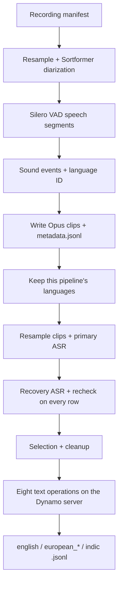

# Granary v2 full pipelines

Turn recordings into speech clips with metadata, ASR transcripts and enriched text in one Ray Data
cluster. One entrypoint, [main.py](main.py), runs one of five pipelines, chosen with `--config-name`:

| Pipeline | Languages | Language ID | ASR (primary → recovery) | Image |
| --- | --- | --- | --- | --- |
| [en_granary_pipeline.yaml](en_granary_pipeline.yaml) | English | SpeechBrain + Whisper | Qwen3-Omni → Qwen3-ASR | [Dockerfile](Dockerfile) |
| [european_qwen_omni_granary_pipeline.yaml](european_qwen_omni_granary_pipeline.yaml) | `de es fr it pt ru nl` | SpeechBrain + Whisper | Qwen3-Omni → Qwen3-ASR | [Dockerfile](Dockerfile) |
| [european_parakeet_v3_granary_pipeline.yaml](european_parakeet_v3_granary_pipeline.yaml) | `pl cs ro hu el fi da sv` | SpeechBrain + Whisper | Parakeet-v3 → Whisper | [Dockerfile](Dockerfile) |
| [european_whisper_granary_pipeline.yaml](european_whisper_granary_pipeline.yaml) | `lt lv hr et bg sk sl mt uk` | SpeechBrain + Whisper | Whisper → Parakeet-v3 | [Dockerfile](Dockerfile) |
| [indic_granary_pipeline.yaml](indic_granary_pipeline.yaml) | 22 Indic languages | SpeechBrain + Indic Canary + Whisper | Indic Canary (TensorRT-LLM) → Parakeet-Riva (`hi`) or IndicConformer (other languages) | [Dockerfile.trt_llm_granary](Dockerfile.trt_llm_granary) |

The language groups and model pairs follow the production Granary v2 routing, where each European routing
group is its own run with one primary and one recovery model. The stages around
the ASR step are identical in all five pipelines, so they and the shared settings live once in
[common.yaml](common.yaml); each pipeline YAML adds only its language ID, ASR stages and output file.
They differ only where the table does:



The metadata audit keeps non-matching, rejected and no-speech rows in `metadata.jsonl`; only clips
whose selected `source_lang` is in the pipeline's language set continue to ASR. Unrecovered ASR and
text rejection flags stay in the final manifest, so the output is an audit manifest, not a guarantee
that every row suits training.

**Audio handling.** Audio is read from memory between stages instead of being re-read from intermediate
files: the recording is decoded once into a 16 kHz mono waveform, and each Opus clip is decoded once into
the 16-bit samples every ASR stage hears. Those samples are bit-identical to what the earlier file-based
flow gave each stage, and the last ASR stage (`keep_waveform: false`) releases it. ffmpeg still
writes a temporary WAV per recording and per clip, which is read back and deleted; no WAVs are kept.

**Language ID.** `SelectAudioLanguageStage` accepts Whisper's answer when it is `en`; otherwise it
needs SpeechBrain and Whisper to agree, and Indic languages need Indic Canary to agree as well. The
English and European pipelines therefore drop the Canary stage and its TensorRT-LLM engine, which the
Indic pipeline keeps.

**European routing.** Each European YAML is one routing group of the reference. Its gate keeps only that
group's languages, so run the three YAMLs separately on the same recordings; rows of the other groups stay
in `metadata.jsonl` only. Recovery stages run on every row, as in the reference pipeline: its `high_quality`
filter compares the primary and recovery prediction of every row.

Use `backend=ray_data` (the default here). Curator raises an error for GPU stages under Xenna while the managed inference server is active.

## 1. Build the image

Run commands from this checkout's root. The default configuration needs **8 H100 80 GB GPUs**,
128 logical CPUs, 500 GiB shared memory for Ray's object store and more host RAM (2 TiB
recommended): two Dynamo replicas reserve two GPUs each, and the other four GPUs serve the audio
stages. Audio stages declare only the GPU memory each model needs; Ray Data scales
their worker pools into whatever the Dynamo replicas leave free. Docker and the NVIDIA Container Toolkit are required.

Build the images from the repository root, from public base images. English and European:

```bash
docker build -f docker/Dockerfile --target nemo_curator \
  --build-arg CURATOR_EXTRA="audio_tensorrt --extra inference_server" --build-arg CURATOR_GROUPS="" \
  -t curator-base .
docker build -f tutorials/audio/granary_v2/full_pipeline/Dockerfile -t curator-granary-full .
```

Indic:

```bash
docker build -f docker/audio/Dockerfile.trt_llm --target granary -t curator-granary-base .
docker build -f tutorials/audio/granary_v2/full_pipeline/Dockerfile.trt_llm_granary -t curator-granary-indic .
```

- [Dockerfile](Dockerfile) extends the repository's [docker/Dockerfile](../../../../docker/Dockerfile)
  (CUDA 12.9, Python 3.13, Torch 2.11, vLLM 0.22, Dynamo, etcd/NATS), built with the `audio_tensorrt`
  and `inference_server` extras. It adds the NeMo encoder the eight-speaker Sortformer checkpoint needs
  and Ubuntu's `ffmpeg` (libopus included), which torchcodec and the Opus clips need.
- [Dockerfile.trt_llm_granary](Dockerfile.trt_llm_granary) extends the Granary image from
  [docker/audio/Dockerfile.trt_llm](../../../../docker/audio/Dockerfile.trt_llm) (`--target granary`: Torch 2.9.1,
  TensorRT-LLM 1.2.1) with `ai-dynamo`, etcd/NATS and the CUDA 12.9 compiler. It adds no in-process vLLM:
  the Indic ASR stages run on TensorRT-LLM and NeMo.

The English and European image needs a host driver that supports CUDA 12.9 (R575 or newer).
Dynamo's text-model workers run in isolated Ray environments (Transformers 5.8.0 from the YAML) and
resolve their packages at startup, so neither image freezes them.

`main.py` sets `PYTORCH_CUDA_ALLOC_CONF=expandable_segments:False` before Ray starts, because vLLM
tensor-parallel CUDA graphs need CUDA-IPC-compatible allocations.

## 2. Supply models and a recording manifest

`model_dir` holds the prepared models described in the metadata tutorial's
[model preparation](../metadata/README.md#1-build-and-prepare-the-shared-environment). Build the Silero and SED
TensorRT engines inside the image you will run (`curator-granary-full` for English and European,
`curator-granary-indic` for Indic): TensorRT engines only load under the TensorRT version that built them,
and the two images differ. The directory holds: `sortformer.nemo`, `silero.plan`,
`sed.pth`, `sed.plan`, `speechbrain/` and `whisper.pt`. The Indic pipeline also needs
`indic_canary/` (the prebuilt TensorRT-LLM engine) and `indic_parakeet/` (`model.nemo` and its
TensorRT engine). Qwen3-Omni, the text model and, for the Indic and European recovery models,
IndicConformer, Parakeet-v3 and Whisper large-v3 download from Hugging Face on first use unless
already cached; set `model_id` and `model_identifier` to local snapshot directories to avoid that.

Use a UTF-8 JSONL manifest, one recording per line, with a unique `audio_item_id` and an absolute
`audio_filepath` visible to every audio worker:

```json
{"audio_item_id":"recording-001","audio_filepath":"/data/recording-001.wav"}
```

Extra provenance fields are preserved. No reference transcript is required, and none is used as a
segment label. Mount the model and recording directories at the **same absolute path** inside the
container so manifest paths still resolve.

## 3. Run

Choose a fresh output directory; the entrypoint refuses to overwrite an existing run.

```bash
export MODELS=/absolute/path/to/prepared/models
export DATA=/absolute/path/to/recordings
export OUTPUT="$PWD/granary-output"
mkdir -p "$PWD/.cache/granary" "$OUTPUT"
docker run --rm --gpus all --ipc=host \
  -v "$MODELS:$MODELS:ro" -v "$DATA:$DATA:ro" \
  -v "$PWD/.cache/granary:/cache" -v "$OUTPUT:/output" \
  curator-granary-full bash -lc '
    source /opt/venv/env.sh
    set -euo pipefail
    python -u tutorials/audio/granary_v2/full_pipeline/main.py "$@" 2>&1 | tee /output/pipeline.log
  ' -- --config-name en_granary_pipeline \
  manifest_path="$DATA/manifest.jsonl" model_dir="$MODELS" \
  output_dir=/output/run cache_root=/cache/compilation
```

Use `--config-name european_qwen_omni_granary_pipeline`, `european_parakeet_v3_granary_pipeline` or
`european_whisper_granary_pipeline` with the same image, or `--config-name
indic_granary_pipeline` with `curator-granary-indic`. For other GPU counts, Ray detects the node's GPUs; set
`inference_server.models.0.num_replicas` (two GPUs each) and, if needed, `ray_client.num_cpus`.

The entrypoint starts one Ray cluster, downloads the pinned text model snapshot and enters the YAML's
`InferenceServer` context. Dynamo handles placement, readiness and routing; the pipeline starts after
the endpoint is ready and reuses it for all eight text operations. On completion or failure the
entrypoint closes the server before Ray. Model downloads and worker environment setup can take
several minutes on first use.

## 4. Outputs

`$OUTPUT/run/` contains:

| Path | Contents |
| --- | --- |
| `metadata.jsonl` | All metadata results, including rejected, other-language and no-speech audit rows |
| `english.jsonl`, `european_<group>.jsonl` or `indic.jsonl` | Selected clips with primary/recovery predictions, selection source, enriched text and rejection notes |
| `audio/` | Opus clips for all speech segments |
| `rttm/` | Recording-level speaker turns |
| `speechbrain_cache/` | Language-model loading cache |

Check that final rows map to metadata clips and inspect flags separately from successful enrichment
(pass the output file name and the pipeline's language codes):

```bash
docker run --rm -i -v "$OUTPUT:/output:ro" --entrypoint python curator-granary-full - \
  english.jsonl en <<'PY'
import json
import sys
from pathlib import Path

root = Path('/output/run')
name, langs = sys.argv[1], set(sys.argv[2].split(','))
metadata = [json.loads(line) for line in (root / 'metadata.jsonl').read_text().splitlines()]
final = [json.loads(line) for line in (root / name).read_text().splitlines()]
expected = {row['audio_item_id']: row for row in metadata if row.get('source_lang') in langs}
actual = {row['audio_item_id']: row for row in final}
assert len(actual) == len(final) == len(expected)
assert actual.keys() == expected.keys()
fields = (
    'primary_model_prediction', 'best_prediction',
    'abbreviated_text',
    'pnc_text', 'llm_language_prediction', 'tn_raw', 'captioning_text',
    'code_switched_text', 'speech_qa_text', 'itn_raw', 'itn_clean',
)
flagged = 0
for clip_id, row in actual.items():
    assert row['source_lang'] in langs
    if row.get('best_prediction_source') == 'fallback':
        assert row.get('fallback_model_prediction')
    for key in ('audio_filepath', 'original_file', 'start_ms', 'end_ms'):
        assert row[key] == expected[clip_id][key], (clip_id, key)
    assert Path(row['audio_filepath']).is_file()
    if row.get('_skipme'):
        flagged += 1
        print('FLAGGED', clip_id, row['_skipme'], row.get('additional_notes'))
    else:
        assert all(isinstance(row.get(key), str) and row[key].strip() for key in fields), row
print(f'{len(metadata)} metadata rows; {len(final)} final rows; {flagged} flagged')
assert final, 'No clips selected; inspect metadata language/VAD notes'
PY
```

For the other pipelines pass `european_qwen_omni.jsonl`, `european_parakeet_v3.jsonl`, `european_whisper.jsonl` or
`indic.jsonl` and the matching comma-separated language codes (for example `de,es,fr,it,pt,ru,nl` for
`european_qwen_omni.jsonl`).

Empty output can reflect no speech, language rejection or the wrong pipeline for the input; inspect
`metadata.jsonl` before changing settings. Nonempty fields and successful requests do not establish
transcript accuracy or semantic quality; review generated text and `additional_notes` first.

## 5. Validation status

CPU checks cover configuration loading, building each YAML's pipeline and importing every stage and
adapter class with its third-party dependencies in the matching image. On a local GPU, language ID, Parakeet-v3,
Whisper and Qwen3-ASR (vLLM 0.22) transcribed real European audio. On a Slurm cluster (one 8x H100 node per
pipeline, 64-recording samples) the English, European Qwen3-Omni-group (Italian FLEURS) and Indic pipelines each
ran end to end and produced the same clips, ids, durations and languages as the file-based flow. Transcript text
matched except for a few rows (model nondeterminism). The European Parakeet-v3 and Whisper groups, full-size
cohorts, multi-node scaling and transcript quality remain unverified. The Indic image inherits
dependency declaration conflicts from the Granary base, so plain `uv pip check` is not clean there.
