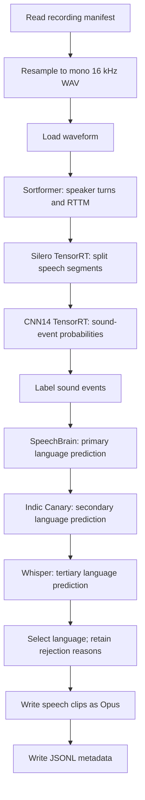

# Granary Metadata Extraction

Extract speech clips and metadata from recordings: who spoke when, where speech
occurs, which sounds are present, and which language was spoken. The pipeline
writes one Opus file per speech segment and a JSONL manifest. It does not
transcribe the audio.



## 1. Build and prepare the shared environment

Use Linux x86_64 with Docker Buildx and the NVIDIA Container Toolkit. The
same image, model directory, runtime settings, and [pipeline.yaml](pipeline.yaml)
serve the tutorial and benchmark. Model preparation happens before either run.
The shared configuration requires 128 logical CPUs, eight H100 80 GB GPUs,
and a 500 GiB Ray object store (`536870912000` bytes). Provide at least that much
shared memory plus RAM for models and workers; 1 TiB host RAM is recommended.
Docker uses `--ipc=host` to expose the host shared-memory capacity. A smaller
allocation has not been validated.

### Build the image

From the root of this checkout, create a dedicated builder with bounded memory,
CPU, and process use. These limits apply to the build worker, not only the Docker
client. Do not build concurrently with another memory-intensive workload. The
example reserves host CPUs 1–2; those CPUs must exist on the build host.

<!-- granary-eos: builder -->
```bash
docker buildx create --name curator-granary-bounded --driver docker-container \
  --driver-opt image=moby/buildkit:v0.33.1 \
  --driver-opt memory=12g --driver-opt memory-swap=12g \
  --driver-opt cpuset-cpus=1-2 --driver-opt cpu-quota=200000 \
  --driver-opt cpu-period=100000
docker buildx inspect curator-granary-bounded --bootstrap
docker update --pids-limit 2048 buildx_buildkit_curator-granary-bounded0
docker inspect --format '{{json .HostConfig}}' buildx_buildkit_curator-granary-bounded0
```

Before continuing, check that `Memory` and `MemorySwap` are both `12884901888`,
`CpusetCpus` is `1-2`, `CpuQuota` is `200000`, `CpuPeriod` is `100000`, and
`PidsLimit` is `2048`. Reuse this builder only while those limits still match.

<!-- granary-eos: build -->
```bash
docker buildx build --builder curator-granary-bounded --no-cache --load --target granary \
  -f docker/audio/Dockerfile.trt_llm -t curator-granary-metadata .
```

The `granary` target extends the dedicated Python 3.12 / Torch `2.9.1+cu128` /
TensorRT `10.14.1.48.post1` / TensorRT-LLM `1.2.1` environment. It installs the
[reference NeMo commit](https://github.com/ipmedenn/NeMo/tree/5d56c27c0e80f4cd8c93b28bacca5f98440a45f9)
without resolving or replacing Torch dependencies. The exact eight-speaker
`8spk-r087-3-50k.nemo` checkpoint requires that fork's RoPE encoder;
released NeMo 3.0.0 cannot restore it.

The image also installs CUDA forward-compatibility package
`cuda-compat-13-3=610.57.04-1ubuntu1` and prepends `/usr/local/cuda-13.3/compat` to
`LD_LIBRARY_PATH`. This is needed on EOS's older host driver for TensorRT's
CUDA 13 runtime; Torch uses CUDA 12.8. Keep this loader path for every Python
process and worker. The image sets `OMP_NUM_THREADS`, `OPENBLAS_NUM_THREADS`,
`MKL_NUM_THREADS`, and `NUMBA_NUM_THREADS` to `1`, and
`PYTORCH_CUDA_ALLOC_CONF=expandable_segments:True`. Builds also use one compiler
and package-install worker. Do not run `uv sync` or install additional packages
inside the resulting image. Record its image digest and resolved Python/package
versions when comparing runs; use that same immutable image for both executors.

### Supply the private model inputs and open the container

Obtain the reference eight-speaker Sortformer checkpoint and the compatible
Indic Canary engine bundle from their owners. They have no public download
in this tutorial. A public four-speaker checkpoint changes the workload, and a
Canary `.nemo` alone does not replace its engine bundle. The hashes below identify
the previously validated H100 bundle; a different bundle needs its own validation.
Fresh Canary conversion is not established by this recipe. The separate
[Indic ASR conversion notes](../indic_asr/README.md#canary) describe its external
converter and required source checkpoint.

Arrange the supplied inputs as `sortformer.nemo` and `indic_canary/` inside one
directory. On EOS this may be an existing verified model directory, mounted
read-only. Set `GRANARY_MODEL_INPUTS` to its absolute host path. Use a fresh work
directory; it holds all generated models, samples, outputs, and logs. Optional
cached public checkpoints can also live under `GRANARY_MODEL_INPUTS`, using the
same relative paths as their download destinations below.

<!-- granary-eos: container -->
```bash
export GRANARY_MODEL_INPUTS=/absolute/path/to/reference-model-inputs
mkdir -p granary-metadata-work/models granary-metadata-work/data \
  granary-metadata-work/outputs granary-metadata-work/ray-logs
docker run --rm -it --gpus all --ipc=host \
  -v "$GRANARY_MODEL_INPUTS:/model-inputs:ro" \
  -v "$PWD/granary-metadata-work/models:/models" \
  -v "$PWD/granary-metadata-work:/work" \
  -v "$PWD/granary-metadata-work/ray-logs:/tmp/ray" \
  curator-granary-metadata bash
```

### Initialize the runtime

Run every remaining command **inside this container**, from `/opt/Curator`.
For EOS/Pyxis, use the same image and mount destinations. Initialize the runtime
once in the parent shell before any Python command. Clear inherited distributed
ranks so NeMo does not initialize a Slurm/MPI training group. Ray's CLI and
explicit-address clients share one private authentication file; never print or
archive its contents.

<!-- granary-eos: environment -->
```bash
set -euo pipefail
set +x
cd /opt/Curator
while IFS= read -r name; do
  case "$name" in
    SLURM_*|OMPI_*|PMI_*|PMIX_*|HYDRA_*|I_MPI_*|MPI_*|MPICH_*|MV2_*|WORLD_SIZE|RANK|LOCAL_RANK|LOCAL_WORLD_SIZE|GROUP_RANK|ROLE_RANK|MASTER_ADDR|MASTER_PORT)
      unset "$name" ;;
  esac
done < <(compgen -e)
unset RAY_ADDRESS RAY_AUTH_TOKEN UV_PYTHON UV_VENV_NAME UV_VENV_PATH
export VIRTUAL_ENV=/opt/venv
export PATH=/opt/venv/bin:/usr/local/sbin:/usr/local/bin:/usr/sbin:/usr/bin:/sbin:/bin
export RAY_DATA_LOG_LEVEL=INFO
export RAY_AUTH_MODE=token
export RAY_AUTH_TOKEN_PATH="$(mktemp /tmp/granary-ray-auth.XXXXXXXX)"
trap 'rm -f -- "$RAY_AUTH_TOKEN_PATH"' EXIT
trap 'exit 130' INT
trap 'exit 143' TERM
python - <<'PYCODE'
import os
import secrets
from pathlib import Path

Path(os.environ['RAY_AUTH_TOKEN_PATH']).write_text(secrets.token_hex(32))
PYCODE
python docker/audio/check_trt_llm.py
python -c "import speechbrain, whisper; print('Language-ID imports passed')"
```

### Verify and copy the private inputs

This copies only the expected files after verifying their SHA-256 hashes. It
reuses an identical destination and refuses a conflicting one. The source mount
is never modified.

<!-- granary-eos: private-assets -->
```bash
python - <<'PYCODE'
import hashlib
import shutil
from pathlib import Path

files = {
    'sortformer.nemo': '909cca86055c03bc19b28322e47544d749ebe2481e701ca5b066d223b7026d47',  # pragma: allowlist secret
    'indic_canary/decoder/config.json': 'abf6061369df404bd4462aec2b1fe5ef6b1dffbb0864ba2dfd0ed735eda054bf',  # pragma: allowlist secret
    'indic_canary/decoder/rank0.engine': 'acb96e0eb0fe97aa4e5cf1bd78647c63a24c2d80b37a8fb415cc3396bfe4d690',  # pragma: allowlist secret
    'indic_canary/decoder/vocab.json': '2ba7e804f6b6e9c88a767065267e90705a19a4f6da808604d54927999e036bee',  # pragma: allowlist secret
    'indic_canary/encoder/config.json': 'f6d1a8e1c207926ff58c8513603a8321e185e10f941c7b278dba73d576601df0',  # pragma: allowlist secret
    'indic_canary/encoder/encoder.plan': '1259c33761a2fd7e59bdb496100b19c84371eab4981df89aac4bee4f095f4eb3',  # pragma: allowlist secret
    'indic_canary/preprocessor/config.json': '6254bbdaf52a70c1c2d64ffb7ec6c3a98538f5624e7ac805bc4b6507c203bc29',  # pragma: allowlist secret
    'indic_canary/preprocessor/mel_basis.pt': '44595c30a2fe50ed073567ff0b009310696487dc67a2842d9bfa695af49d8868',  # pragma: allowlist secret
}

def check(path, expected):
    with path.open('rb') as stream:
        actual = hashlib.file_digest(stream, 'sha256').hexdigest()
    if actual != expected:
        raise ValueError(f'Unexpected model content: {path}')

for relative, expected in files.items():
    source, target = Path('/model-inputs') / relative, Path('/models') / relative
    check(source, expected)
    if not target.exists():
        target.parent.mkdir(parents=True, exist_ok=True)
        shutil.copyfile(source, target)
    check(target, expected)
    print(relative, expected)
PYCODE
```

### Download the public checkpoints

The public assets are PANNs
[`Cnn14_DecisionLevelMax_mAP=0.385`](https://zenodo.org/records/3987831)
(CC BY 4.0), SpeechBrain
[`lang-id-voxlingua107-ecapa`](https://huggingface.co/speechbrain/lang-id-voxlingua107-ecapa/tree/0253049ae131d6a4be1c4f0d8b0ff483a0f8c8e9)
(Apache 2.0), and OpenAI [Whisper medium](https://github.com/openai/whisper)
(MIT). The command pins every asset by content hash and the SpeechBrain snapshot
by revision. It copies a matching cached download from `/model-inputs` when
available, otherwise downloads the pinned URL. Existing different files fail;
partial downloads never become model files.

<!-- granary-eos: public-assets -->
```bash
python - <<'PYCODE'
import hashlib
import os
import shutil
import tempfile
import urllib.request
from pathlib import Path

revision = '0253049ae131d6a4be1c4f0d8b0ff483a0f8c8e9'  # pragma: allowlist secret
speechbrain = {
    'README.md': 'e2a24d3c912f3c02bc104abb86904271bacc245e55b9f856220e71c7d96eaf4c',  # pragma: allowlist secret
    'classifier.ckpt': 'a50d9024ff58d317031c9787d4c6c614d454a87a8ef32f9d36338cd3ff57adbc',  # pragma: allowlist secret
    'config.json': 'a861f8fbc2e23c0fc0823b3c0fd2b3d1e839563c2d4e3f9663a1237cce62bc89',  # pragma: allowlist secret
    'embedding_model.ckpt': 'ab750d5c06d713477045fa798fab5d33e959dbc0dfe4de510a9a47844c79a19a',  # pragma: allowlist secret
    'hyperparams.yaml': '88fec9791a8416a152fb10834327e18d38e5bf7a351e9b714e08cdc4af05de6f',  # pragma: allowlist secret
    'label_encoder.txt': '9f566d83c4f19168be4a0bf86c0c7dac7d3264a95105bcbf33a7c32b83ccc17f',  # pragma: allowlist secret
    'normalizer.ckpt': 'c369e01dfa2e0d84c6b116f33c7b94f1fe28c061642086538e93cde3d97c26ef',  # pragma: allowlist secret
}
whisper_sha = '345ae4da62f9b3d59415adc60127b97c714f32e89e936602e85993674d08dcb1'  # pragma: allowlist secret
files = [
    ('sed.pth', 'https://zenodo.org/api/records/3987831/files/Cnn14_DecisionLevelMax_mAP=0.385.pth/content',
     'dd3b4043a87d4ec13df8082c0fcfee3fb5084151808e47e060987a95eabdd142'),  # pragma: allowlist secret
    ('whisper.pt', f'https://openaipublic.azureedge.net/main/whisper/models/{whisper_sha}/medium.pt', whisper_sha),
]
files += [(f'speechbrain/{name}',
           f'https://huggingface.co/speechbrain/lang-id-voxlingua107-ecapa/resolve/{revision}/{name}', digest)
          for name, digest in speechbrain.items()]

def check(path, expected):
    with path.open('rb') as stream:
        actual = hashlib.file_digest(stream, 'sha256').hexdigest()
    if actual != expected:
        raise ValueError(f'Unexpected model content: {path}')

for relative, url, expected in files:
    target, cached = Path('/models') / relative, Path('/model-inputs') / relative
    if target.exists():
        check(target, expected)
        continue
    target.parent.mkdir(parents=True, exist_ok=True)
    with tempfile.NamedTemporaryFile(dir=target.parent, delete=False) as stream:
        temporary = Path(stream.name)
    try:
        if cached.exists():
            check(cached, expected)
            shutil.copyfile(cached, temporary)
        else:
            request = urllib.request.Request(url, headers={'User-Agent': 'NeMo-Curator-Granary'})
            with urllib.request.urlopen(request, timeout=60) as response, temporary.open('wb') as output:
                shutil.copyfileobj(response, output)
        check(temporary, expected)
        os.replace(temporary, target)
    finally:
        temporary.unlink(missing_ok=True)
    print(relative, expected)
PYCODE
```

### Build the two TensorRT engines

Build these inside the same image on the H100 that will run inference. Use a
new `/models` directory if engine outputs already exist; the builders refuse
to overwrite them. Silero exports its installed official 16 kHz weights and
validates the recurrent engine. Its default FP32 profiles cover batches 1–64.

<!-- granary-eos: engine-silero -->
```bash
python -m nemo_curator.models.audio.vad.build_silero_tensorrt_engine \
  --output /models/silero.plan --min-batch 1 --opt-batch 16 --max-batch 64
```

SED uses the downloaded CNN14 checkpoint and the Granary 16 kHz frontend:
1,024-sample window, 320-sample hop, 64 mel bins, and 527 classes. The profile
covers the graph's maximum 40-second speech segment. The builder's default
sample rate is 32 kHz, so retain the explicit `--sample-rate 16000`.

<!-- granary-eos: engine-sed -->
```bash
python -m nemo_curator.models.audio.sed.build_sed_tensorrt_engine \
  --checkpoint /models/sed.pth --output /models/sed.plan \
  --sample-rate 16000 --fp16
```

Keep the generated `silero.plan.json` and `sed.plan.json` provenance sidecars
with their engines. SED checks its checkpoint, frontend, GPU, engine hash, and
TensorRT version; copying an unrelated sidecar cannot make an old engine valid.
The completed layout is:

```text
/models/
├── sortformer.nemo
├── silero.plan
├── silero.plan.json
├── sed.pth
├── sed.plan
├── sed.plan.json
├── speechbrain/          # Pinned complete snapshot
├── whisper.pt
└── indic_canary/
    ├── encoder/encoder.plan
    ├── encoder/config.json
    ├── decoder/config.json
    ├── decoder/rank0.engine
    ├── decoder/vocab.json
    ├── preprocessor/config.json
    └── preprocessor/mel_basis.pt
```

Keep `/models` unchanged between tutorial and benchmark runs. Subsequent run
containers can mount that directory read-only; all worker caches go under
`output_dir`. Do not enable Hugging Face offline mode until the public-model
and sample-download steps have completed.

## 2. Download two sample recordings

Reuse the public Hindi sample downloader from the Indic ASR tutorial:

<!-- granary-eos: samples -->
```bash
python tutorials/audio/granary_v2/indic_asr/download_samples.py --output-dir /work/data/fleurs
```

This downloads two Google FLEURS recordings, 12.24 and 10.26 seconds long,
under the dataset's CC BY 4.0 license. It pins the dataset revision, verifies
file hashes, and refuses to overwrite different files.

Create a recording manifest with absolute audio paths. Keep the dataset
provenance; the parent recording's transcript is not a transcript of each
future speech segment:

<!-- granary-eos: manifest -->
```bash
python - <<'PY'
import json
from pathlib import Path

root = Path('/work/data/fleurs')
rows = [json.loads(line) for line in (root / 'manifest.jsonl').read_text().splitlines()]
with (root / 'metadata_input.jsonl').open('x') as output:
    for row in rows:
        item = {key: row[key] for key in ('audio_item_id', 'duration', 'dataset', 'dataset_revision', 'license')}
        item['audio_filepath'] = str((root / row['audio_filepath']).resolve(strict=True))
        output.write(json.dumps(item, ensure_ascii=False) + '\n')
PY
```

This creates `metadata_input.jsonl` once; reuse it for both executors.

## 3. Run the pipeline

All stages and model settings are listed in [pipeline.yaml](pipeline.yaml).
Run one pipeline at a time and use a new output directory and log filename
for every run:

<!-- granary-eos: tutorial-xenna -->
```bash
set -o pipefail
test ! -e /work/outputs/xenna && test ! -e /work/outputs/xenna.log && {
  python nemo_curator/config/run.py \
    --config-path ../../tutorials/audio/granary_v2/metadata --config-name pipeline \
    manifest_path=/work/data/fleurs/metadata_input.jsonl \
    model_dir=/models output_dir=/work/outputs/xenna \
    backend=xenna execution_mode=streaming \
    2>&1 | tee /work/outputs/xenna.log
}
```

To run the same graph with Ray Data:

<!-- granary-eos: tutorial-ray-data -->
```bash
set -o pipefail
test ! -e /work/outputs/ray_data && test ! -e /work/outputs/ray_data.log && {
  python nemo_curator/config/run.py \
    --config-path ../../tutorials/audio/granary_v2/metadata --config-name pipeline \
    manifest_path=/work/data/fleurs/metadata_input.jsonl \
    model_dir=/models output_dir=/work/outputs/ray_data backend=ray_data \
    2>&1 | tee /work/outputs/ray_data.log
}
```

`execution_mode` selects Xenna streaming or batch scheduling; Ray Data ignores
that setting. Console logs and Ray worker logs persist under
`granary-metadata-work` on the host.

## 4. Inspect the output

For the Xenna command, the host output directory is
`granary-metadata-work/outputs/xenna`:

```text
xenna/
├── metadata.jsonl       # One row per speech segment, plus no-speech audit rows
├── audio/              # Emitted Opus speech clips
├── rttm/               # Recording-level speaker turns
├── resampled/          # Intermediate mono 16 kHz WAV recordings
└── speechbrain_cache/  # Worker-local model loading files
```

Print every output row from both executors and check that emitted clips exist:

<!-- granary-eos: inspect -->
```bash
python - <<'PY'
import json
from pathlib import Path

for executor in ('xenna', 'ray_data'):
    path = Path('/work/outputs') / executor / 'metadata.jsonl'
    rows = [json.loads(line) for line in path.read_text().splitlines()]
    assert rows, f'{executor}: no speech segments or no-speech audit rows were written'
    for row in rows:
        if not row.get('vad_empty'):
            clip = Path(row['audio_filepath'])
            assert clip.is_file() and clip.stat().st_size > 0, clip
            assert row['start_ms'] < row['end_ms']
            assert row['duration'] > 0
        assert 'waveform' not in row and '_sed_framewise' not in row
        print(json.dumps(row, ensure_ascii=False, indent=2))
    print(f'{executor}: {len(rows)} output rows')
PY
```

| Field | Meaning |
| --- | --- |
| `audio_filepath` | Absolute path to the emitted Opus clip. A `vad_empty` audit row keeps the original recording path and has no new clip. |
| `original_file` | Original recording used to create the speech segment. |
| `audio_item_id` | Stable identifier for this speech segment; distinct from sibling segments from the same recording. |
| `start_ms`, `end_ms` | Segment offsets in the original recording, in integer milliseconds. |
| `duration`, `sample_rate` | Duration of the segment waveform in seconds and its working sample rate, 16,000 Hz. Opus decoders may expose a different playback sample rate. |
| `num_speakers`, `rttm_filepath` | Number of diarization speaker labels overlapping this segment, and the recording-level RTTM path relative to `rttm/`. |
| `sed_events` | Sound labels with `start_time` and `end_time` in seconds relative to this segment; each includes its broader `superclass`. |
| `source_lang` | Selected language code, empty when predictions are missing, or `skipped` when models disagree. |
| `additional_notes`, `_skipme` | Model labels/confidences, selection notes, and rejection reasons. Inspect these even when the process succeeds. |
| `vad_empty` | A recording produced no usable speech; retained so it is distinguishable from a missing input. |

A nonempty `_skipme` does not silently drop the segment. Speech clips with
rejected language predictions remain available for inspection. Do not use
those rows as accepted language-labeled training data without reviewing them.

## What each stage does

1. **Read and resample:** read JSONL, create a mono 16 kHz floating-point WAV, then load its
   waveform. The original audio path remains available for provenance.
2. **Sortformer:** diarize the whole recording and save speaker turns as RTTM.
3. **VAD:** split speech at threshold 0.5 with 1,000 ms minimum silence,
   100 ms padding, and segment lengths from 0.5 to 40 seconds. Each segment
   receives the number of overlapping diarization speakers.
4. **SED:** run CNN14 through TensorRT, then label individual sound classes
   at probability threshold 0.5. This labels clips; it does not filter them.
5. **Language identification:** run SpeechBrain, Indic Canary, and Whisper on
   each eligible segment. They inspect up to the first 10, 40, and 30 seconds,
   respectively; clips below one second have no model language prediction.
6. **Language selection:** accept Whisper's English prediction; otherwise
   require all three models to agree for Indic languages, or SpeechBrain and
   Whisper to agree for non-Indic languages. Preserve rejection reasons.
7. **Write:** encode the speech waveform as Opus and write JSON-safe metadata.
   Remove waveform arrays and recording-level diarization arrays from each
   row; retain the RTTM path and per-segment speaker count.

## Observed throughput

The 2026-10-20 EOS runs used Curator `8d275057` and the immutable Granary image
documented above. One run per executor processed the same 30,631 LibriSpeech
recordings, totaling 107.76357 source audio hours,
with identical model bundles and pipeline settings. Each run received one node
with 8 × NVIDIA H100 80GB HBM3 GPUs.

| Measurement | Xenna streaming | Ray Data |
| --- | ---: | ---: |
| Full benchmark process | 863.954 seconds | 2,374.678 seconds |
| Pipeline time | 821.388 seconds | 2,333.515 seconds |
| Whole-node pipeline throughput | **472.309 audio-hours/hour** | **166.251 audio-hours/hour** |
| Pipeline throughput per allocated GPU | **59.039 audio-hours/GPU-hour** | **20.781 audio-hours/GPU-hour** |

Pipeline time measures `Pipeline.run()`, including model startup, all stages,
and executor shutdown. Full process time also includes imports, input checks,
and output validation. Data and model staging and scheduler queue time are
excluded. Throughput uses source audio hours and the pipeline clock; it does
not use the shorter total duration of the emitted speech segments.

Both runs covered every recording and produced 38,416 speech clips plus one
retained no-speech row. Segment identities, intervals, speaker counts, final
language decisions, skip flags, SED events, and all 30,631 RTTM files matched.
Language audit notes differed on 15,626 rows. All encoded Opus file hashes
differed; only two retained pairs were decoded and compared directly, and those
samples matched. These checks do not establish full-corpus decoded-audio parity.

All eight Xenna GPUs and seven Ray Data GPUs recorded at least 30 seconds of
sampled processing activity. Ray Data's GPU 7 recorded only eight seconds and
0.828% mean utilization. Per-GPU throughput divides whole-node throughput by
all eight allocated GPUs; it does not establish scaling efficiency.
NeMo-CI jobs: Xenna `497618497`; Ray Data `497618498`.

## Use your own recordings

Supply a JSONL manifest with one recording per row and absolute local paths
visible at the same location to every worker:

```json
{"audio_filepath":"/data/recording.wav","audio_item_id":"recording_001"}
```

Use unique `audio_item_id` values containing only letters, numbers, underscores,
or hyphens. WAV and FLAC inputs are supported by the supplied container.
Change `manifest_path` and choose fresh output/log paths in the command above.

This draft loads each resampled recording into memory before diarization and
segmentation. Start with short recordings: it does not implement the production
reader's bounded file-streaming behavior for recordings up to 11 hours.
VAD processes one parent recording per task to preserve Curator's fan-out
identity contract, instead of the production runner's batch of 64 parents.
The Silero engine still batches recurrent windows internally.

The graph preserves the optimized reference model choices and processing
settings. Numerical parity with the production pipeline and long-recording
memory scaling have not been established.
