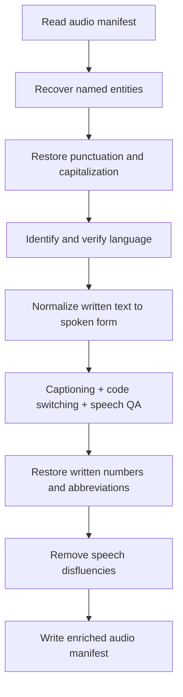

# Process English audio transcripts

Turn existing ASR transcripts into punctuated, normalized text and useful text
features. Records remain `AudioTask` objects throughout; this pipeline reads no
audio waveforms. The two bundled English examples need no data download.



[text_pipeline.yaml](text_pipeline.yaml) lists the complete pipeline. Its seven
`AudioTextLLMStage` instances perform nine operations: the three text features
share one stage and run concurrently against the same normalized transcript.

## 1. Prepare the environment

Use one Linux x86_64 node with Docker, the NVIDIA Container Toolkit, and a driver
compatible with CUDA 12.9. The serving configuration uses eight H100 80 GB GPUs:
four Gemma FP8 replicas with two GPUs each. Earlier EOS runs exposed 224 logical CPUs;
the seven processing stages can reserve 84 CPUs in total, with additional CPUs
needed for Ray, serving, reading and writing. A two-row input reduces processing
work but keeps these settings.

Clone [NeMo Curator](https://github.com/NVIDIA-NeMo/Curator), check out the branch
or commit containing this tutorial, and start in that checkout's root. Build the
checked-in Dockerfile with its locked dependencies; use this same checkout and
image for the tutorial and benchmarks. Internet access is needed during the build
and the first server startup to download packages and model weights.

Create the dedicated builder once. Its 12 GiB memory limit, disabled swap and
single-CPU affinity contain the project's native extension compilation; allow
additional memory for your host applications. Reuse this builder for later builds.

Create fresh output and cache directories and an input directory. The input
directory can stay empty for the bundled examples. For benchmarking, place your
English cohort at `text_processing_data/english/manifest.jsonl` before proceeding.

```bash
git rev-parse HEAD
docker buildx create --name curator-audio-text-bounded --driver docker-container \
  --driver-opt image=moby/buildkit:v0.15.0 \
  --driver-opt memory=12g,memory-swap=12g,cpuset-cpus=0,cpu-quota=100000,cpu-period=100000
docker buildx build --builder curator-audio-text-bounded --load \
  -f docker/Dockerfile -t curator-audio-text .
mkdir -p text_processing_output text_processing_data/english .cache/audio-text
docker run --rm -it --name curator-audio-text --gpus all --ipc=host \
  --mount type=bind,src="$PWD/text_processing_data",dst=/data,readonly \
  --mount type=bind,src="$PWD/text_processing_output",dst=/output \
  --mount type=bind,src="$PWD/.cache/audio-text",dst=/cache \
  --env HF_HOME=/cache/huggingface \
  curator-audio-text bash
```

The project image includes Python 3.13, the audio and `inference_server`
dependencies, `etcd`, and `nats-server`. There are two Python environments:

| Package | Driver, from `uv.lock` | Dynamo model worker |
| --- | --- | --- |
| ai-dynamo | 1.3.1 | 1.3.1 |
| vLLM | 0.22.0+cu129 | 0.23.0+cu129 |
| Transformers | 4.57.6 | 5.8.0 |
| Torch | 2.11.0+cu129 | 2.11.0+cu129 |
| Ray | 2.57.0 | 2.57.0 |

Curator creates isolated model-worker environments from the driver environment,
installs the matching Dynamo vLLM extra using CUDA 12.9 wheels, and applies the
YAML's Transformers override there. Keep the driver's Transformers version;
audio dependencies require it. Other worker dependencies are resolved at startup.
The tutorial entrypoint keeps one server running for every operation in a pipeline
invocation, then shuts it down. Worker dependencies can resolve differently
between invocations; use an external endpoint when runs must share one server. Keep
`/cache` to reuse weights and compilation artifacts with the same runtime and GPU
architecture.

## 2. Run the two examples

Inside the built container, run the tutorial entrypoint. It reuses the shared
YAML construction helpers without modifying the shared runner. No separate
server command or second terminal is needed:

```bash
cd /opt/Curator
unset RAY_ADDRESS
set -euo pipefail
test ! -e /output/english_output.jsonl
python tutorials/audio/granary_v2/text_pipeline/main.py \
  manifest_path=/opt/Curator/tutorials/audio/granary_v2/text_pipeline/sample_input.jsonl \
  output_path=/output/english_output.jsonl \
  cache_root=/cache/compilation \
  2>&1 | tee /output/pipeline.log
```

When `endpoint` is missing or empty, this entrypoint instantiates the YAML's
`inference_server`, resolves the pinned model snapshot, waits for readiness,
and passes the endpoint to every processing stage. The server stays alive
throughout the pipeline and is stopped on success or failure before it
stops its Ray cluster. Curator's existing Dynamo backend handles model workers,
package environments, routing and health checks. A first run may spend several
minutes downloading and loading the model.

With an existing endpoint, the unchanged shared `nemo_curator/config/run.py`
can also consume this YAML directly; it requires an explicit endpoint and does
not manage serving.

The default executor is Ray Data. These processing stages are CPU HTTP clients;
Dynamo owns the eight GPUs. The pipeline uses batch size 128, 12 workers per
processing stage and up to 256 concurrent requests per worker.

For your own English JSONL manifest, replace `manifest_path` with a path visible
inside the container and choose a fresh output path. The default fields are
`abbreviated_text` (ASR transcript), `text` (reference for entity spelling), and
`source_lang` (language). Override `text_key`, `ground_truth_key`, and `language_key`
when your field names differ. Audio paths and other metadata are preserved;
this pipeline does not open audio files or filter input by language.

## 3. Reuse an existing endpoint (optional)

Add `endpoint=http://inference-host:8000/v1` and the appropriate `model_name` to
the same tutorial command. A nonempty endpoint skips server creation, snapshot
download and server shutdown; `cache_root` is then unnecessary. The endpoint
must be reachable by every worker. The YAML's serving block does not reconfigure
an external server. Leave `RAY_ADDRESS` unset to let the entrypoint manage its own
cluster, or set it deliberately to an existing compatible cluster.

## 4. Inspect the result

Before stopping the container, run:

```bash
python - <<'PY_CHECK'
import json
from pathlib import Path

input_path = Path("tutorials/audio/granary_v2/text_pipeline/sample_input.jsonl")
source = [json.loads(line) for line in input_path.read_text().splitlines()]
output = [json.loads(line) for line in Path("/output/english_output.jsonl").read_text().splitlines()]
by_id = {row["audio_item_id"]: row for row in output}
operations = {
    "RecoverEntities": "entity_recovered_text",
    "PnCRestoration": "pnc_text",
    "LanguageID": "llm_language_prediction",
    "TextNormalization": "tn_raw",
    "Captioning": "captioning_text",
    "CodeSwitching": "code_switched_text",
    "SpeechQA": "speech_qa_text",
    "ITNRestoration": "itn_raw",
    "DisfluencyRemoval": "itn_clean",
}
assert len(output) == len(by_id) == len(source) == 2
for original in source:
    row = by_id[original["audio_item_id"]]
    assert all(row[key] == value for key, value in original.items())
    assert not row.get("_skipme"), row
    notes = row["additional_notes"]
    for name, field in operations.items():
        assert isinstance(row[field], str) and row[field].strip(), (name, row)
        note = notes[name]
        assert note in {"recovered", "unchanged"} or note.startswith(("applied (", "fallback (")), (name, note)
    assert notes["LLMLanguageVerification"].startswith("passed ("), notes
    print(json.dumps(row, ensure_ascii=False, indent=2))
PY_CHECK
```

This checks row identity, preservation of input fields, all nine nonempty output
fields, and that every operation ran on both English examples. A guarded fallback
counts as a completed request; a skipped operation fails this example check.
Inspect the generated text and `additional_notes` as well; successful execution
is not a text-quality score.

| Operation | Reads | Writes / purpose |
| --- | --- | --- |
| Entity recovery | `text`, `abbreviated_text` | `entity_recovered_text`: restore reference spellings of named entities. |
| Punctuation and capitalization | `entity_recovered_text` | `pnc_text`: add punctuation and casing. |
| Language identification and verification | `pnc_text`, `source_lang` | `llm_language_prediction`: identify languages and check the expected language. |
| Text normalization | `pnc_text` | `tn_raw`: convert written quantities to spoken forms. |
| Captioning, inside the fused stage | `tn_raw` | `captioning_text`: summarize what the speaker says. |
| Code switching, inside the fused stage | `tn_raw` | `code_switched_text`: restore English spelling of phonetically transcribed English words; English inputs often stay unchanged. |
| Speech QA, inside the fused stage | `tn_raw` | `speech_qa_text`: generate a question/answer pair, or `SKIP` when inappropriate. |
| Inverse text normalization | `tn_raw` | `itn_raw`: restore written numbers, dates and abbreviations. |
| Disfluency removal | `itn_raw` | `itn_clean`: remove fillers, repeats and false starts. |

The three fused operations send separate prompts concurrently through one shared
client and concurrency limit. They all read `tn_raw`; their outputs do not replace
the input to inverse text normalization. Entity recovery allows 1,024 output
tokens; the other operations allow 512. Temperature and seed are zero, and model
thinking is disabled.

Each operation records its decision in `additional_notes`. A single-language
mismatch or unparseable prediction sets `_skipme`; later requests are skipped
while the row is retained. Parsed multilingual predictions are retained. Rewrite
guards can preserve the input instead of accepting a changed response. Text
normalization permits number expansion; exhausted request retries fail the batch.

## 5. Benchmark the same pipeline (optional)

Follow the [benchmark instructions](../../../../benchmarking/README.md#audio-text-pipeline-benchmark)
in the same container. The benchmark also starts and stops the YAML-defined
server automatically when no endpoint is supplied. Supply an external
`--endpoint` to reuse an already running server.

## 6. Leave the container

The managed server and Ray cluster stop when the tutorial entrypoint returns. After inspecting
the output, run `exit` to leave and remove the container. Inputs, outputs and
caches remain in the mounted host directories. External servers remain under
their owner's control.

## Observed throughput

The October 20, 2026 EOS run used Curator `8d275057` and the environment
documented above. One run per executor processed the same
14,290 English transcript records sequentially on one node with 224 logical CPUs
and eight H100 GPUs. Both used the same running Gemma FP8 server with four
two-GPU replicas, batch size 128, 12 workers per processing stage, and up to 256
concurrent requests per worker.

| Measurement | Xenna streaming | Ray Data |
| --- | --- | --- |
| Pipeline time with the server already running | 471.889 seconds | 1,169.686 seconds |
| Whole-node pipeline throughput | **30.283 rows/second** | **12.217 rows/second** |
| Pipeline throughput per allocated GPU | **3.785 rows/GPU/second** | **1.527 rows/GPU/second** |

These pipeline clocks include reading, all nine processing operations and writing
the output. Both client runs used the same shared model server; its 510.097-second
startup, driver setup and benchmark validation are excluded. Individual full
benchmark process times were not measured separately, so these results do not
establish a 10–15 minute full-process target. Per-GPU throughput divides whole-node
throughput by all eight allocated GPUs; it does not establish linear scaling or
scaling efficiency.

Both outputs retain all 14,290 rows, original transcripts, IDs and non-mutable
input values. Language validation flags five Xenna rows and four Ray Data rows
without dropping them. There are 865/870 operation fallbacks from novel-word or
word-count guards; no request-failure or empty-response fallback notes were found.
Generated text, audit notes or status values differ on 7,727 rows, including one
language-rejection decision. Complete coverage does not establish exact generated
output or semantic parity.

## Sample provenance and a recorded result

[sample_input.jsonl](sample_input.jsonl) contains transcripts for LibriSpeech
clips `7800-283478-0020` and `3240-131231-0052`, sourced from
[`openslr/librispeech_asr`](https://huggingface.co/datasets/openslr/librispeech_asr/tree/71cacbfb7e2354c4226d01e70d77d5fca3d04ba1).
The [LibriSpeech corpus](https://www.openslr.org/12/), prepared by Vassil Panayotov
with Daniel Povey, is licensed under
[CC BY 4.0](https://creativecommons.org/licenses/by/4.0/). These transcript-only
fixtures retain the reference text, saved ASR text, duration and language from an
earlier public-data run. Only the public clip IDs, portable audio basenames and
fields needed here are included; the audio files themselves are not bundled.

The following fields are copied unchanged from one **historical EOS output** for
clip `7800-283478-0020`, produced with the configured Gemma model at Curator commit
`ce8aa4b6`. This documents an observed transformation, not a fresh execution of
this walkthrough or a promise of byte-identical model output. Other metadata and
processing notes are omitted from this excerpt.

```json
{
  "abbreviated_text": "As the four chums went away Jerry chuckled",
  "entity_recovered_text": "As the four chums went away JERRY chuckled",
  "pnc_text": "As the four chums went away, Jerry chuckled.",
  "llm_language_prediction": "Primary: English\nLanguages: English",
  "tn_raw": "As the four chums went away, Jerry chuckled.",
  "captioning_text": "A brief narrative snippet describing Jerry chuckling as four friends depart.",
  "code_switched_text": "As the four chums went away, Jerry chuckled.",
  "speech_qa_text": "SKIP",
  "itn_raw": "As the 4 chums went away, Jerry chuckled.",
  "itn_clean": "As the 4 chums went away, Jerry chuckled."
}
```
