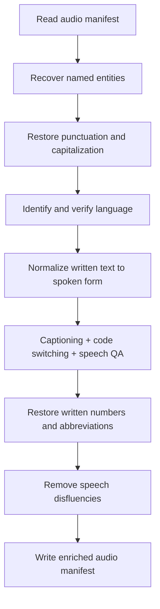

# Process English audio transcripts

Turn existing ASR transcripts into punctuated, normalized text and useful text
features. Records remain `AudioTask` objects throughout; this pipeline reads no
audio waveforms. The two bundled English examples need no data download.



[text_pipeline.yaml](text_pipeline.yaml) lists the complete pipeline. Its seven
`AudioTextLLMStage` instances perform nine operations: the three text features
share one stage and run concurrently against the same normalized transcript.

## 1. Prepare the environment

Use one Linux x86_64 node with Docker, the NVIDIA Container Toolkit, and a driver
compatible with CUDA 12.9. The serving configuration uses eight H100 80 GB GPUs:
four Gemma FP8 replicas with two GPUs each. Earlier EOS runs exposed 224 logical CPUs;
the seven processing stages can reserve 84 CPUs in total, with additional CPUs
needed for Ray, serving, reading and writing. A two-row input reduces processing
work but keeps these settings.

Clone [NeMo Curator](https://github.com/NVIDIA-NeMo/Curator), check out the branch
or commit containing this tutorial, and start in that checkout's root. Build the
checked-in Dockerfile with its locked dependencies; use this same checkout and
image for the tutorial and benchmarks. Internet access is needed during the build
and the first server startup to download packages and model weights.

Create the dedicated builder once. Its 12 GiB memory limit, disabled swap and
single-CPU affinity contain the project's native extension compilation; allow
additional memory for your host applications. Reuse this builder for later builds.

Create fresh output and cache directories and an input directory. The input
directory can stay empty for the bundled examples. For benchmarking, place your
English cohort at `text_processing_data/english/manifest.jsonl` before proceeding.

```bash
git rev-parse HEAD
docker buildx create --name curator-audio-text-bounded --driver docker-container \
  --driver-opt image=moby/buildkit:v0.15.0 \
  --driver-opt memory=12g,memory-swap=12g,cpuset-cpus=0,cpu-quota=100000,cpu-period=100000
docker buildx build --builder curator-audio-text-bounded --load \
  -f docker/Dockerfile -t curator-audio-text .
mkdir -p text_processing_output text_processing_data/english .cache/audio-text
docker run --rm -it --name curator-audio-text --gpus all --ipc=host \
  --mount type=bind,src="$PWD/text_processing_data",dst=/data,readonly \
  --mount type=bind,src="$PWD/text_processing_output",dst=/output \
  --mount type=bind,src="$PWD/.cache/audio-text",dst=/cache \
  --env HF_HOME=/cache/huggingface \
  curator-audio-text bash
```

The project image includes Python 3.13, the audio and `inference_server`
dependencies, `etcd`, and `nats-server`. There are two Python environments:

| Package | Driver, from `uv.lock` | Dynamo model worker |
| --- | --- | --- |
| ai-dynamo | 1.3.1 | 1.3.1 |
| vLLM | 0.22.0+cu129 | 0.23.0+cu129 |
| Transformers | 4.57.6 | 5.8.0 |
| Torch | 2.11.0+cu129 | 2.11.0+cu129 |
| Ray | 2.57.0 | 2.57.0 |

Curator creates isolated model-worker environments from the driver environment,
installs the matching Dynamo vLLM extra using CUDA 12.9 wheels, and applies the
YAML's Transformers override there. Keep the driver's Transformers version;
audio dependencies require it. Other worker dependencies are resolved at startup.
The commands below keep one server running for the tutorial and both benchmarks,
so all three runs use the same resolved environment and model weights. Keep
`/cache` to reuse weights and compilation artifacts with the same runtime and GPU
architecture.

## 2. Start the model server

In the container, start a Ray cluster and the existing `InferenceServer` API.
The Python snippet instantiates the **same `inference_server` block** from the
pipeline YAML; it does not construct another serving recipe.

```bash
set -euo pipefail
cd /opt/Curator
# Match Curator's state API limits before starting the external Ray cluster.
export RAY_MAX_LIMIT_FROM_API_SERVER=40000
export RAY_MAX_LIMIT_FROM_DATA_SOURCE=40000
ray start --head --node-ip-address=127.0.0.1 --port=6379 --num-gpus=8
export RAY_ADDRESS=127.0.0.1:6379
python -u - <<'PY_SERVER' 2>&1 | tee /output/server.log
from pathlib import Path
from threading import Event

from huggingface_hub import snapshot_download
from hydra.utils import instantiate
from omegaconf import OmegaConf

cfg = OmegaConf.load("tutorials/audio/granary_v2/text_pipeline/text_pipeline.yaml")
cfg.cache_root = "/cache/compilation"
cfg.model_name = str(cfg.model_name)
cfg.model_identifier = snapshot_download(
    repo_id=cfg.model_identifier,
    revision=cfg.inference_server.models[0].engine_kwargs.revision,
)
with instantiate(cfg.inference_server) as server:
    Path("/output/endpoint.txt").write_text(server.endpoint + "\n")
    print(f"Ready: {server.endpoint}. Keep this terminal open; Ctrl-C stops serving.", flush=True)
    try:
        Event().wait()
    except KeyboardInterrupt:
        pass
PY_SERVER
```

The snapshot download fixes the model to the YAML's revision before Dynamo starts;
its prefetch otherwise resolves the model repository independently of vLLM's
revision setting. The endpoint keeps the public model name. Cached snapshots are
reused on subsequent starts.

Wait for `Ready:` before continuing. Initial model download, loading and compilation
can take several minutes. The server defaults are four TP=2 replicas, context and
batched-token limits of 8,192, 256 sequences, prefix caching, chunked prefill, and
95% GPU memory utilization.

## 3. Run the two examples

In a **second host terminal**, enter the running container:

```bash
docker exec -it curator-audio-text bash
```

Then run Curator's shared YAML entrypoint:

```bash
cd /opt/Curator
export RAY_ADDRESS=127.0.0.1:6379
set -euo pipefail
test ! -e /output/english_output.jsonl
python nemo_curator/config/run.py \
  --config-path ../../tutorials/audio/granary_v2/text_pipeline \
  --config-name text_pipeline \
  manifest_path=/opt/Curator/tutorials/audio/granary_v2/text_pipeline/sample_input.jsonl \
  output_path=/output/english_output.jsonl \
  endpoint="$(cat /output/endpoint.txt)" \
  2>&1 | tee /output/pipeline.log
```

The default executor is Ray Data. Add `backend=xenna execution_mode=streaming`
to the same command to use Xenna. Both use batch size 128, 12 workers and up to
256 concurrent requests per worker. The shared runner connects to the existing
Ray cluster and model endpoint; it does not start or stop the model server.

Output and logs appear in `text_processing_output/` on the host. The command
refuses to overwrite an existing result; choose a fresh output path and update
the guard when running again. Keep the server running while inspecting results
and running the optional benchmarks below.

For your own English JSONL manifest, replace `manifest_path` with an absolute
path visible inside the container and choose a different output path. The default
fields are `abbreviated_text` (ASR transcript), `text` (reference for entity
spelling), and `source_lang` (language). Override `text_key`, `ground_truth_key`,
and `language_key` when your field names differ. Audio paths and other metadata
are preserved; this pipeline does not open the audio files or filter input by
language before processing.

If you already have a compatible model endpoint, use the shared-runner command
with that endpoint and its `model_name`; skip step 2 and omit the
`RAY_ADDRESS` export in step 3. Run `unset RAY_ADDRESS` so the shared runner can
start its own CPU cluster. The endpoint must be reachable by every worker. Changing the YAML's serving block does not
reconfigure an independently managed endpoint.

## 4. Inspect the result

Before stopping the container, run:

```bash
python - <<'PY_CHECK'
import json
from pathlib import Path

input_path = Path("tutorials/audio/granary_v2/text_pipeline/sample_input.jsonl")
source = [json.loads(line) for line in input_path.read_text().splitlines()]
output = [json.loads(line) for line in Path("/output/english_output.jsonl").read_text().splitlines()]
by_id = {row["audio_item_id"]: row for row in output}
operations = {
    "RecoverEntities": "entity_recovered_text",
    "PnCRestoration": "pnc_text",
    "LanguageID": "llm_language_prediction",
    "TextNormalization": "tn_raw",
    "Captioning": "captioning_text",
    "CodeSwitching": "code_switched_text",
    "SpeechQA": "speech_qa_text",
    "ITNRestoration": "itn_raw",
    "DisfluencyRemoval": "itn_clean",
}
assert len(output) == len(by_id) == len(source) == 2
for original in source:
    row = by_id[original["audio_item_id"]]
    assert all(row[key] == value for key, value in original.items())
    assert not row.get("_skipme"), row
    notes = row["additional_notes"]
    for name, field in operations.items():
        assert isinstance(row[field], str) and row[field].strip(), (name, row)
        note = notes[name]
        assert note in {"recovered", "unchanged"} or note.startswith(("applied (", "fallback (")), (name, note)
    assert notes["LLMLanguageVerification"].startswith("passed ("), notes
    print(json.dumps(row, ensure_ascii=False, indent=2))
PY_CHECK
```

This checks row identity, preservation of input fields, all nine nonempty output
fields, and that every operation ran on both English examples. A guarded fallback
counts as a completed request; a skipped operation fails this example check.
Inspect the generated text and `additional_notes` as well; successful execution
is not a text-quality score.

| Operation | Reads | Writes / purpose |
| --- | --- | --- |
| Entity recovery | `text`, `abbreviated_text` | `entity_recovered_text`: restore reference spellings of named entities. |
| Punctuation and capitalization | `entity_recovered_text` | `pnc_text`: add punctuation and casing. |
| Language identification and verification | `pnc_text`, `source_lang` | `llm_language_prediction`: identify languages and check the expected language. |
| Text normalization | `pnc_text` | `tn_raw`: convert written quantities to spoken forms. |
| Captioning, inside the fused stage | `tn_raw` | `captioning_text`: summarize what the speaker says. |
| Code switching, inside the fused stage | `tn_raw` | `code_switched_text`: restore English spelling of phonetically transcribed English words; English inputs often stay unchanged. |
| Speech QA, inside the fused stage | `tn_raw` | `speech_qa_text`: generate a question/answer pair, or `SKIP` when inappropriate. |
| Inverse text normalization | `tn_raw` | `itn_raw`: restore written numbers, dates and abbreviations. |
| Disfluency removal | `itn_raw` | `itn_clean`: remove fillers, repeats and false starts. |

The three fused operations send separate prompts concurrently through one shared
client and concurrency limit. They all read `tn_raw`; their outputs do not replace
the input to inverse text normalization. Entity recovery allows 1,024 output
tokens; the other operations allow 512. Temperature and seed are zero, and model
thinking is disabled.

Each operation records its decision in `additional_notes`. A single-language
mismatch or unparseable prediction sets `_skipme`; later requests are skipped
while the row is retained. Parsed multilingual predictions are retained. Rewrite
guards can preserve the input instead of accepting a changed response. Text
normalization permits number expansion; exhausted request retries fail the batch.

## 5. Benchmark the same pipeline (optional)

Keep this container, Ray cluster and server running. Follow the
[paired benchmark commands](../../../../benchmarking/README.md#audio-text-pipeline-benchmark)
in the second terminal. They reuse `/output/endpoint.txt`, `/cache/compilation`,
the model, and the complete YAML. Only the cohort size, executor and result paths
change. Run Xenna and Ray Data sequentially on the same input manifest.

## 6. Stop the server

After inspecting the tutorial and any benchmark results, press Ctrl-C in the
server terminal. Then run there:

```bash
ray stop
exit
```

The container is removed when it exits. Inputs, outputs and caches remain in the
three mounted host directories.

## Observed throughput

The October 20, 2026 EOS run used Curator `8d275057` and the environment
documented above. One run per executor processed the same
14,290 English transcript records sequentially on one node with 224 logical CPUs
and eight H100 GPUs. Both used the same running Gemma FP8 server with four
two-GPU replicas, batch size 128, 12 workers per processing stage, and up to 256
concurrent requests per worker.

| Measurement | Xenna streaming | Ray Data |
| --- | --- | --- |
| Pipeline time with the server already running | 471.889 seconds | 1,169.686 seconds |
| Whole-node pipeline throughput | **30.283 rows/second** | **12.217 rows/second** |
| Pipeline throughput per allocated GPU | **3.785 rows/GPU/second** | **1.527 rows/GPU/second** |

These pipeline clocks include reading, all nine processing operations and writing
the output. Both client runs used the same shared model server; its 510.097-second
startup, driver setup and benchmark validation are excluded. Individual full
benchmark process times were not measured separately, so these results do not
establish a 10–15 minute full-process target. Per-GPU throughput divides whole-node
throughput by all eight allocated GPUs; it does not establish linear scaling or
scaling efficiency.

Both outputs retain all 14,290 rows, original transcripts, IDs and non-mutable
input values. Language validation flags five Xenna rows and four Ray Data rows
without dropping them. There are 865/870 operation fallbacks from novel-word or
word-count guards; no request-failure or empty-response fallback notes were found.
Generated text, audit notes or status values differ on 7,727 rows, including one
language-rejection decision. Complete coverage does not establish exact generated
output or semantic parity.

## Sample provenance and a recorded result

[sample_input.jsonl](sample_input.jsonl) contains transcripts for LibriSpeech
clips `7800-283478-0020` and `3240-131231-0052`, sourced from
[`openslr/librispeech_asr`](https://huggingface.co/datasets/openslr/librispeech_asr/tree/71cacbfb7e2354c4226d01e70d77d5fca3d04ba1).
The [LibriSpeech corpus](https://www.openslr.org/12/), prepared by Vassil Panayotov
with Daniel Povey, is licensed under
[CC BY 4.0](https://creativecommons.org/licenses/by/4.0/). These transcript-only
fixtures retain the reference text, saved ASR text, duration and language from an
earlier public-data run. Only the public clip IDs, portable audio basenames and
fields needed here are included; the audio files themselves are not bundled.

The following fields are copied unchanged from one **historical EOS output** for
clip `7800-283478-0020`, produced with the configured Gemma model at Curator commit
`ce8aa4b6`. This documents an observed transformation, not a fresh execution of
this walkthrough or a promise of byte-identical model output. Other metadata and
processing notes are omitted from this excerpt.

```json
{
  "abbreviated_text": "As the four chums went away Jerry chuckled",
  "entity_recovered_text": "As the four chums went away JERRY chuckled",
  "pnc_text": "As the four chums went away, Jerry chuckled.",
  "llm_language_prediction": "Primary: English\nLanguages: English",
  "tn_raw": "As the four chums went away, Jerry chuckled.",
  "captioning_text": "A brief narrative snippet describing Jerry chuckling as four friends depart.",
  "code_switched_text": "As the four chums went away, Jerry chuckled.",
  "speech_qa_text": "SKIP",
  "itn_raw": "As the 4 chums went away, Jerry chuckled.",
  "itn_clean": "As the 4 chums went away, Jerry chuckled."
}
```
