# Indic Granary ASR Pipeline

Run the Indic Granary automatic speech recognition (ASR) pipeline on two
Hindi audio clips. Both models transcribe each valid clip: Indic Canary
provides the primary transcript and Parakeet provides a recovery candidate.
The pipeline checks both transcripts, selects and cleans the final text,
and measures word error rate (WER) against a reference transcript.

The same eleven stages run in this order with either executor:

```mermaid
flowchart TD
    read["1. ManifestReader<br/>Read each clip's path, metadata, and reference text"]
    prepare["2. PrepareIndicASRInputStage<br/>Load mono 16 kHz audio; validate Hindi, duration, and reference"]
    canary["3. InferenceIndicCanaryStage<br/>Generate the primary transcript with TensorRT + TensorRT-LLM"]
    primary_check["4. WhisperHallucinationStage — primary<br/>Flag suspicious repetition, phrases, word length, or character rate"]
    parakeet["5. InferenceParakeetStage<br/>Generate a recovery candidate with TensorRT + NeMo/PyTorch RNN-T"]
    recovery_check["6. WhisperHallucinationStage — recovery<br/>Check Parakeet's text; a passing candidate can clear Canary's flag"]
    select["7. SelectBestPredictionStage<br/>Prefer Canary, use recovered Parakeet, or check agreement if flagged"]
    clean["8. RegexSubstitutionStage<br/>Clean punctuation, character sets, and whitespace into cleaned_text"]
    abbreviate["9. AbbreviationConcatStage<br/>Join eligible spaced abbreviations into abbreviated_text"]
    wer["10. GetPairwiseWerStage<br/>Compare final text with the reference to calculate wer_pct"]
    write["11. ManifestWriterStage<br/>Write predictions, final text, notes, flags, and WER to JSONL"]

    read --> prepare --> canary --> primary_check --> parakeet
    parakeet --> recovery_check --> select --> clean --> abbreviate --> wer --> write
```



**Both ASR models run on every valid clip.** Parakeet is not conditional on
the first hallucination check failing. The two `WhisperHallucinationStage`
steps are rule-based text checks, not Whisper model inference. A flag does
not remove a row: unresolved flags remain in `_skipme` in the output, and
flagged rows bypass text cleanup.

## 1. Build and check the environment

On a Linux x86_64 host with Docker and the NVIDIA Container Toolkit, run
from the root of this Curator checkout:

```bash
docker build -f docker/audio/Dockerfile.trt_llm -t curator-indic-asr .
docker run --rm --gpus all curator-indic-asr python docker/audio/check_trt_llm.py
```

**GPU:** an 80 GB H100 is suitable for H100-built engine bundles. The
configuration reserves 50 GiB for Canary and 24 GiB for Parakeet. Use an
NVIDIA driver compatible with CUDA 13, or a supported data-center
forward-compatibility setup.

The [audio Dockerfile](../../../docker/audio/Dockerfile.trt_llm) installs
Curator with Python 3.12, Torch 2.9.1, TensorRT-LLM 1.2.1, and
TensorRT 10.14.1.48.post1. The second command checks the native libraries
and GPU access. Fix any errors before continuing.

Reuse this image for subsequent runs. Do not run `uv sync` inside it:
that would replace the inference environment.

Before opening the container, supply compatible Indic Canary and Hindi
Parakeet engine bundles in the [model-file layout](#model-files) below.
The tutorial downloads audio, not models. If you have the matching source
checkpoints, see [building bundles](#building-model-bundles-optional).

Create the work directories and open the container. **Replace
`/absolute/path/to/engines`** with your model directory:

```bash
mkdir -p indic-asr-work/data indic-asr-work/output indic-asr-work/ray-logs
docker run --rm -it --gpus all --ipc=host \
  -e PYTORCH_CUDA_ALLOC_CONF=expandable_segments:True \
  -v "$PWD/indic-asr-work/data:/data" \
  -v "$PWD/indic-asr-work/output:/outputs" \
  -v "$PWD/indic-asr-work/ray-logs:/tmp/ray" \
  -v /absolute/path/to/engines:/models:ro \
  curator-indic-asr bash
```

Run steps 2–4 **inside this container**, from `/opt/Curator`.
Your data, outputs, and Ray worker logs persist under `indic-asr-work` on
the host. Files created by Docker may be owned by root.

## 2. Download two Hindi clips

The samples come from [Google FLEURS](https://huggingface.co/datasets/google/fleurs)
and are licensed [CC BY 4.0](https://huggingface.co/datasets/google/fleurs/blob/70bb2e84b976b7e960aa89f1c648e09c59f894dd/README.md).
No Hugging Face token is needed.

```bash
python tutorials/audio/indic_asr/download_samples.py --output-dir /data/indic_asr
```

This downloads two mono 16 kHz WAV files and their reference transcripts
into `/data/indic_asr`, with a two-row `manifest.jsonl`:

| Audio file | Duration |
| --- | ---: |
| `audio/10003386135529782184.wav` | 12.24 seconds |
| `audio/10028896103651079035.wav` | 10.26 seconds |
| Total | 22.50 seconds |

The downloader uses a fixed dataset revision, verifies file hashes, and
reuses identical files. It refuses to overwrite conflicting files.

## 3. Run the pipeline

The settings and all eleven stages are in [pipeline.yaml](pipeline.yaml).
The default uses the Xenna executor, one worker per model, and batches
of two clips:

```bash
set -o pipefail
test ! -e /outputs/indic_asr_xenna.jsonl && \
python nemo_curator/config/run.py \
  --config-path ../../tutorials/audio/indic_asr \
  --config-name pipeline \
  dataset_dir=/data/indic_asr \
  indic_canary_engine_dir=/models/indic_canary \
  parakeet_tensorrt_engine_dir=/models/parakeet \
  output_path=/outputs/indic_asr_xenna.jsonl \
  2>&1 | tee /outputs/indic_asr_xenna.log
```

Run only one pipeline at a time. The command saves console output to
`indic_asr_xenna.log` and refuses to overwrite an existing JSONL result.
For another run, choose new JSONL **and** log filenames. Keep `pipefail`
and the `test` guard so errors and existing results are not hidden.

<details>
<summary>Optional: run the same pipeline with Ray Data</summary>

```bash
set -o pipefail
test ! -e /outputs/indic_asr_ray_data.jsonl && \
python nemo_curator/config/run.py \
  --config-path ../../tutorials/audio/indic_asr \
  --config-name pipeline \
  dataset_dir=/data/indic_asr \
  indic_canary_engine_dir=/models/indic_canary \
  parakeet_tensorrt_engine_dir=/models/parakeet \
  backend=ray_data output_path=/outputs/indic_asr_ray_data.jsonl \
  2>&1 | tee /outputs/indic_asr_ray_data.log
```

Use `/outputs/indic_asr_ray_data.jsonl` in the result check below.

</details>

## 4. Check the results

On the host, results are in `indic-asr-work/output/indic_asr_xenna.jsonl`.
Each line contains one clip's metadata, both model predictions, the selected
transcript, the final text in `abbreviated_text`, and `wer_pct`.

Run the check below inside the container. It verifies both rows' identities
and references, checks for flagged or empty transcripts,
and independently recalculates WER. It prints each clip's ID, final text,
and WER when successful:

<details>
<summary>Expand and run the two-clip result check</summary>

```bash
python - /outputs/indic_asr_xenna.jsonl <<'PY'
import json
import math
import sys
from pathlib import Path

inputs = [json.loads(line) for line in Path("/data/indic_asr/manifest.jsonl").read_text().splitlines()]
outputs = [json.loads(line) for line in Path(sys.argv[1]).read_text().splitlines()]
inputs_by_id = {row["audio_item_id"]: row for row in inputs}
assert len(inputs) == len(inputs_by_id) == len(outputs) == 2
assert set(inputs_by_id) == {row["audio_item_id"] for row in outputs}
for row in outputs:
    original = inputs_by_id[row["audio_item_id"]]
    assert row["reference_text"] == row["granary_v1_prediction"] == original["text"]
    assert row["audio_filepath"] == str((Path("/data/indic_asr") / original["audio_filepath"]).resolve())
    for key in ("duration", "sampling_rate", "source_lang", "dataset", "dataset_revision", "license"):
        assert row[key] == original[key], (row["audio_item_id"], key)
    assert row["_skipme"] == "", (row["audio_item_id"], row["_skipme"], row["additional_notes"])
    for key in ("primary_model_prediction", "fallback_model_prediction",
                "best_prediction", "cleaned_text", "abbreviated_text"):
        assert isinstance(row[key], str) and row[key].strip(), (row["audio_item_id"], key)
    source = row["best_prediction_source"]
    assert source in ("primary", "fallback"), source
    assert row["best_prediction"] == row[f"{source}_model_prediction"]
    wer = row["wer_pct"]
    assert type(wer) in (int, float) and math.isfinite(wer) and wer >= 0
    reference, prediction = original["text"].split(), row["abbreviated_text"].split()
    assert reference
    costs = list(range(len(prediction) + 1))
    for i, reference_word in enumerate(reference, 1):
        next_costs = [i]
        for j, predicted_word in enumerate(prediction, 1):
            next_costs.append(min(costs[j] + 1, next_costs[j - 1] + 1,
                                  costs[j - 1] + (reference_word != predicted_word)))
        costs = next_costs
    assert wer == round(costs[-1] / len(reference) * 100.0, 4), row["audio_item_id"]
    assert "waveform" not in row and "text" not in row
    print(row["audio_item_id"], row["abbreviated_text"], row["wer_pct"])
PY
```

</details>

WER measures word differences from the reference; lower is better, but a
successful run need not have zero WER. Inserted words can make WER exceed
100%. A nonempty `_skipme` means the row was flagged: inspect
`additional_notes` and both predictions. This is not necessarily a crash.

## Use your own Hindi audio

Create a `manifest.jsonl` with one row per clip:

```json
{"audio_filepath":"audio/my_clip.wav","audio_item_id":"my_clip","duration":6.26,"sampling_rate":16000,"source_lang":"hi","text":"इस ऑडियो का वास्तविक संदर्भ प्रतिलेख"}
```

- Use 16 kHz Hindi audio between **0.5 and 40 seconds** long. Split longer
  recordings first: Canary truncates audio after 40 seconds.
- Set `duration` to your file's decoded duration, accurate within 1 ms.
- Put a nonempty reference transcript in `text`. It is used for WER, not
  as a prompt to either model.
- Paths may be absolute or relative to `dataset_dir`. The preparation stage
  converts loaded audio to mono.

Change `dataset_dir` in the run command to your dataset directory and choose
new output/log filenames. The two-clip result check above is specific to the
downloaded FLEURS samples.

## Troubleshooting

- **Import or library error:** use the dedicated audio container and rerun
  its environment check, not the normal `all` or `audio_tensorrt` environment.
- **CUDA, GPU memory, or engine-loading error:** check the GPU, driver,
  available memory, and the TensorRT version used to build the engines.
- **Missing file:** check the container mounts, model layout, and audio paths.
- **Pipeline error:** inspect the saved console log and `indic-asr-work/ray-logs`.

## Model files

Put both bundles under one directory on your machine. That directory will
be mounted as `/models` inside the container:

```text
/models/
├── indic_canary/
│   ├── encoder/encoder.plan
│   ├── encoder/config.json
│   ├── decoder/config.json
│   ├── decoder/rank0.engine
│   ├── decoder/vocab.json
│   ├── preprocessor/config.json
│   └── preprocessor/mel_basis.pt
└── parakeet/
    ├── encoder.plan
    ├── metadata.json
    └── model.nemo
```

An engine bundle contains files prepared for a specific GPU and TensorRT
runtime. A Hugging Face model ID or a `.nemo` checkpoint alone cannot replace
it. The pipeline does not build missing engines.

### Building model bundles (optional)

Skip this section if your engine bundles are ready. If you only have `.nemo`
checkpoints, use the corresponding builder below.

Use matching source checkpoints and writable output directories.

#### Parakeet

Run the following **on the host, from the Curator root**. Replace the checkpoint path:

```bash
PARAKEET_CHECKPOINT=/absolute/path/to/indic-parakeet.nemo
test -f "$PARAKEET_CHECKPOINT" &&
mkdir -p indic-asr-work/engines &&
docker run --rm --gpus all --ipc=host \
  --mount "type=bind,src=$PARAKEET_CHECKPOINT,dst=/checkpoints/parakeet.nemo,readonly" \
  --mount "type=bind,src=$PWD/indic-asr-work/engines,dst=/engine-output" \
  curator-indic-asr \
  python nemo_curator/stages/audio/inference/scripts/build_indic_parakeet_rnnt_tensorrt_engine.py \
  --model /checkpoints/parakeet.nemo \
  --output-dir /engine-output/parakeet \
  --min-batch 1 --opt-batch 8 --max-batch 16 \
  --min-frames 8 --opt-frames 800 --max-frames 4001 \
  --max-symbols-per-step 10 --workspace-gb 8
```

The builder writes `encoder.plan`, `metadata.json`, and `model.nemo` under
`indic-asr-work/engines/parakeet` on the host. That directory must be absent or
empty; existing bundles are not overwritten. Once the Canary bundle is also
under `indic-asr-work/engines/indic_canary`, use the absolute path to
`indic-asr-work/engines` as the model directory in step 1.

`INDIC_PARAKEET_RNNT_TENSORRT_ENCODER_PARITY_PASSED` means the encoder's
numerical check passed—not full transcription parity. The checkpoint must
contain an RNN-T encoder, decoder, and joint network.

#### Canary

The Canary converter is not in this checkout. Use
`scripts/audio/indic_canary_trtllm_conversion/build_engine.py` from the
`nithinraok/Curator` reference at commit `1e2d6399`. Supply the matching Indic
Canary `.nemo` and AI4Bharat NeMo fork. Run from that conversion directory,
replacing all three paths:

```bash
python build_engine.py \
  --nemo_model_path /absolute/path/to/indic-canary.nemo \
  --nemo_repo_path /absolute/path/to/indic-canary-NeMo \
  --engine_dir /absolute/path/to/engines/indic_canary \
  --dtype bfloat16 --max_batch_size 64 --max_beam_width 4 \
  --max_audio_seconds 40 --max_prompt_tokens 10
```

Success prints `CANARY_TRTLLM_ENGINE_BUILD_PASSED`. Check all seven Canary
files in [model files](#model-files), including `encoder/config.json` and
`decoder/rank0.engine`; the builder's final presence check covers only five.
Always supply the matching Hindi checkpoint rather than its default model.

These build arguments support the tutorial's 40-second window, four beams,
and 347-new-token limit. Their command-line arguments have been checked,
but fresh checkpoint conversion has not been validated here.

## Observed throughput

| Measurement | Result |
| --- | --- |
| Executor | Xenna streaming |
| Hardware | One node with 8 × NVIDIA H100 80GB HBM3 GPUs |
| Batch size | 64 |
| Workers per model | 8 |
| Input and output | 216,164 unique clips; 531.75763 audio hours |
| Pipeline time | 554.05 seconds |
| Whole-node pipeline throughput | **3,455.13 audio-hours/hour** |
| Pipeline throughput per allocated GPU | **431.89 audio-hours/GPU-hour** |
| Timing scope | Model startup, all eleven stages, and executor shutdown |
| Measured runs | 1 |

## What each stage does

<details>
<summary>Follow one recorded Hindi row through all eleven stages</summary>

This is the first FLEURS clip downloaded above:
`fleurs_hi_in_validation_1602_10003386135529782184` (12.24 seconds).
The input and output come from the two-clip EOS tutorial run.
Both Xenna and Ray Data produced byte-identical output files, including this row.

The input and final output below are original recorded bytes. Intermediate
task snapshots were not saved, so the stage descriptions are reconstructed
from the source code and the recorded results.

### Original input: verbatim

```json
{"audio_filepath": "audio/10003386135529782184.wav", "audio_item_id": "fleurs_hi_in_validation_1602_10003386135529782184", "source_lang": "hi", "duration": 12.24, "sampling_rate": 16000, "text": "मेजरकेन खाना, भूमध्य सागर में समान क्षेत्रों की तरह, रोटी, सब्जियों और मांस (विशेष रूप से सूअर का मांस) पर आधारित है, और जैतून के तेल का उपयोग करता है।", "dataset": "google/fleurs", "dataset_revision": "70bb2e84b976b7e960aa89f1c648e09c59f894dd", "license": "CC-BY-4.0"}
```

The reader keeps the relative audio path; the preparation stage resolves
it to `/data/indic_asr/audio/10003386135529782184.wav` inside the container.

### Stage-by-stage changes

The table uses these shorthand labels for the exact recorded text:

```text
R (reference): मेजरकेन खाना, भूमध्य सागर में समान क्षेत्रों की तरह, रोटी, सब्जियों और मांस (विशेष रूप से सूअर का मांस) पर आधारित है, और जैतून के तेल का उपयोग करता है।
P (Canary):    मेजर किनखाना भूमध्य सागर में सामान्य क्षेत्रों की तरह रोटी सब्जियों और मांस विशेष रूप से सुअर का मांस पर आधारित है और जैतून के तेल का उपयोग करता है
F (Parakeet):  मेजर किनखाना भूमध्यसागर में समान क्षेत्रों की तरह रोटी, सब्जियों और मांस विशेषरूप से सूअर का मांस पर आधारित है, और जैतून के तेल का उपयोग करता है।
```

Fields not mentioned stay unchanged; entries in `additional_notes` accumulate.

| Stage / function | What happens to this row |
| --- | --- |
| 1. `ManifestReaderStage.process()` | Reads the manifest into an `AudioTask`, keeping the original fields and relative audio path. |
| 2. `PrepareIndicASRInputStage.process()` | Resolves the audio path and loads mono 16 kHz audio into `waveform` (float32, `[1, 195840]`). Moves `text` to `reference_text=R` and `granary_v1_prediction=R`; initializes `_skipme=""` and model notes. |
| 3. `InferenceIndicCanaryStage` → `ASRStage.process_batch()` / `assemble()` | Runs the TensorRT encoder and TensorRT-LLM decoder with four beams, at most 347 new tokens, and `pnc=false`. Adds `primary_model_prediction=P` and `asr_language="hi"`; keeps the waveform. |
| 4. `WhisperHallucinationStage.process()` — primary | Checks for suspicious repetition, long words, known phrases, and excessive character rate. Adds `WhisperHallucination_primary="passed"` to the notes; leaves `P` unchanged. |
| 5. `InferenceParakeetStage` → `ASRStage.process_batch()` / `assemble()` | Runs the TensorRT encoder and NeMo/PyTorch RNN-T decoder. Adds `fallback_model_prediction=F` and removes the waveform. Parakeet runs even though the primary check passed. |
| 6. `WhisperHallucinationStage.process()` — recovery | Checks `F` and adds `WhisperHallucination_asr="passed"`. A valid fallback can clear a primary hallucination flag; this row needs no recovery. |
| 7. `SelectBestPredictionStage.process()` | Selects `P`: sets `best_prediction=P`, `best_prediction_source="primary"`, and the note `SelectBestPrediction="used primary"`. No cross-model agreement score or reference substitution is needed. |
| 8. `RegexSubstitutionStage.process()` | Applies the Granary text-cleanup rules. This row needs no changes, so `cleaned_text=P`. |
| 9. `AbbreviationConcatStage.process()` | Joins eligible spaced abbreviations. None occurs here, so `abbreviated_text=P`. |
| 10. `GetPairwiseWerStage.process()` | Compares the final text with `R`, including its original punctuation. Ten substitutions among 30 reference words give `wer_pct=33.3333`. |
| 11. `ManifestWriterStage.process()` | Writes the complete row as UTF-8 JSONL, preserving both predictions and notes, without the waveform. |

The clip contains 195,840 samples at 16 kHz (12.24 seconds). Both models
ran even though Canary passed the first check. This row selects Canary
without needing recovery, a regex edit, or an abbreviation join.

### Final output: verbatim

```json
{"audio_filepath": "/data/indic_asr/audio/10003386135529782184.wav", "audio_item_id": "fleurs_hi_in_validation_1602_10003386135529782184", "source_lang": "hi", "duration": 12.24, "sampling_rate": 16000, "dataset": "google/fleurs", "dataset_revision": "70bb2e84b976b7e960aa89f1c648e09c59f894dd", "license": "CC-BY-4.0", "additional_notes": {"primary_model": "indic_canary", "recovery_model": "parakeet_riva", "WhisperHallucination_primary": "passed", "WhisperHallucination_asr": "passed", "SelectBestPrediction": "used primary"}, "granary_v1_prediction": "मेजरकेन खाना, भूमध्य सागर में समान क्षेत्रों की तरह, रोटी, सब्जियों और मांस (विशेष रूप से सूअर का मांस) पर आधारित है, और जैतून के तेल का उपयोग करता है।", "reference_text": "मेजरकेन खाना, भूमध्य सागर में समान क्षेत्रों की तरह, रोटी, सब्जियों और मांस (विशेष रूप से सूअर का मांस) पर आधारित है, और जैतून के तेल का उपयोग करता है।", "_skipme": "", "primary_model_prediction": "मेजर किनखाना भूमध्य सागर में सामान्य क्षेत्रों की तरह रोटी सब्जियों और मांस विशेष रूप से सुअर का मांस पर आधारित है और जैतून के तेल का उपयोग करता है", "asr_language": "hi", "fallback_model_prediction": "मेजर किनखाना भूमध्यसागर में समान क्षेत्रों की तरह रोटी, सब्जियों और मांस विशेषरूप से सूअर का मांस पर आधारित है, और जैतून के तेल का उपयोग करता है।", "best_prediction": "मेजर किनखाना भूमध्य सागर में सामान्य क्षेत्रों की तरह रोटी सब्जियों और मांस विशेष रूप से सुअर का मांस पर आधारित है और जैतून के तेल का उपयोग करता है", "best_prediction_source": "primary", "cleaned_text": "मेजर किनखाना भूमध्य सागर में सामान्य क्षेत्रों की तरह रोटी सब्जियों और मांस विशेष रूप से सुअर का मांस पर आधारित है और जैतून के तेल का उपयोग करता है", "abbreviated_text": "मेजर किनखाना भूमध्य सागर में सामान्य क्षेत्रों की तरह रोटी सब्जियों और मांस विशेष रूप से सुअर का मांस पर आधारित है और जैतून के तेल का उपयोग करता है", "wer_pct": 33.3333}
```

</details>
