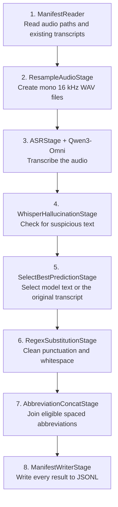

# Qwen Omni ASR

Use Qwen3-Omni to transcribe audio, check the result, and clean the selected
text. The prompts preserve disfluencies, repetitions, false starts, colloquial
speech, and spoken numbers as words. Existing transcripts are used only as a
fallback when the generated text is flagged.



All eight stages and model settings are in [pipeline.yaml](pipeline.yaml).
Run it through the standard `nemo_curator/config/run.py` entry point.
`WhisperHallucinationStage` checks text; it does not run a Whisper model.
If that check flags Qwen's text, the pipeline can select the original
transcript before cleanup. It retains every row.

This tutorial requires an existing transcript for each clip for the fallback
stage; Qwen does not receive it. For transcription without that fallback,
see [Qwen3-Omni in-process ASR](../qwen_omni_inprocess/).
[Qwen3-ASR](../qwen_asr/) uses a different model.

## 1. Set up the environment

Use Linux x86_64 with CUDA, FFmpeg, and at least two GPUs with enough memory for
`Qwen/Qwen3-Omni-30B-A3B-Instruct`. Each ASR worker uses two GPUs together.
Model startup and the first weight download can take several minutes, even for
a small input.

From the Curator repository root:

```bash
uv sync --extra audio_cuda12 --extra vllm
source .venv/bin/activate
command -v ffmpeg
python -c 'import torch; assert torch.cuda.device_count() >= 2, "At least two CUDA GPUs are required"'
```

Run the remaining commands from that same directory and activated environment.
For an existing Ray cluster, set `RAY_ADDRESS`; audio and workspace paths must
be accessible to every worker. FFmpeg must also be installed on each worker.

## 2. Prepare a small public sample

Use the existing data helper to download the beginning of the pinned
[LibriSpeech dataset](https://huggingface.co/datasets/openslr/librispeech_asr)
(`train.clean.100`, CC BY 4.0):

```bash
python benchmarking/data_prep/prepare_librispeech_data.py \
  --output-path "$PWD/qwen-omni-asr-work/data" \
  --cache-dir "$PWD/qwen-omni-asr-work/hf-cache" \
  --hf-repo-id openslr/librispeech_asr \
  --hf-revision 71cacbfb7e2354c4226d01e70d77d5fca3d04ba1 \
  --hf-config all --hf-split train.clean.100 \
  --target-audio-hours 0.02
```

The helper stops after reaching at least 72 seconds using whole clips. This
pinned prefix contains **six clips totaling 82.8 seconds**, all shorter than
30 seconds. It writes the audio files and a `manifest.jsonl` containing their
absolute paths and transcripts. It reuses an existing manifest at that path;
use a new directory if you change the dataset settings.

## 3. Run the pipeline

The default is Xenna streaming. This command saves a console log and refuses
to reuse the output, log, or resampling workspace:

```bash
set -o pipefail
export VLLM_WORKER_MULTIPROC_METHOD=spawn
test ! -e "$PWD/qwen-omni-asr-work/xenna.jsonl" && \
test ! -e "$PWD/qwen-omni-asr-work/xenna.log" && \
test ! -e "$PWD/qwen-omni-asr-work/xenna-workspace" && \
python nemo_curator/config/run.py \
  --config-path ../../tutorials/audio/qwen_omni_asr \
  --config-name pipeline \
  manifest_path="$PWD/qwen-omni-asr-work/data/manifest.jsonl" \
  output_path="$PWD/qwen-omni-asr-work/xenna.jsonl" \
  workspace_dir="$PWD/qwen-omni-asr-work/xenna-workspace" \
  2>&1 | tee "$PWD/qwen-omni-asr-work/xenna.log"
```

Choose new output, log, and workspace names for another run. The
`--config-path` is relative to `nemo_curator/config/run.py`; other paths are
resolved from your working directory. The model revision is pinned in the
YAML. To use downloaded weights offline, add `model_id=/absolute/path/to/model`
pointing to a local copy of that revision.

<details>
<summary>Optional: run the same pipeline with Ray Data</summary>

Run one pipeline at a time. This uses separate output and workspace paths:

```bash
set -o pipefail
export VLLM_WORKER_MULTIPROC_METHOD=spawn
test ! -e "$PWD/qwen-omni-asr-work/ray_data.jsonl" && \
test ! -e "$PWD/qwen-omni-asr-work/ray_data.log" && \
test ! -e "$PWD/qwen-omni-asr-work/ray-data-workspace" && \
python nemo_curator/config/run.py \
  --config-path ../../tutorials/audio/qwen_omni_asr \
  --config-name pipeline \
  manifest_path="$PWD/qwen-omni-asr-work/data/manifest.jsonl" \
  backend=ray_data \
  output_path="$PWD/qwen-omni-asr-work/ray_data.jsonl" \
  workspace_dir="$PWD/qwen-omni-asr-work/ray-data-workspace" \
  2>&1 | tee "$PWD/qwen-omni-asr-work/ray_data.log"
```

Use `qwen-omni-asr-work/ray_data.jsonl` in the result check below.

</details>

## 4. Check the results

The final transcript is in `abbreviated_text`. Run this check for the sample:

```bash
python - qwen-omni-asr-work/data/manifest.jsonl qwen-omni-asr-work/xenna.jsonl <<'PY'
import json
import sys
from pathlib import Path

inputs = [json.loads(line) for line in Path(sys.argv[1]).read_text().splitlines()]
outputs = [json.loads(line) for line in Path(sys.argv[2]).read_text().splitlines()]
by_path = {row["audio_filepath"]: row for row in inputs}
assert len(inputs) == len(by_path) == len(outputs) == 6
assert set(by_path) == {row["audio_filepath"] for row in outputs}
for row in outputs:
    assert row["text"] == by_path[row["audio_filepath"]]["text"]
    assert row["_skipme"] == "", (row["audio_filepath"], row["additional_notes"])
    for field in ("primary_model_prediction", "best_prediction", "cleaned_text", "abbreviated_text"):
        assert isinstance(row[field], str) and row[field].strip(), field
    assert 0 < row["duration"] <= 30
    print(Path(row["audio_filepath"]).name, row["abbreviated_text"])
print("Checked all six clips.")
PY
```

This checks completion and output structure. Listen to the audio when assessing
transcription quality, and check `best_prediction_source` to distinguish model
predictions from fallback text.

| Output field | Meaning |
| --- | --- |
| `text` | Original transcript, preserved unchanged. |
| `resampled_audio_filepath`, `duration` | Prepared WAV path and its duration in seconds. |
| `primary_model_prediction` | Qwen's generated transcript. |
| `best_prediction`, `best_prediction_source` | Selected text and whether it came from Qwen or the original transcript. |
| `cleaned_text`, `abbreviated_text` | Text after cleanup, then the final transcript after abbreviation handling. |
| `_skipme`, `additional_notes` | Remaining flags and stage decisions; an empty `_skipme` means no unresolved flag. |

## Use your own audio

Create a JSONL manifest with one row per clip:

```json
{"audio_filepath": "/data/clip.wav", "text": "The existing transcript.", "source_lang": "en"}
```

Use existing audio files and nonempty transcripts for the fallback stage.
ASR splits recordings longer than 30 seconds into chunks, transcribes each,
and joins their predictions into one transcript per input clip. FFmpeg converts
supported input formats to mono 16 kHz WAV. Use absolute audio paths visible
to the workers.

Supply `source_lang` for non-English audio; missing language defaults to English.
The supported codes are listed in the YAML. Set `transcript_key=my_column` if
your fallback transcript column has another name. Change `manifest_path` and
use fresh output and workspace locations. The six-clip check above is specific
to the public sample.

## Follow one clip through the stages

This is the first public sample, `374-180298-0000.flac` (14.53 seconds), with
its audio path shortened. The table describes the configured transformations;
the generated text and stage decisions depend on the run.

```json
{
  "audio_filepath": "/data/audio/374-180298-0000.flac",
  "text": "CHAPTER SIXTEEN I MIGHT HAVE TOLD YOU OF THE BEGINNING OF THIS LIAISON IN A FEW LINES BUT I WANTED YOU TO SEE EVERY STEP BY WHICH WE CAME I TO AGREE TO WHATEVER MARGUERITE WISHED"
}
```

| Stage | What happens to this row |
| --- | --- |
| 1. `ManifestReader` | Reads the path and transcript into an `AudioTask`, keeping both fields. |
| 2. `ResampleAudioStage` | Adds `audio_item_id`, creates a mono 16 kHz WAV, and records its path and duration. |
| 3. `ASRStage` with `QwenOmniASRAdapter` | Transcribes the audio with the configured prompt and writes `primary_model_prediction`. The original `text` is preserved and is not sent to Qwen. |
| 4. `WhisperHallucinationStage` | Checks repetition, known suspicious phrases, word lengths, and character rate, recording its decision in `additional_notes`. |
| 5. `SelectBestPredictionStage` | Selects Qwen's text or falls back to the original transcript when flagged, writing `best_prediction` and `best_prediction_source`. |
| 6. `RegexSubstitutionStage` | Applies the YAML's punctuation, character, and whitespace rules to create `cleaned_text`. |
| 7. `AbbreviationConcatStage` | Joins eligible spaced abbreviations into `abbreviated_text`. |
| 8. `ManifestWriterStage` | Writes the complete row to JSONL, including the original transcript, generated text, and decisions. |

<details>
<summary>Recorded output for this clip</summary>

This row comes from the Xenna benchmark described below. Only the two file
paths are shortened; generated text and stage decisions are shown as recorded.

```json
{
  "audio_filepath": "374-180298-0000.flac",
  "text": "CHAPTER SIXTEEN I MIGHT HAVE TOLD YOU OF THE BEGINNING OF THIS LIAISON IN A FEW LINES BUT I WANTED YOU TO SEE EVERY STEP BY WHICH WE CAME I TO AGREE TO WHATEVER MARGUERITE WISHED",
  "audio_item_id": "374-180298-0000_f5f9f2e0",
  "resampled_audio_filepath": "374-180298-0000_f5f9f2e0.wav",
  "duration": 14.53,
  "primary_model_prediction": "Chapter sixteen. I might have told you of the beginning of this liaison in a few lines, but I wanted you to see every step by which we came. I too agreed to whatever Marguerite wished.",
  "_skipme": "",
  "additional_notes": {
    "WhisperHallucination_primary": "passed",
    "SelectBestPrediction": "used primary"
  },
  "best_prediction": "Chapter sixteen. I might have told you of the beginning of this liaison in a few lines, but I wanted you to see every step by which we came. I too agreed to whatever Marguerite wished.",
  "best_prediction_source": "primary",
  "cleaned_text": "Chapter sixteen. I might have told you of the beginning of this liaison in a few lines, but I wanted you to see every step by which we came. I too agreed to whatever Marguerite wished.",
  "abbreviated_text": "Chapter sixteen. I might have told you of the beginning of this liaison in a few lines, but I wanted you to see every step by which we came. I too agreed to whatever Marguerite wished."
}
```

</details>

## Observed throughput

One measured run per executor used the same 22,710 unique English LibriSpeech
clips, totaling 80.61259 audio hours. Each run used one EOS node with
8 × NVIDIA H100 80GB HBM3 GPUs, batch size 32, two GPUs per ASR worker, and
automatic worker scaling.

| Measurement | Xenna streaming | Ray Data |
| --- | --- | --- |
| Full benchmark process | 748.54 seconds | 1,275.65 seconds |
| Pipeline time | 742.96 seconds | 1,270.40 seconds |
| Whole-node pipeline throughput | **390.61 audio-hours/hour** | **228.44 audio-hours/hour** |
| Pipeline throughput per allocated GPU | **48.83 audio-hours/GPU-hour** | **28.55 audio-hours/GPU-hour** |

Both runs wrote all 22,710 clips, preserved the input transcripts, selected the
original transcript for five clips, and left zero rows flagged. Xenna's full
process time met the 10–15 minute target; Ray Data used the identical cohort.
Pipeline time includes model startup, all eight stages, and executor shutdown.
Full process time also includes imports and output validation. Data and model
staging are excluded from both measurements.

All eight Xenna GPUs and six Ray Data GPUs recorded at least 30 seconds above
10% utilization after model initialization. Ray Data did not meet the
eight-GPU activity target. Per-GPU throughput divides whole-node throughput by
all eight allocated GPUs.

## Troubleshooting

- **No new run starts:** one of the guarded output, log, or workspace paths
  already exists. Choose new names; inspect the previous log first.
- **FFmpeg or missing-file error:** check `ffmpeg` and the audio paths on each
  worker, including any container mounts.
- **GPU or model-loading error:** confirm at least two CUDA GPUs are visible,
  check free memory, and verify any local model directory contains the pinned
  weights. The console log includes worker startup messages.
- **Empty or flagged text:** inspect `_skipme`, `additional_notes`, the language
  code, and the audio. Check the original transcript if fallback text was selected.
