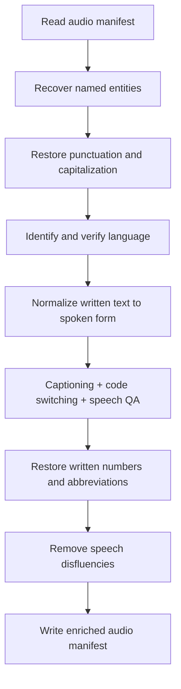

# Process English audio transcripts

Turn existing ASR transcripts into punctuated, normalized text and useful text
features. Records remain `AudioTask` objects throughout; this pipeline reads no
audio waveforms. The two bundled English examples need no data download.



[text_pipeline.yaml](text_pipeline.yaml) lists the complete pipeline. Its seven
`AudioTextLLMStage` instances perform nine operations: the three text features
share one stage and run concurrently against the same normalized transcript.

## 1. Prepare the environment

Use Linux x86_64, Docker with the NVIDIA Container Toolkit, and eight compatible
GPUs. This configuration serves four Gemma FP8 replicas with two GPUs per replica;
the earlier example below used H100 80 GB GPUs. A two-row input reduces processing
work but keeps this serving configuration.

From the repository root, build the existing project image and open a container:

```bash
docker build -f docker/Dockerfile -t curator-audio-text .
mkdir -p text_processing_output .cache/audio-text
docker run --rm -it --name curator-audio-text --gpus all --ipc=host \
  --mount type=bind,src="$PWD/text_processing_output",dst=/output \
  --mount type=bind,src="$PWD/.cache/audio-text",dst=/cache \
  --env HF_HOME=/cache/huggingface \
  curator-audio-text bash
```

The project image includes the audio and `inference_server` dependencies, `etcd`,
and `nats-server`. The YAML uses Curator's existing model runtime environment to
select Dynamo's compatible vLLM and Transformers 5.8.0. Model weights download on
first startup; keep `/cache` to reuse weights and compilation artifacts with the
same runtime and GPU architecture.

## 2. Start the model server

In the container, start a Ray cluster and the existing `InferenceServer` API.
The Python snippet instantiates the **same `inference_server` block** from the
pipeline YAML; it does not construct another serving recipe.

```bash
cd /opt/Curator
ray start --head --node-ip-address=127.0.0.1 --port=6379 --num-gpus=8
export RAY_ADDRESS=127.0.0.1:6379
set -euo pipefail
python -u - <<'PY_SERVER' 2>&1 | tee /output/server.log
from pathlib import Path
from threading import Event

from hydra.utils import instantiate
from omegaconf import OmegaConf

cfg = OmegaConf.load("tutorials/audio/text_processing/text_pipeline.yaml")
cfg.cache_root = "/cache/compilation"
with instantiate(cfg.inference_server) as server:
    Path("/output/endpoint.txt").write_text(server.endpoint + "\n")
    print(f"Ready: {server.endpoint}. Keep this terminal open; Ctrl-C stops serving.", flush=True)
    try:
        Event().wait()
    except KeyboardInterrupt:
        pass
PY_SERVER
```

Wait for `Ready:` before continuing. Initial model loading and compilation can
take several minutes. The server defaults are four TP=2 replicas, context and
batched-token limits of 8,192, 256 sequences, prefix caching, chunked prefill, and
95% GPU memory utilization.

## 3. Run the two examples

In a **second host terminal**, enter the running container:

```bash
docker exec -it curator-audio-text bash
```

Then run Curator's shared YAML entrypoint:

```bash
cd /opt/Curator
export RAY_ADDRESS=127.0.0.1:6379
set -euo pipefail
test ! -e /output/english_output.jsonl
python nemo_curator/config/run.py \
  --config-path ../../tutorials/audio/text_processing \
  --config-name text_pipeline \
  manifest_path=/opt/Curator/tutorials/audio/text_processing/sample_input.jsonl \
  output_path=/output/english_output.jsonl \
  endpoint="$(cat /output/endpoint.txt)" \
  2>&1 | tee /output/pipeline.log
```

The default executor is Ray Data. Add `backend=xenna execution_mode=streaming`
to the same command to use Xenna. Both use batch size 128, 12 workers and up to
256 concurrent requests per worker. The shared runner connects to the existing
Ray cluster and model endpoint; it does not start or stop the model server.

Output and logs appear in `text_processing_output/` on the host. The command
refuses to overwrite an existing result; choose a fresh output path and update
the guard when running again. After inspecting the result below, press Ctrl-C in
the server terminal, then run `ray stop` and `exit` in that container.

For your own English JSONL manifest, replace `manifest_path` with an absolute
path visible inside the container and choose a different output path. The default
fields are `abbreviated_text` (ASR transcript), `text` (reference for entity
spelling), and `source_lang` (language). Override `text_key`, `ground_truth_key`,
and `language_key` when your field names differ. Audio paths and other metadata
are preserved; this pipeline does not open the audio files or filter input by
language before processing.

If you already have a compatible model endpoint, use the shared-runner command
with that endpoint and its `model_name`; skip step 2 and omit the
`RAY_ADDRESS` export in step 3. Run `unset RAY_ADDRESS` so the shared runner can
start its own CPU cluster. The endpoint must be reachable by every worker. Changing the YAML's serving block does not
reconfigure an independently managed endpoint.

## 4. Inspect the result

Before stopping the container, run:

```bash
python - <<'PY_CHECK'
import json
from pathlib import Path

input_path = Path("tutorials/audio/text_processing/sample_input.jsonl")
source = [json.loads(line) for line in input_path.read_text().splitlines()]
output = [json.loads(line) for line in Path("/output/english_output.jsonl").read_text().splitlines()]
by_id = {row["audio_item_id"]: row for row in output}
assert len(output) == len(by_id) == len(source) == 2
for original in source:
    row = by_id[original["audio_item_id"]]
    assert all(row[key] == value for key, value in original.items())
    print(json.dumps(row, ensure_ascii=False, indent=2))
PY_CHECK
```

This checks row identity and preservation of input fields. Inspect the generated
text and `additional_notes` as well; a successful request is not a text-quality
score.

| Operation | Reads | Writes / purpose |
| --- | --- | --- |
| Entity recovery | `text`, `abbreviated_text` | `entity_recovered_text`: restore reference spellings of named entities. |
| Punctuation and capitalization | `entity_recovered_text` | `pnc_text`: add punctuation and casing. |
| Language identification and verification | `pnc_text`, `source_lang` | `llm_language_prediction`: identify languages and check the expected language. |
| Text normalization | `pnc_text` | `tn_raw`: convert written quantities to spoken forms. |
| Captioning, inside the fused stage | `tn_raw` | `captioning_text`: summarize what the speaker says. |
| Code switching, inside the fused stage | `tn_raw` | `code_switched_text`: restore English spelling of phonetically transcribed English words; English inputs often stay unchanged. |
| Speech QA, inside the fused stage | `tn_raw` | `speech_qa_text`: generate a question/answer pair, or `SKIP` when inappropriate. |
| Inverse text normalization | `tn_raw` | `itn_raw`: restore written numbers, dates and abbreviations. |
| Disfluency removal | `itn_raw` | `itn_clean`: remove fillers, repeats and false starts. |

The three fused operations send separate prompts concurrently through one shared
client and concurrency limit. They all read `tn_raw`; their outputs do not replace
the input to inverse text normalization. Entity recovery allows 1,024 output
tokens; the other operations allow 512. Temperature and seed are zero, and model
thinking is disabled.

Each operation records its decision in `additional_notes`. A single-language
mismatch or unparseable prediction sets `_skipme`; later requests are skipped
while the row is retained. Parsed multilingual predictions are retained. Rewrite
guards can preserve the input instead of accepting a changed response. Text
normalization permits number expansion; exhausted request retries fail the batch.

## Sample provenance and a recorded result

[sample_input.jsonl](sample_input.jsonl) contains transcripts for LibriSpeech
clips `7800-283478-0020` and `3240-131231-0052`, sourced from
[`openslr/librispeech_asr`](https://huggingface.co/datasets/openslr/librispeech_asr/tree/71cacbfb7e2354c4226d01e70d77d5fca3d04ba1).
The [LibriSpeech corpus](https://www.openslr.org/12/), prepared by Vassil Panayotov
with Daniel Povey, is licensed under
[CC BY 4.0](https://creativecommons.org/licenses/by/4.0/). These transcript-only
fixtures retain the reference text, saved ASR text, duration and language from an
earlier public-data run. Only the public clip IDs, portable audio basenames and
fields needed here are included; the audio files themselves are not bundled.

The following fields are copied unchanged from one **historical EOS output** for
clip `7800-283478-0020`, produced with the configured Gemma model at Curator commit
`ce8aa4b6`. This documents an observed transformation, not a fresh execution of
this walkthrough or a promise of byte-identical model output. Other metadata and
processing notes are omitted from this excerpt.

```json
{
  "abbreviated_text": "As the four chums went away Jerry chuckled",
  "entity_recovered_text": "As the four chums went away JERRY chuckled",
  "pnc_text": "As the four chums went away, Jerry chuckled.",
  "llm_language_prediction": "Primary: English\nLanguages: English",
  "tn_raw": "As the four chums went away, Jerry chuckled.",
  "captioning_text": "A brief narrative snippet describing Jerry chuckling as four friends depart.",
  "code_switched_text": "As the four chums went away, Jerry chuckled.",
  "speech_qa_text": "SKIP",
  "itn_raw": "As the 4 chums went away, Jerry chuckled.",
  "itn_clean": "As the 4 chums went away, Jerry chuckled."
}
```
