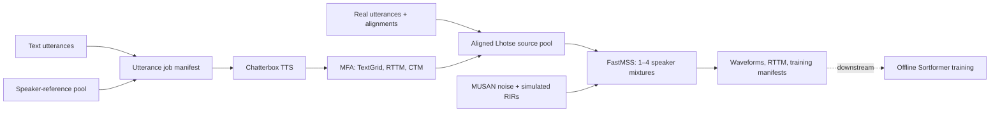
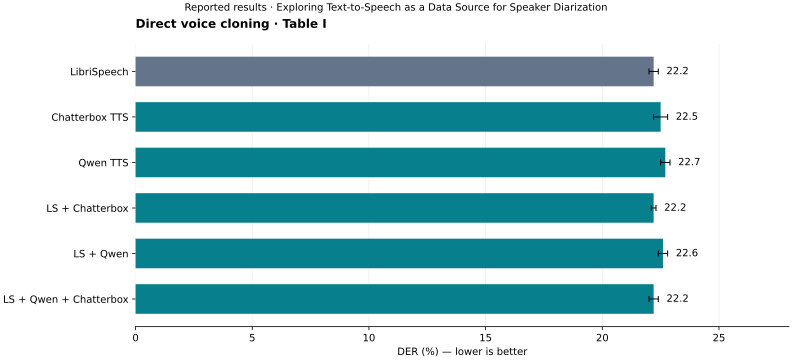
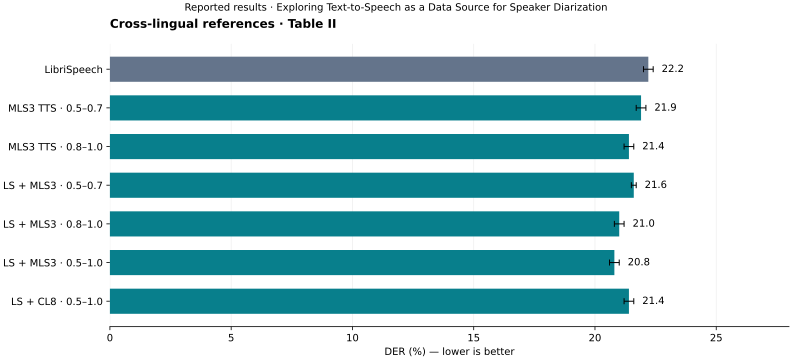
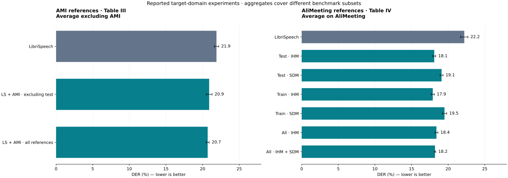

# TTS data generation for speaker diarization

An utterance-to-mixture recipe for **Exploring Text-to-Speech as a Data Source for Speaker Diarization**, by Sofia Kostandian, Tatiana Timofeeva, Ivan Medennikov, Taejin Park, Nikolay Karpov, Jagadeesh Balam, and Boris Ginsburg.

The three main stages are **Chatterbox TTS → Montreal Forced Aligner (MFA) → FastMSS**. Text and reference-speaker pools are selected independently. Chatterbox generates single-speaker utterances; MFA supplies speech and word boundaries; FastMSS introduces multi-speaker structure and acoustic augmentation. Conversation generation with an LLM is not part of this recipe. Sortformer training and benchmark scoring consume the generated data downstream.



## Code and dependency provenance

Chatterbox and MFA use their implementations on Curator `main`. The small [utterance adapter](stages.py) reuses Chatterbox's model loading, isolated runtime, verified cache, normalization, and resampling, while accepting the paper's preassigned reference waveform for each job.

The native FastMSS stage, subprocess runner, dependency declaration, and tests are carried from [PR #2524](https://github.com/NVIDIA-NeMo/Curator/pull/2524), pinned at `3a922019095730a68a85f47162ace4766e004230`, while that PR is unmerged. The toolkit itself remains the external `fastmss==0.1.0` dependency at Git revision `3f0a17393f0fc1642527aea1a057a8a5a1e9420d`; it is not vendored. Once #2524 merges, the tutorial can be rebased onto its merged runtime.

The native worker is extended to admit a safe single-speaker case: exactly one speaker, independent transitions, and `p_ind=[1,0,0,0]`. A single speaker cannot switch to or interrupt a different speaker. Mixed `[1,4]` configurations and unsafe one-speaker transition settings remain rejected. Separate count-specific shards implement the paper's ratio.

## What the paper specifies

The manuscript's Section III describes preparation; Section IV gives the experimental setup. Section IV explicitly follows the [Mind the Gap protocol](https://arxiv.org/html/2605.15442v1), implemented by the [FastMSS paper recipes](https://github.com/popcornell/FastMSS/tree/master/recipes/paper/diarization). Simulator settings stay fixed across TTS conditions so comparisons isolate the speech source.

| Component | Paper setting and implementation |
|---|---|
| Text | English LibriSpeech utterances; retain source utterance, speaker, split, chapter, and original-audio provenance |
| Voice prompt | Preassigned reference waveform; missing references and references shorter than 5 s are rejected |
| Chatterbox | Zero-shot voice cloning; English generation even when reference speech is non-English |
| Sampling | Temperature **0.8**, classifier-free guidance **0.5** |
| Exaggeration | Sampled per utterance; general range **[0.5, 1.0]**; direct-cloning experiment uses **[0.5, 0.7]** |
| Output speech | **24 kHz WAV**, normalized to **−20 dB** |
| MFA | `english_us_arpa`; TextGrid → RTTM + CTM; merge neighboring speech gaps shorter than **0.2 s** |
| Mixtures | **90 s**; **1–4 speakers**, with count ratio **1:3:6:10** |
| Turn taking | CALLHOME independent probabilities **[0.15, 0.21, 0.44, 0.20]** for hold/switch/interruption/backchannel; no overlap boosting, following the referenced paper's selected diarization setting |
| Noise | MUSAN **noise** and **music**, excluding its speech subset; applied to **50%** of mixtures |
| Reverberation | Artificial RIRs, independently applied to **50%** of mixtures |
| FastMSS sample rate | **16 kHz**, inherited from the released diarization recipes; source TTS remains 24 kHz and the simulator resamples its inputs |
| Downstream model | Offline 4-speaker Sortformer; 109M-parameter NEST initialization; no extra transformer layers; random **60 s** training crops |
| Reporting | Three training seeds; DER with **0 s collar**; AMI/AliMeeting evaluated in **180 s** chunks |

The published recipe files contain some 120 s / overlap-boosted variants. This recipe uses the attached manuscript's 90 s length and the referenced paper's stated best diarization transition model rather than copying an ASR or boosted setting. Gains, room dimensions, RIR counts, and other unspecified engine settings inherit the immutable dependency's `recipes/default.yaml`.

`count_unit=4000` yields **4,000 / 12,000 / 24,000 / 40,000** meetings, or 2,000 nominal hours at 90 s, matching the reference protocol's simulation budget. The supplied TTS manuscript does not separately state a total mixture count; override this budget explicitly for smaller runs. `LS+TTS` combines the eligible real and synthetic CutSets. The pinned engine samples eligible speaker IDs uniformly, then samples uniformly from the selected speaker's cuts. The resulting real/TTS proportion depends on the source pool and speaker identities; the manuscript does not specify an additional fixed real/TTS weighting.

## Requirements

- A Curator source checkout containing this PR; Python 3.11–3.13 on Linux.
- A CUDA GPU and sufficient memory for Chatterbox. Its model/runtime are downloaded on first use; model generation is not a CPU smoke test.
- MFA installed separately with its English acoustic model and dictionary.
- Shared local paths visible to every worker, including this checkout, speech, reference audio, models, and outputs.
- User-provided corpora and MUSAN acquired under their upstream licenses. Audio and trained checkpoints are not redistributed here.

```bash
uv sync --extra audio_cuda12 --extra audio_simulation
source .venv/bin/activate
export PYTHONPATH="$PWD:${PYTHONPATH:-}"

export MFA_ROOT_DIR=/data/mfa
/path/to/mfa/env/bin/mfa model download acoustic english_us_arpa
/path/to/mfa/env/bin/mfa model download dictionary english_us_arpa
```

Install from source with `uv`: the Git source pin in `pyproject.toml` must apply. Plain installation from package-index metadata alone does not select the pinned FastMSS source. Chatterbox keeps its separate Ray runtime to avoid Torch/Transformers conflicts. No additional environment is needed for the tutorial itself; the existing MFA environment supplies its CLI.

## Input manifests

One source-text row in `texts.jsonl`:

```json
{"utterance_id":"ls_123_456_0001","speaker":"ls_123","text":"The afternoon was quiet.","audio_filepath":"/data/LibriSpeech/123/456/0001.flac","duration":6.3,"split":"train","chapter_id":"456"}
```

One reference-catalog row in `references.jsonl`:

```json
{"speaker":"mls_fr_142","reference_audio":"/data/references/mls_fr_142.wav","language":"fr","split":"train","channel":"close-talk"}
```

Paths may be absolute or relative to the manifest. Use globally distinct speaker labels for different corpora. For direct cloning, source and reference speaker labels must match; real and cloned utterances intentionally retain the same speaker identity. Each reference clip must contain at least five seconds of suitable single-speaker speech. For meeting corpora, prepare references from non-overlapping speaker regions before providing the catalog.

### The three generation strategies

| Strategy | Text | References | Jobs |
|---|---|---|---|
| `direct` | Each LibriSpeech utterance | Same LibriSpeech speaker | One clone per source row |
| `cross-lingual` | Random English LibriSpeech text | MLS3 or CL8 | **125 per reference speaker** |
| `target-domain` | Random English LibriSpeech text | AMI or AliMeeting | **500 per reference speaker** |

**MLS3:** French, German, Spanish; **404 speakers**. **CL8:** Dutch 40, Italian 65, French 142, German 176, Polish 11, Portuguese 42, Spanish 86, Russian 5; **567 speakers**. Russian references come from RuLS; the other seven languages come from MLS. Select the appropriate reference catalog/languages, while leaving TTS `language: null` for English output.

Target-domain catalogs retain their split and channel. Test references are excluded by default; `--include-test-references` explicitly enables the paper's test-inclusive analyses. For test-only, train-only, IHM, or SDM experiments, supply a catalog containing that subset. These conditions are reported separately, not pooled as a standard held-out benchmark.

## Run the pipeline

Run all commands from the repository root. The three stage YAMLs use Curator's shared runner; intermediate manifests are explicit checkpoints between stages. Use fresh output directories for each experiment.

### 1. Prepare jobs and run Chatterbox

```bash
python -m tutorials.audio.tts_diarization.prepare jobs \
  --texts /data/texts.jsonl --references /data/mls_references.jsonl \
  --strategy cross-lingual --languages fr de es --seed 42 \
  --output /data/run1/jobs.jsonl

python nemo_curator/config/run.py \
  --config-path ../../tutorials/audio/tts_diarization/configs --config-name tts \
  input_manifest=/data/run1/jobs.jsonl output_dir=/data/run1/tts
```

For direct cloning, select `--strategy direct` and pass `'exaggeration=[0.5,0.7]'` to the TTS command. For the other Table II ablations, use `[0.5,0.7]` or `[0.8,1.0]`. The adapter uses each utterance ID as an internal cache key, giving a stable per-utterance exaggeration sample without maintaining conversation-level state. Failed synthesis raises instead of allowing a silence placeholder into the source pool.

### 2. Align generated speech with MFA

```bash
python nemo_curator/config/run.py \
  --config-path ../../tutorials/audio/tts_diarization/configs --config-name align \
  input_manifest=/data/run1/tts/utterances.jsonl output_dir=/data/run1/aligned \
  mfa_command=/path/to/mfa/env/bin/mfa mfa_root_dir=/data/mfa num_jobs=4
```

Outputs include TextGrid, RTTM, CTM and `/data/run1/aligned/aligned.jsonl`. Silence labels are ignored; RTTM regions follow non-silence word boundaries and the paper's 0.2 s gap threshold. MFA uses its bounded subprocess and isolated model-cache implementation. Rejected or unaligned utterances cannot enter the exported simulation pool.

### 3. Export aligned sources and simulate with FastMSS

```bash
python -m tutorials.audio.tts_diarization.prepare export \
  --synthetic /data/run1/aligned/aligned.jsonl \
  --real /data/real_aligned.jsonl --output-dir /data/run1/corpus

python -m tutorials.audio.tts_diarization.prepare recipes \
  --corpus-dir /data/run1/corpus --output-dir /data/run1/recipes \
  --musan-root /data/musan --count-unit 4000 --seed 42

python nemo_curator/config/run.py \
  --config-path ../../tutorials/audio/tts_diarization/configs --config-name simulate \
  recipes_dir=/data/run1/recipes output_dir=/data/run1/simulated \
  python_executable="$VIRTUAL_ENV/bin/python" jobs_per_config=8
```

Omit `--real` for TTS-only experiments. Real utterances must also carry successful MFA/CTM alignment; the alignment YAML can be run on an original-audio manifest using the same `text`, `speaker`, and `audio_filepath` fields. MFA requires WAV input: convert original FLAC/OPUS sources to mono WAV with Curator's `ResampleAudioStage` before aligning them. The exporter requires mono sources and writes `paper_train.jsonl.gz` with word-aligned Lhotse cuts and a `sources.json` inventory. It preserves speaker IDs across real and synthetic cuts while making cut IDs distinct.

The recipe generator writes four `.yaml` shards. They select exact speaker counts rather than drawing uniformly from `[1,4]`, ensuring the configured **1:3:6:10** ratio. One shard is one scheduling unit; `jobs_per_config` reserves the CPUs used by its child workers. Caches and temporary files are run-local. Each invocation records its effective config and logs in its generated run directory.

For a small simulation check, use `--count-unit 1 --duration 2 --no-augmentation --min-utterances 1`. This produces 20 short meetings from a prepared pool with at least four speakers and is **not** a paper-scale experiment. A real reference clip must still be at least five seconds. Use the normal paper settings for results intended for comparison.

## Outputs and handoff to training

| Artifact | Meaning |
|---|---|
| `jobs.jsonl` | Text/reference pairing, seed-derived utterance ID, strategy and source/split/channel provenance |
| `tts/utterances.jsonl` | Generated WAV, measured duration, actual reference, original source fields |
| `aligned/aligned.jsonl` | Successful TextGrid/RTTM/CTM paths and alignment status |
| `corpus/paper_train.jsonl.gz` | Lhotse source cuts with word alignments |
| `corpus/sources.json` | Real/TTS utterance and speaker inventory |
| `simulated/runs/fastmss-*/` | Waveforms, meeting RTTMs, Lhotse recording/supervision manifests, effective config and worker log |
| `simulated/mixtures.jsonl` | One checked whole-meeting row per mixture: audio, duration, text, RTTM, speaker count and additional native annotations |

Train the offline Sortformer described above using 60-second crops from the mixtures. This PR prepares data; it does not rerun the three-seed training/evaluation campaigns or ship their checkpoints.

## Results reported in the manuscript

The following figures are redrawn from **Tables I–IV, pages 5–6 of the supplied manuscript**. Values are reported experimental measurements, not outputs of this tutorial's smoke tests. [results.json](results.json) includes all eight benchmark DERs and the aggregates for every table row. Error bars reproduce the manuscript's `±` values; the manuscript does not identify them as confidence intervals, so they are labelled only as reported spread.

### Direct cloning: comparable performance, no overall augmentation gain



LibriSpeech gives **22.2 ± 0.2%** macro DER. Chatterbox-only and Qwen-only give **22.5 ± 0.3%** and **22.7 ± 0.2%**. LS+Chatterbox remains **22.2 ± 0.1%**: direct cloning does not establish a macro-average improvement. Qwen is included as the paper's ablation; this implementation uses Chatterbox. The paper reports Qwen generation was 2–3 times slower, without a detailed timing benchmark.

### Cross-lingual references: selecting diversity matters



The best MLS3 condition, LS+Chatterbox with exaggeration **0.5–1.0**, reaches **20.8 ± 0.2%**, versus **22.2 ± 0.2%** for LS: **1.4 percentage points**, or approximately **6.3% relative DER reduction**. Expanding to CL8 reaches **21.4 ± 0.2%**, so a larger reference pool does not automatically improve performance.

### Target-domain references: retain split and channel distinctions



- **AMI, Table III:** excluding test speakers improves AMI MHM **22.0 → 20.1%** and SDM **23.9 → 23.1%**. The average excluding AMI improves **21.9 ± 0.3 → 20.9 ± 0.4%**; all AMI references give **20.7 ± 0.2%** on that out-of-domain average.
- **AliMeeting, Table IV:** train-only IHM references give the best in-domain average, **17.9 ± 0.2%**, versus **22.2 ± 0.5%** baseline. Combining all IHM/SDM profiles gives **18.2 ± 0.1%** in-domain and the strongest out-of-domain average, **21.3 ± 0.3%**. Train and test reference results must remain separately identified.

The aggregate definitions differ: Tables I–II cover eight conditions; Table III excludes the two AMI conditions; Table IV reports averages excluding AliMeeting and on AliMeeting separately. Do not compare these averages as if they covered the same benchmark set. Evaluation includes NSF1 3–4 speakers, AMI/AliMeeting 180-second chunks, DIHARD-III 1–4 speakers, and MSDWild few-talker recordings.

Regenerate the charts without any models or datasets:

```bash
python -m tutorials.audio.tts_diarization.plot_results
```

Both SVG and PNG outputs are generated from the checked-in data; the chart script requires Matplotlib.

## Validation and limits

Tests exercise manifest pairing, reference validation, the existing Chatterbox adapter/cache boundary with a lightweight model substitute, MFA metadata conversion, Lhotse export, recipe composition, and real FastMSS execution. Chart inputs are transcribed from the manuscript; regenerate and inspect the figures separately. GPU TTS and full Sortformer training require the external models, corpora, and hardware described above. CPU checks cannot establish that the paper's DERs have been reproduced.

```bash
pytest tests/stages/audio/tts_diarization tests/stages/audio/simulation \
  tests/stages/audio/tts/test_chatterbox_tts.py \
  tests/stages/audio/alignment/test_mfa_alignment.py -m 'not gpu' -q
```

The installed-engine tests skip when the optional FastMSS dependencies are absent. Install `audio_simulation` to exercise them. The small tutorial simulation test runs all four speaker-count shards and validates 20 generated meetings. Charts can be checked separately with the regeneration command above.

The pinned FastMSS recipe seeds are recorded, but its worker initialization also incorporates process IDs. A fixed configured seed is not a promise of byte-identical output across different worker counts or executions. Preserve the effective configs, source inventories, generated artifacts, model versions, and training seeds with each experiment.

## References

- Kostandian et al., *Exploring Text-to-Speech as a Data Source for Speaker Diarization*, supplied manuscript (2026), Sections III–V and Tables I–IV.
- Polok et al., [*Mind the Gap: Impact of Synthetic Conversational Data on Multi-Talker ASR and Speaker Diarization*](https://arxiv.org/abs/2605.15442), 2026.
- [FastMSS source and paper recipes](https://github.com/popcornell/FastMSS), [pending Curator integration #2524](https://github.com/NVIDIA-NeMo/Curator/pull/2524).
- [Chatterbox](https://github.com/resemble-ai/chatterbox), [MFA](https://montreal-forced-aligner.readthedocs.io/), [LibriSpeech](https://www.openslr.org/12/), [MLS](https://www.openslr.org/94/), [RuLS](https://www.openslr.org/96/), [MUSAN](https://www.openslr.org/17/).
